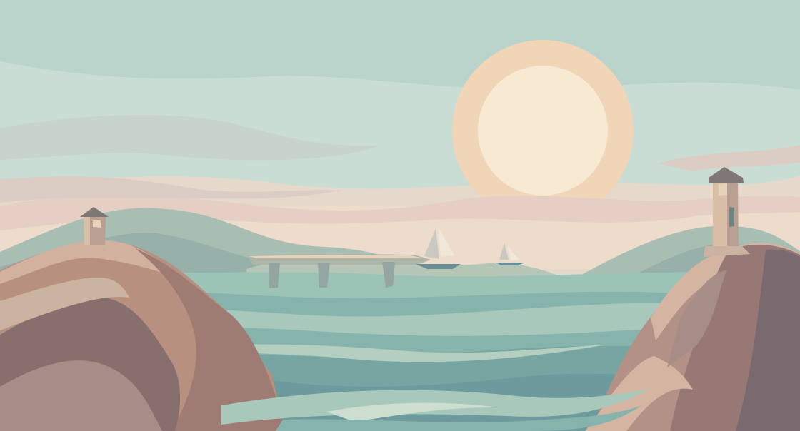

# ARCLINE｜1〜5面「はじまりの入江」背景アート正本

**デザイン状態：ユーザー承認済み（2026-11-07）。** ゲーム実装・本編合成・公開は未実施。

## 作品の狙い
「旅が始まる朝の、静かで開放的な入江」。左右の岬と灯台が水辺を囲み、中央の空と水面にゆったりとした余白を持たせる。遠い山並み、小さな船着場と帆船を、控えめなコントラストの単色色面で示す。背景そのものは通行可能な足場ではなく、すべて非インタラクティブ。

- 対象：**themeIndex=0／ステージ1〜5すべてで共通の1背景**。
- 正本：[`first_cove.json`](first_cove.json)（58図形・8レイヤー・不透明HEXパレット41定義）。
- 描画：[`first_cove_canvas.js`](first_cove_canvas.js)（Canvas 2D / Path2D。ゲームランタイムの外部依存不要）。
- 確認：[単体プレビューHTML](first_cove_preview.html)（埋込みJSON＋JS、通信不要。GitHubではダウンロードしてローカルで開くこと）。GitHub上では上記SVGをプレビューに使用。
- 実装引継ぎ：[`IMPLEMENTATION_HANDOFF.md`](IMPLEMENTATION_HANDOFF.md)。
- 造形・配色ルール：[`ART_DIRECTION.md`](ART_DIRECTION.md)。
- 検証状況：[`VALIDATION.md`](VALIDATION.md)。

## 変更禁止と工程分離
このPRは **デザインデータのみ** です。`ARCLINE/game/`、地形座標、敵味方、物理・当たり判定、射線、セーブ、UI、リソース参照、既存100面構成を変更しません。ゲーム統合は別PRで行い、実画面で視認性を検証してください。

このPRは、背景の先行試作と複数テーマの制作進捗を含む[PR #75](https://github.com/bittrove88/bittrove88.github.io/pull/75)とは独立しています。PR #75の試作を本番仕様とみなさず、実装側で競合・重複を整理してください。

次に制作する未着手テーマは**6〜10面「鏡の岸壁」**。制作全体の共通ルールは [ART_DIRECTION.md](ART_DIRECTION.md) に引き継ぎます。
