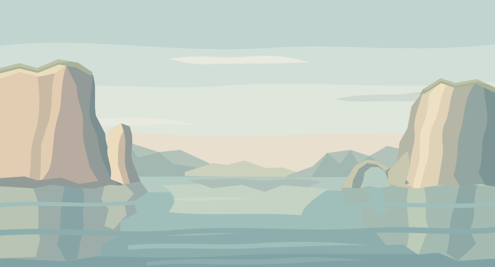

# 6〜10面「鏡の岸壁」背景デザイン

白い岩肌を、静かな海が映している。



2026-11-07制作。**デザイン確認待ち・ゲーム未統合・未公開。** 6〜10面で共通の背景1点。PR #75の制作方針とPR #100の承認済み「はじまりの入江」の表現原則を引き継ぐ。新しい配色と構図について、ユーザーの承認を受けた状態ではない。

## ファイル

| ファイル | 用途 |
|---|---|
| [mirror_cliffs.json](mirror_cliffs.json) | 編集正本。55図形、8レイヤー、36色。全色面は不透明 |
| [mirror_cliffs.svg](mirror_cliffs.svg) | JSONから生成したベクトルプレビュー |
| [mirror_cliffs_preview.png](mirror_cliffs_preview.png) | 同じCanvas描画から書き出した全景。実行時には不要 |
| [mirror_cliffs_canvas.js](mirror_cliffs_canvas.js) | Canvas 2D用の独立描画モジュール |
| [mirror_cliffs_preview.html](mirror_cliffs_preview.html) | データと描画コードを内包。保存してブラウザで開ける単体プレビュー |
| [generate_preview.py](generate_preview.py) | JSON・描画コードの変更をSVG・単体HTMLへ反映するスクリプト |
| [ART_DIRECTION.md](ART_DIRECTION.md) | 構図・色・反射・余白の意図 |
| [IMPLEMENTATION_HANDOFF.md](IMPLEMENTATION_HANDOFF.md) | 後工程の選択条件・描画順・受入れ条件 |
| [VALIDATION.md](VALIDATION.md) | 今回確認した範囲と未検証事項 |

## 独立プレビュー

HTMLは通信や外部画像を必要とせず、1120×604／844×390／568×240／393×852を切り替えられる。縦画面は中央切り抜きの資料で、ゲームの縦向き対応を示さない。

```js
ArcMirrorCliffsBackground.draw(ctx, widthCssPx, heightCssPx, scene, {fit:'cover'});
```

基準は1120×604、中央寄せcover。JSONを編集した場合はこのディレクトリで `python3 generate_preview.py` を実行し、SVGとHTMLを同期する。PNGはCanvasから改めて書き出す。

ゲーム本体・地形設計・保存・他テーマは変更していない。独立した新規コンテンツの入口を追加するものではなく、既存ARCLINEの制作資料。実装と公開は別工程。次の未制作テーマは11〜15面「吊り橋の水路」だが、この背景のデザイン確認より先には進めない。

参照：[PR #75](https://github.com/bittrove88/bittrove88.github.io/pull/75) ／ [PR #100](https://github.com/bittrove88/bittrove88.github.io/pull/100)。元PRの未マージファイルやゲーム試作は本変更に取り込んでいない。
