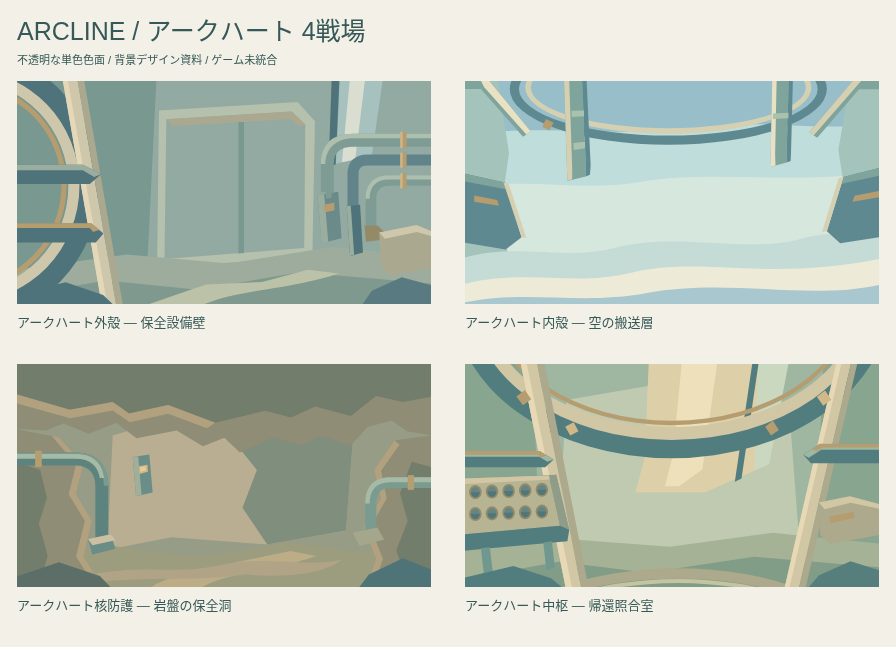
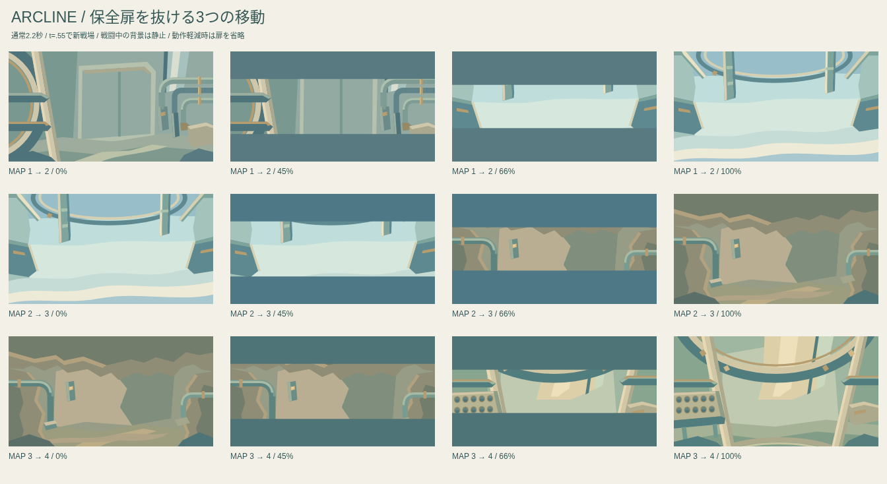

# アークハートの4戦場 — 設定上の保全施設を描く

## 設定と原画

アークハートは、帰還と安全の返事が届かないまま緊急停止を維持した古い保全中枢。物語正本 `design/narrative_0_13.json` の `world.heart_secret`、`world.ending_mechanism` とE01〜E03を参照。

既存原画 `assets/cinematics/E01-01.jpeg` の青緑の機械、クリーム色の補強材、真鍮の継ぎ手、巨大な支持環、上方採光を背景の建材へ翻訳した。`E02-01.jpeg` の十個の照合口は最後の室の左端に置き、戦闘中は全て未点灯のままにする。

原画の貼り付け、画像生成、テクスチャの再現は使わない。ボス本体・中央の光る核を背景へ複製せず、支持環は建築として画面端や頭上へ置く。

## 4つの空間

| mapIndex | 担当 | 景・視点 | 色と空間の違い |
|---:|---|---|---|
| 0 | ハナ→コロ→バン | **外殻・保全設備壁**。設備壁の正面、左の支持環、右の集合配管 | 抑えた青緑と厚い補強材。閉じた施設の重さ |
| 1 | ソラ→リコ→ヒバリ | **内殻・空の搬送層**。見上げる楕円の搬送環、吊り構造、雲までの空隙 | 明るい水色・青緑と白い雲。背景に床を置かず高さを示す |
| 2 | モグ→リン→ユイ | **核防護・岩盤の保全洞**。不規則な連続天井、埋設配管、土の床 | 岩盤の土色と小さな保全灯。同じ配管が地中へ続く |
| 3 | ガン | **中枢・帰還照合室**。大きな支持環、斜めの補強材、十個の未点灯の照合口 | 暖かい採光と静かな余白。最後の一射と帰還を待つ場所 |

4景は共通の門を色替えしたものではない。同じ施設の建材を保ちながら、正面の設備壁・上向きの空間・横へ広がる洞窟・採光のある最終室を個別に設計した。

## 移動演出案

単体ギャラリーに確認用演出を収録。通常は既存と同じ2.2秒、動作軽減は0.7秒。既存 `game/ui/final-travel.js` の55%の場面切替と同期する設計。

| 進行 | 背景側の表示 |
|---|---|
| 0〜35% | 旧戦場を静止表示 |
| 35〜55% | 単色の保全扉が上下から閉じる |
| 55% | 閉じた位置で新戦場へ切替 |
| 55〜83% | 保全扉が開き、新しい空間を見せる |
| 83〜100% | 新戦場を静止表示 |

動作軽減時は扉を動かさず55%で切替。自動再生やループはなく、プレビューの再生操作で開始する。OSの動作軽減設定を継承し、タブを隠すとプレビューは停止する。

**ゲームへの導入は未実施。** 既存の地形崩壊・機体移動・画面切替を変えず、扉は戦場移動時だけの背景側オーバーレイ案として扱う。実装時は地形片・機体・HUDより後ろに配置し、既存演出との重なりを確認する。背景側に新たな物理・待ち時間・操作制限を追加しない。

## 物語と進行の保全

- 正式名と最終4景を通常96〜99面へ前倒ししない。
- 照合口は固定された設備で、与ダメージ・機体達成数・帰還数を表示しない。
- 十灯の点灯、「おかえり」「ただいま」、静かな休止、全線再稼働は既存の勝利後E01〜E03に残す。
- 機体の固定順、HP、必殺、行動数、敗北機からの再挑戦、勝利条件、セーブを変更しない。
- ボスの死や施設全体の爆発を背景へ描き足さない。
