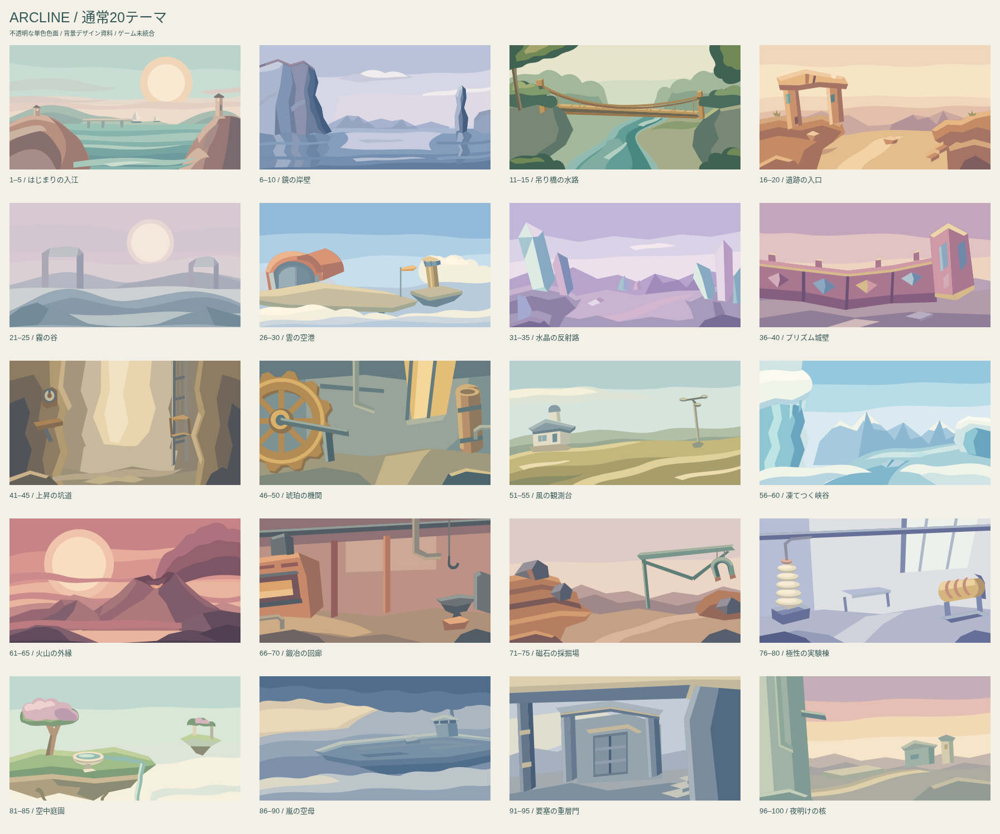
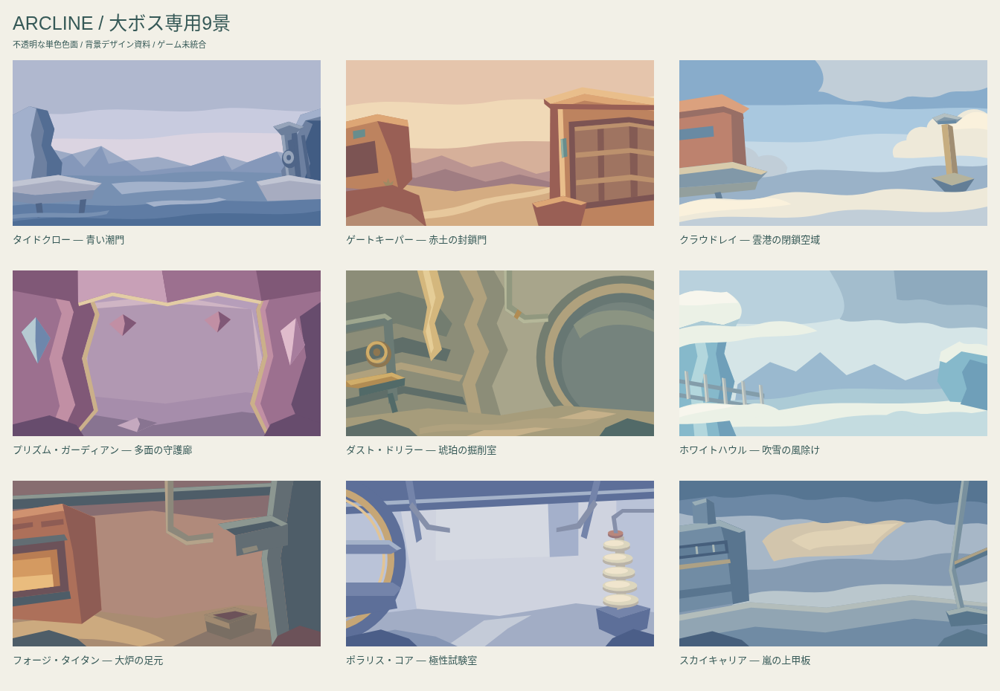
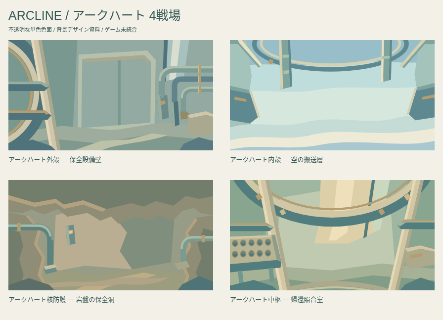

# ARCLINE 背景デザイン再制作 v2 — テーマごとの色・物・空間

**6〜10面も含め、新作30景を再制作。既存3景を継承し、通常20テーマ・大ボス9景・最終4景を収録。ゲーム未統合・再制作案のユーザー承認待ち。**







## 確認する

- [確認用ZIP](ARCLINE_Background_Collection.zip)を展開し、`index.html` をブラウザで開く。全33景・通常と大ボスの比較・4画面サイズ・最終戦の移動案を確認できる。
- [単体HTML](index.html)はデータと描画コードを内包し、外部通信なしで表示する。GitHub上のHTMLソース表示では実行されない。
- [テーマごとの設計](ART_DIRECTION.md) ／ [個別の内部確認と改善](REVIEW_NOTES.md) ／ [受け渡し条件](IMPLEMENTATION_HANDOFF.md) ／ [最終4景](ARCHEART.md) ／ [検証](VALIDATION.md)。

## 今回の修正

前回の [PR #104](https://github.com/bittrove88/bittrove88.github.io/pull/104) は、描き方の統一と配色・オブジェクト・構図の統一を混同し、似た景色を繰り返したため差戻し。この版はその一括案を採用しない。

共通にするのは**不透明な単色色面、隣接面のトーン差、マットな描写、大きな形と余白、ゲーム表示の優先順位**。配色、光、地形、素材、建物や機械の描写、視点、構図はテーマに合わせて個別に作る。

- 6〜10面「鏡の岸壁」も、ユーザーの最新指示で承認を再開し再制作。新しい案は `approved:false`。
- 再制作30景：通常17テーマ＋大ボス9景＋最終4景。
- 継承3景：1〜5「はじまりの入江」、21〜25「霧の谷」、61〜65「火山の外縁」。図形と色の出所を保持。火山の好評評価を正式承認とは推測しない。
- 中ボスは通常テーマを使用。10〜90面の大ボスは専用背景、100面は4戦場別背景を優先する。

## 制作手順

最新のユーザー指示は、全体をまとめて完成させつつ、**1景制作 → その景を描画して内部確認 → 改善 → 再描画・再検証 → 次の景**。

新しい30景はすべてこの順序で進めた。各景の編集元は別の `art_*.py`。各景に初稿と改善後の描画検査、および発見・改善内容を記録している。`build.py` は確認済みの編集元を収集する処理であり、共通の空・丘・門・パレットを全テーマへ適用する作画処理は持たない。

## 正本と生成物

| ファイル | 役割 |
|---|---|
| `art_normal*.py`、`art_boss*.py`、`art_final*.py` | 再制作30景それぞれの編集正本 |
| `art_core.py` | path・多角形・ellipseなどの基本形状。共通の風景や配色を持たない |
| `sources/*.json` | 継承3景の元データ |
| `author.py`、`review_one.cjs` | 1景ずつの出力と描画確認 |
| `review/*.json`、`REVIEW_LOG.json` | 初稿／改善後の検査と内部確認の記録 |
| `recipes.py` | 個別の作品を列挙する索引 |
| `build.py`、`gallery.template.html` | JSON・SVG・一覧・HTMLの再生成 |
| `data/*.json`、`svg/*.svg` | 33景の受け渡しデータと確認画像 |
| `renderer.js` | 独立Canvas描画・背景選択・最終移動プレビュー |
| `png/` | Canvas書き出し。実行時には使わない |
| `manifest.json`、`VALIDATION.json` | 構成・対象・状態と検証結果 |

1景の編集・確認例：

```sh
python3 author.py normal-01
node review_one.cjs normal-01
```

確認済みの全体を再出力する場合：

```sh
python3 build.py
node validate.cjs
python3 package.py
```

ブラウザ検証にはPlaywrightとChromiumを使う。グラデーション・ぼかし・画像生成・テクスチャ・ノイズは使わない。既存ARCLINE内の美術資料であり、ゲームコード・地形・物理・機体・AI・保存・公開入口を変更するものではない。
