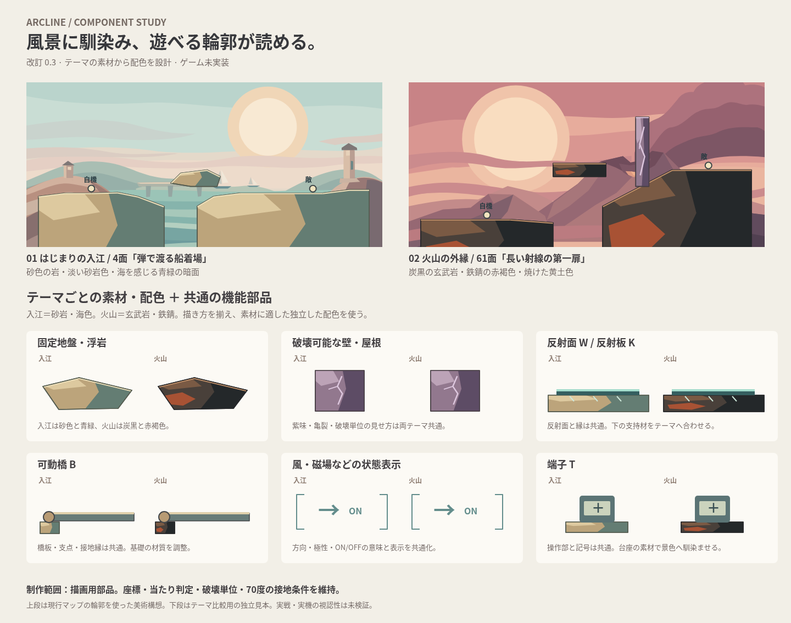

# ARCLINE 地形とオブジェクトの美術制作

2026-11-07、ユーザーがv0.3の方針と見本を承認。今後は、**テーマの素材から配色を設計し、破壊材・反射面などの機能部品を共通化する**。入江4面と火山61面を、制作の基準見本として引き継ぐ。



[SVGで拡大して確認](component-study.svg) ／ [単独HTMLプレビュー](component-study.html)

## 制作の入口

| 資料 | 用途 |
| --- | --- |
| [制作ルール](ART_DIRECTION.md) | 共通の描き方、テーマ別の素材・配色、機能部品の扱い |
| [実装引き継ぎ](IMPLEMENTATION_HANDOFF.md) | 担当範囲、描画と物理の接続、次の制作順と受入れ条件 |
| [承認記録](APPROVAL.md) | 承認された方針・見本と、実装・検証の区分 |
| [編集正本JSON](component-art.json) | テーマ材質・共通機能部品のパレットと描画契約 |
| [検証記録](VALIDATION.md) | 正本・生成物の同期、比較プレビューの確認範囲 |
| [参照元台帳](sources.json) | 背景とマップ形状の出典・コミット・ハッシュ |

## 編集元と生成物

`component-art.json` の `themeMaterials` がテーマ固有の材質、`sharedMaterials` が全テーマ共通の機能部品。`build_study.py` はこのJSON、比較用の `map-geometry.json`、`references/` の背景を読み、SVGと自己完結HTMLを生成する。PNGは生成SVGをブラウザで描画した閲覧用画像。

```sh
# リポジトリのルートから
python3 ARCLINE/design/components/build_study.py
python3 ARCLINE/design/components/build_study.py --check
node ARCLINE/design/components/render_preview.cjs
```

ブラウザ描画にはARCLINEのPlaywright依存とChromiumが必要。`ARCLINE_CHROMIUM` でブラウザの実行パス、`ARCLINE_COMPONENT_EVIDENCE_DIR` で確認画像・JSONの出力先を指定できる。既定の出力先は一時ディレクトリ。確認結果から `component-study.png` と `validation.json` を更新する。

SVG・HTML・PNGは直接修正せず、配色はJSON、部品の造形と比較シートの構成はPythonを編集する。背景の編集正本はPR #75・#100にあり、このディレクトリでは変更しない。

## 今回の制作範囲

制作対象は地盤・岩肌・固定浮島・破壊壁と屋根・反射部品・橋・作用領域の表示・端子。上段は現行4面・61面の輪郭を使った美術構想で、丸印は自機と敵の位置マーカー。下段は独立した部品比較であり、4面や61面へ追加するギミックではない。

承認済みなのは制作方針とv0.3見本。実ゲームでの描画、全20テーマへの展開、実戦・実機の視認性確認は今後の工程。[ゲーム全体の入口](../../README.md)と[更新ルール](../../docs/UPDATE_RULES.md)も参照する。
