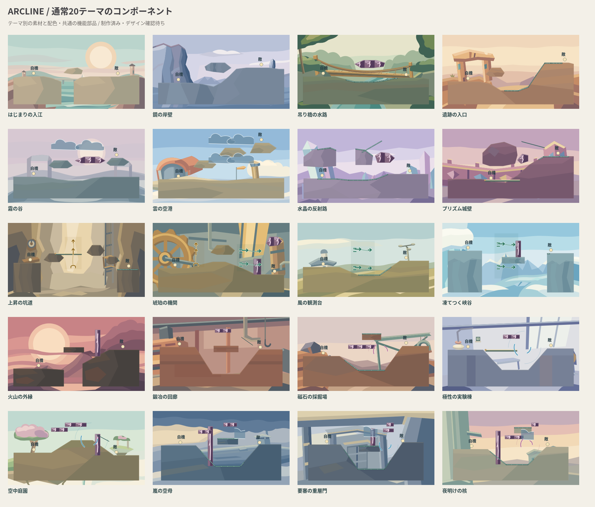
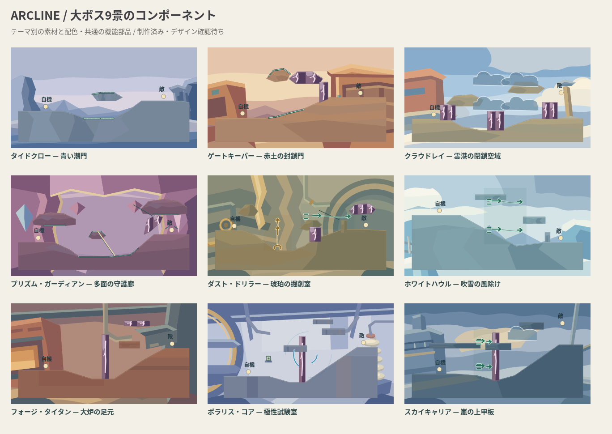
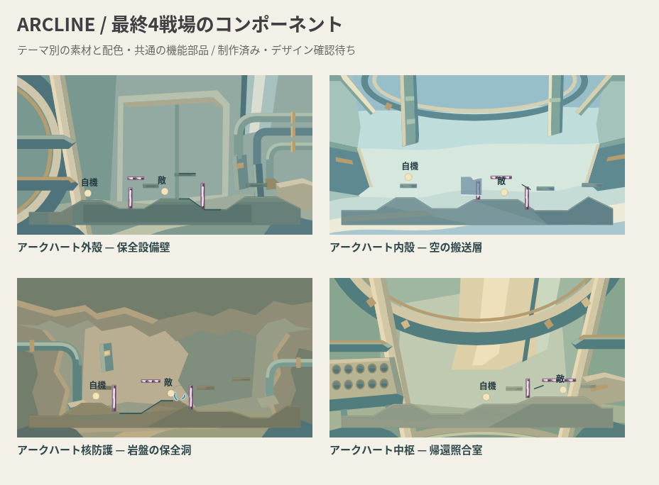

# 全テーマの地形・オブジェクト制作セット

**2026-11-07 デザイン承認・ゲーム実装へ：** この制作案はユーザー承認済み。[0.24.2のゲーム統合](../../../docs/releases/0.24.2.md)で、最新mainの100面を使う正式描画へ接続した。mainマージ・公開・実機確認は別工程。以下の図版・動画・「未統合」は制作時点の比較記録で、古い `worlds.json` をゲームへ読み戻さない。

背景PR [#106](https://github.com/bittrove88/bittrove88.github.io/pull/106) の通常20テーマ・大ボス9景・最終4戦場に対応した、計33景のコンポーネント美術。入江と火山の承認済みv0.3方針を展開し、各景に地盤材・支持材、6形状の見本、現行マップへの重ね合わせを制作した。

**制作済み・新作のデザイン確認待ち・ゲーム未統合。** 方針の承認、個別アートの承認、実ゲームの検証を区別する。背景の編集正本は変更しない。

**作用範囲改訂1.7：** [氷河・夕景の新しい表示だけを見る](game-context/flow-range-review.png) ／ [全33景を操作して比較](visibility-review.html) ／ [実動作](game-context/all-gimmicks/index.html)。帯の不透明度は14％から7％へ半減。風・気流・噴気は実際の領域を薄い帯で示し、発生端から終端まで流線をつなぐ。画面外の噴出口は「噴出口↓」で案内。スイッチは明暗差を抑えた配色へ調整し、物理・範囲・強度は維持。

**視認性改訂1.6：** [全33景の調整前後を操作](visibility-review.html) ／ [全景一覧](png/visibility-all-themes.png) ／ [実画面の比較](game-context/visibility-before-after.png) ／ [変更・検査](VISIBILITY_REVIEW.md)。共通の機能色を濃くし、動く線を2px・85％と細い明色で描く。雲は青灰色の面へ。弱化時も見えやすさを維持し、磁場以外の領域枠とOFF表示は追加しない。

**T端子の追加調整：** [スイッチの前後比較](game-context/terminal-before-after.png)。操作面の白さと外装との明暗差を少し抑え、周囲になじむ灰緑へ。大きさと記号の読みやすさ、他ギミックの表示は維持。

**全ギミックの実動作：** [13項目を選んで再生](game-context/all-gimmicks/index.html) ／ [約102秒の通し動画](game-context/all-gimmicks/all-gimmicks.mp4)。通常弾の反射・破壊・減速、橋と板の切り替え、風・上昇気流・噴気・磁場、端子の命中から次手番の極性反転までを、実エンジンと実ゲーム描画で収録。途中戦闘を省略した状態見本は動画内に明記した。

**改訂1.5：** [地形の調整前後](png/terrain-comparison.png) ／ [実ゲームの描画・HUDで確認](game-context/index.html) ／ [動きと切替](gimmick-motion.html)。地形の内部コントラストと彩度を抑え、磁場以外の枠・定型ラベルとOFF表示を省いた。雲は濃さを戻し、風は同じ見た目のまま流速で強さを伝える。

**輪郭改訂1.2：** [調整前後の比較](png/outline-comparison.png)。暗いinkの混色をやめ、素材と同じ色相の線へ変更した。通常外周0.8px・機能部品0.9px・接地辺1.8pxは維持。砂岩は砂色、氷は青、破壊材は紫でなじませる。[配色と輪郭の考え方](ART_DIRECTION.md#コンポーネント用の配色と輪郭)を参照。

[比較ギャラリー](index.html) ／ [制作セットZIP](ARCLINE_Component_Collection.zip) ／ [設計一覧](ART_DIRECTION.md) ／ [実装引き継ぎ](IMPLEMENTATION_HANDOFF.md) ／ [内部確認](REVIEW_NOTES.md) ／ [検証記録](VALIDATION.md)







## 確認と編集

ZIPを展開して `index.html` をブラウザで開く。ページはデータと描画コードを内包し、通信・保存なしで動作する。通常／大ボス／最終／共通部品を選び、部品シートと現行マップを比較できる。背景の表示、当たり判定の輪郭、90%表示を切り替えられる。部品シートは横スクロール、マップは表示幅に収める。日本語フォントは閲覧環境のフォントを使う。

| 編集元 | 用途 |
| --- | --- |
| `data/*.json` 全33件 | 個別の地盤材・支持材パレットと正規化した色面。テーマ別美術の編集正本 |
| `shared-materials.json` | 破壊材・反射面・橋・端子・作用領域の共通色。テーマ内で複製・上書きしない |
| `render-style.json` | 全テーマ共通の線幅・素材色の明るさ調整。配色パレットとは分けて管理 |
| `visibility.template.html`、`visibility_verify.cjs` | 全33背景×13状態と共通実体部品の比較、通常／90％・スマホ2サイズの明暗差検査。`references/visibility-v15/` は固定した前版 |
| `motion-cases.json`、`motion.template.html` | 13状態の比較見本と操作ページ。比較用の状態・秒数であり、ゲームの手番や物理の正本ではない |
| `build.py`、`vector.py` | 部品の造形、状態表示、図版の構成。マップの生成元ではない |
| `manifest.json` | 全33景のID・面・最終mapIndex・出力先 |
| `worlds.json` | 現行1〜99面＋最終4戦場の103比較用スナップショット。ゲームに読み戻さない |
| `references/backgrounds/` | PR106固定コミットの参照専用JSON・SVG・描画コード |
| `source-manifest.json` | 背景出典・SHA-256・ゲーム比較元・方針の参照先 |

配色だけでなく、色面の配置も個別JSONで編集する。`planes[].points` は部品の外接矩形に対する0〜1座標、`color` はその材質のパレットキー。描画時に実際のポリゴン内へクリップする。材質が輪郭を決める構造にはしない。

生成物は `graphs/` 39件、`svg/`・`png/` 各39件、`maps/` 103件、`collection.json`、`index.html`。33景・共通状態・一覧3枚に輪郭と地形の調整前後比較各1枚を含む。SVG・PNG・生成JSONを直接修正しない。

```sh
# リポジトリルートから。Python標準ライブラリのみでベクトル生成
python3 ARCLINE/design/components/complete/build.py
python3 ARCLINE/design/components/complete/build.py --check

# ARCLINEのPlaywright依存・ChromiumでPNGと検証記録を生成
node ARCLINE/design/components/complete/render_verify.cjs
node ARCLINE/design/components/complete/motion_verify.cjs
node ARCLINE/design/components/complete/game_context_verify.cjs
python3 ARCLINE/design/components/complete/package.py
python3 ARCLINE/design/components/complete/package.py --check
```

`ARCLINE_CHROMIUM` でブラウザの実行ファイル、`ARCLINE_COMPONENT_EVIDENCE_DIR` で確認画像の出力先を指定できる。`snapshot_worlds.cjs` は現行ゲームの比較用データを書き直す補助ツールで、通常の美術再生成には使わない。基準ゲームを変更する場合に限り、出典コミット・ハッシュと比較結果を更新する。

`renderer.js` の `ArcComponentCollection.draw(ctx, width, height, graph, options)` は、この独立ギャラリー用のCanvas描画器。`select(manifest, stage, mapIndex)` はテーマ選択の参照実装。ゲームの `world` オブジェクトを受け取る実装ではない。`chargeZoom` は美術の90%比較であり、実ゲームのカメラ判定を再実装していない。

動きは `fieldMotion:true, time:秒数`、静止した手掛かりは `reducedMotion:true` で確認できる。GIF／MP4の再生成にはFFmpegが必要。確認用の一時フレームは `ARCLINE_MOTION_EVIDENCE_DIR`（既定 `/tmp/arcline-field-motion`）へ出力する。動きのプレビューは `prefers-reduced-motion` を尊重し、非表示タブでは再生を進めない。

実際の機体・射線・HUDへの一時適用は `game-context/` に確認を保存した。ゲーム本体への正式な組み込み、実戦、実機、性能、公開は別工程。[接続時に維持する条件](IMPLEMENTATION_HANDOFF.md)を参照する。
