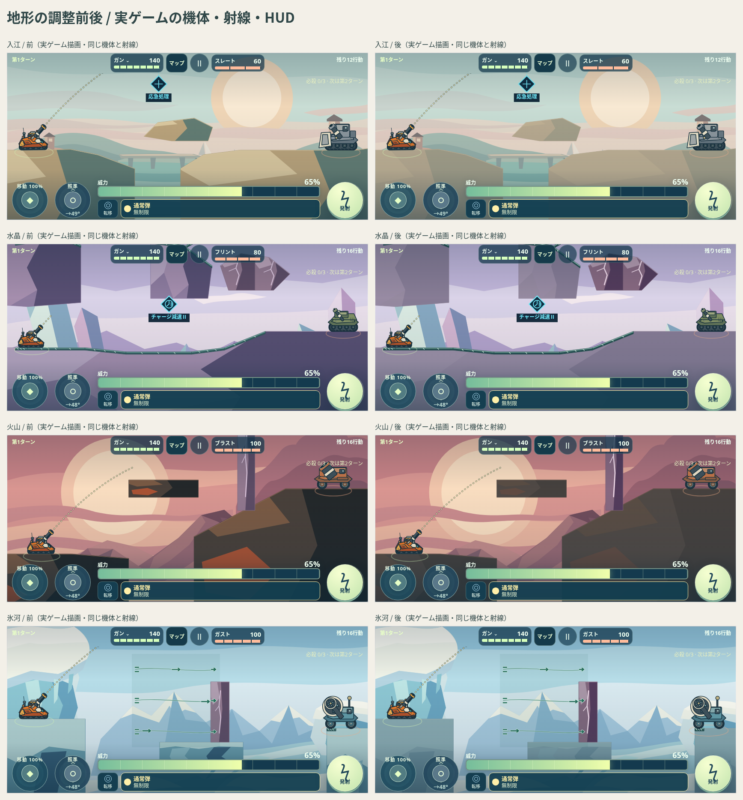

# 実ゲーム描画を使った認識確認

制作中の美術をブラウザ内だけで既存ゲームへ一時適用し、正規の機体・敵・射線・HUDと重ねて確認した。公開ゲームへの統合・配信や、対戦のクリア検証ではない。ゲーム本体は編集せず、新しい一時ブラウザプロファイルを使う。

**作用範囲改訂1.7：** [氷河・夕景の新しい表示だけを見る](flow-range-review.png)。風・気流・噴気は帯・発生端・終端までの流線で範囲と向きを示す。噴出口が画面下なら「噴出口↓」で案内する。風向きの反転も加えた20場面・240条件で確認。T端子は明暗差を少し抑え、実画面も共通の制作描画へ揃えた。[端子の前後比較](terminal-before-after.png)。1.6の色だけの改善を補う変更で、以下の画像・動画は更新済み。

**現行は視認性改訂1.6。** 共通機能色を濃くし、細い明色を添えた。下記の実画面・動画は更新済み。[風・噴気・磁場・雲の前後比較](visibility-before-after.png) ／ [全33景の比較操作](../visibility-review.html) ／ [変更と検査](../VISIBILITY_REVIEW.md)。1.5では画素差があっても見分けにくい状態が残ったため、全景で合成後の明暗差も検査した。

[画像・動画を見る](index.html) ／ [実画面の動画・8秒](gimmicks-in-game.mp4) ／ [検査データ](validation.json)

## 全ギミックの実際の動き

[13項目の個別再生・速度変更](all-gimmicks/index.html) ／ [通し動画・約102秒](all-gimmicks/all-gimmicks.mp4) ／ [物理イベントの記録](all-gimmicks/validation.json)

従来の8秒動画は領域の演出のみ。追加の動画は本物の通常弾を発射し、現行エンジンの `launch`、`applyEvents`、`resolve`、`boundary` とゲームの `ArcRender` を使用する。

| 項目 | 確認する動作 |
| --- | --- |
| 破壊材 | 通常弾の着弾と爆風、破壊単位の消失、残った地形 |
| 反射面 W | 地面側の反射と、天井側の面での反射 |
| 反射板 K | 板への反射、39面の90度回転 |
| 可動橋 B | ターン境界の開閉、0.6秒の形状変化と再接地 |
| 減速雲 C | 通過時の減速、薄くなった雲の状態見本 |
| 風 F | 右風と左風での弾道、通常・弱化・停止の見本 |
| 上昇気流 U | 弾への上向きの力 |
| 間欠噴気 V | 停止→噴出→停止と、噴出中の弾道 |
| 磁場 M | 正負での弾道、弱化と停止の見本 |
| 極性端子 T | 命中→反転予約→次の手番で反転、もう一度命中して戻す |
| 固定の天井・壁 | 弾を遮る岩盤が着弾後も残る |

現行100面の配置にある9種類 W/K/B/C/F/U/V/M/T と破壊材・固定岩盤を扱う。旧S/Rは現行配置にない。重力変更は既存スキルであり、マップのギミックとして追加していない。

`all_gimmicks_verify.cjs` で再生成できる。橋・板の中間ポリゴンは、まず実ゲームの描画へ渡された形を採取し、同じ形に美術を再生成して収録する。動画は960×480の実画面と、その下の説明欄、15fps、音声なし。個別13本と通し版を同梱。再生・一時停止・シークはブラウザ標準コントロール、速度は0.5／1／1.5倍を選べる。

敵行動と手番の待ち時間を省略し、橋・板の周期は実際のターン境界を進めて見せる。ボス部位破壊後の強弱・停止と薄い雲は、正規の到達状態から始める見本であり、そこまでの戦闘を収録したものではない。端子の命中と予約・反転は実際のイベントを連続適用した。新美術の正式統合・端末実機・全100面の継続プレイは未実施。

## 確認したこと

20場面×4画面サイズ×3難易度＝240条件。ゲーム既定のカメラを基準に、通常表示と90%表示を比較した。844×390・568×240はタッチ端末、393×852はゲーム既定の横向き回転、1440×900はPCの条件。

- 地形内部の明暗差と彩度を抑えると、元の背景を変えずに機体・砲口・射線へ視線を戻しやすい。上の比較はカメラ・姿勢・背景を揃え、地形の制作データだけを切り替えた。
- 雲は薄すぎる小さな楕円から、まとまった雲の面へ変更。明るい空港でも雲のまとまりが見える。
- 風は同じ形・数・出る位置を維持し、強さだけを流速で伝える。源の側に短い流れの出始めを残し、囲いを付けない。
- 噴気・上昇気流は、最初の確認では操作パネルに流れが偏り、暖色背景で淡く見えた。物理範囲を変えず、表示中の領域内へ手掛かりを配置し、同じ暖色系で読みやすい線色へ調整した。
- 磁場だけは薄い円弧と＋／−を残す。その他の枠、定型ON／弱ON／倍率ラベル、OFF時の画面内表示は省いた。

## 残るカメラ条件

**568×240の90面では、雲領域が通常カメラの上端より上に出る。** 通常／薄化の2状態×3難易度の6条件で確認。画面内にある領域の描画が消えているケースはなかった。

[通常カメラ](cloud-camera-clipped-568.png) ／ [既存の見渡し表示](cloud-camera-inspection-568.png)

見渡しでは雲を確認できる。雲を濃くしても画面外という問題は解消しないため、領域を偽の位置へ描いたり、今回の美術調整でカメラや配置を変更したりしていない。正式統合時に、画面外の作用領域の案内が必要かを確認する。

## 検査の限界

領域あり／なしの描画差、OFFの差0、世界・機体・保存の不変を検査し、代表画像を目視した。画素差があることだけを、人が必ず認識できる保証にはしない。物理端末の見え方、動作性能、実戦の継続プレイ、全100面の全状態は未確認。

`game_context_verify.cjs` は現行ゲームの `ArcRender`、キャラクター・敵の正規描画、HUD、射線を使い、ブラウザ内で背景・コンポーネントの描画呼び出しだけを一時置換する。比較ワールドはゲームのエンジンから作り、その場のポリゴンへ美術を再生成する。正式なゲームファイル・セーブを変更する実装ではない。動画は状態を固定した雲・風・噴気・磁場を2秒ずつ映した美術確認録画。
