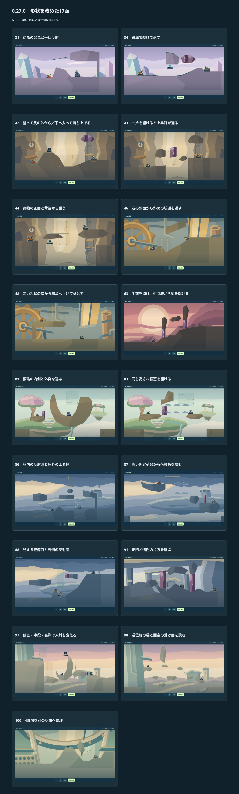
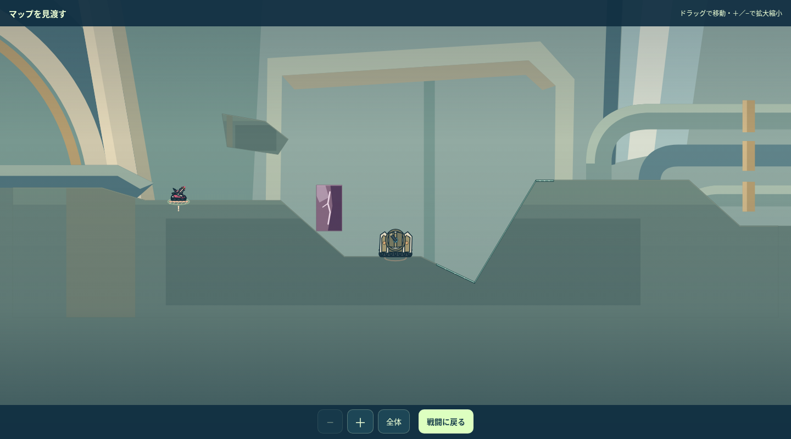
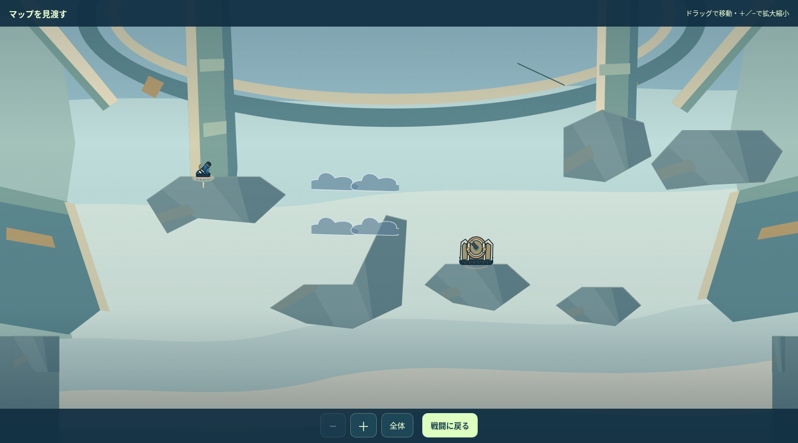
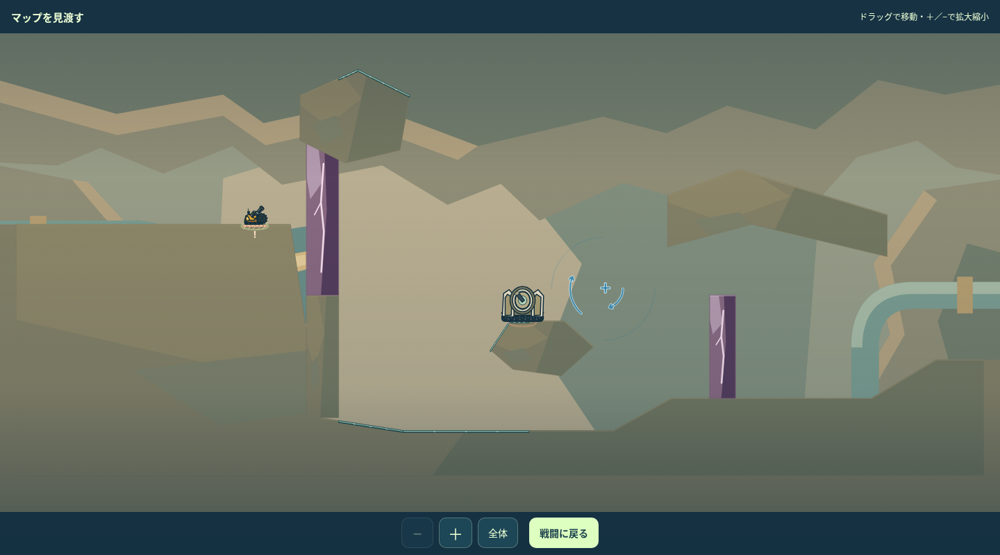
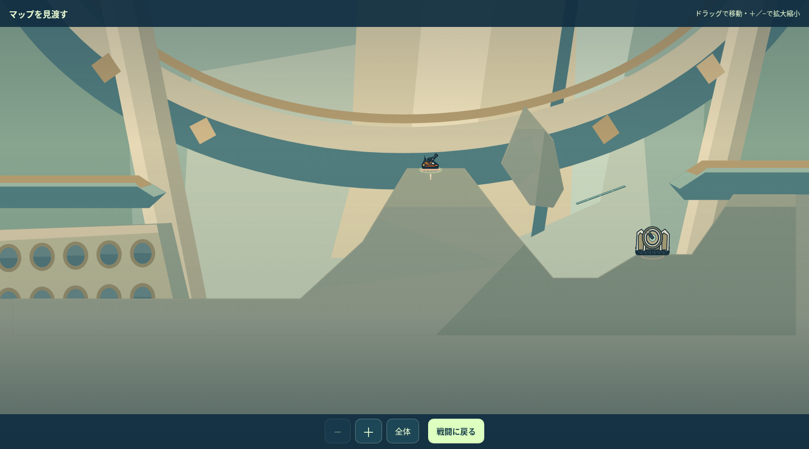

# ARCLINE｜残りのマップ改善・変更後レビュー

2026-11-07／0.27.0候補。既存の方針で、残りの通常16面と100面の4戦場を一つずつ制作・実描画・内部改善した。41・45面は案内だけを訂正。**今回の19面は変更後レビュー対象。本番マージ・公開は未実施。**

[変更前後と実入力後](index.html)／[全100面の判断・テーマ・10面比較](../MAP_REVIEW_FINAL_DECISIONS_001_100_20261107.md)／[採用元とハッシュ](../STAGES_REVIEW_COMPLETION_RUNTIME_20261107.json)／[検証一覧](../../../evidence/maps-0270/VALIDATION.json)

| 面 | 変えた判断 | 仕上げと限定確認 |
|---|---|---|
| [31](index.html#stage-031) | 結晶の発見と一回反射 | 結晶を岩肩から離し、面の向きを見分けられる高さへ上げた。岩肩・敵の洞室は保持。Gun63°/75は9近傍命中、Ricoは6/9。 |
| [34](index.html#stage-034) | 鏡床で続けて返す | 開始頭上の蓋と半ば埋もれた結晶を撤去。小さな肩を残し、低い屋根の下を鏡床で連続反射する。6°/55の二回反射は4/9。 |
| [41](index.html#stage-041) | 上昇流の初出を素直に案内 | 地形は保持。現行で壊せない柱を開くように読めた案内を、大きな窓から上昇流へ通す説明へ訂正した。 |
| [42](index.html#stage-042) | 登って風の外から／下へ入って持ち上げる | 歩ける坑道の肩へ出れば低く狙え、下の床へ転移すれば上昇流が使える。上7/9・下9/9。既存カプセルの下へ上面を削り、座標を維持。 |
| [43](index.html#stage-043) | 一片を開けると上昇路が通る | 一枚の隔壁を壊すと上昇流の出口が開く。敵上の屋根も上げた。隔壁7/9・開口後5/9。結晶と橋の数合わせは残していない。 |
| [44](index.html#stage-044) | 荷物の正面と背後から狙う | 二つの大きな貨物台の間に射点を分けた。正面の上昇流7/9、背後へ転移後の逆向き射撃9/9。カプセルに干渉する貨物の下面を削った。 |
| [45](index.html#stage-045) | 部位に通す位置を正確に案内 | 既存の部位・地形を保持。「安全な射点」の断定をやめ、柱の手前と脇の棚から昇降ドライブへ通す角度を選ぶ案内へ訂正。 |
| [46](index.html#stage-046) | 右の斜面から斜めの坑道を通す | 右開始の車体角を含めて上昇流へ入れ、斜めの屋根の内部を抜ける。局所入力69°/45は6/9。弾が屋根上を越えただけの証拠にはしていない。 |
| [48](index.html#stage-048) | 高い舌状の岸から結晶へ上げて落とす | 高所開始と低い敵を残し、上昇流と広い結晶の受け面を合わせた。33°/75は両方を経て9/9。同じ入力はどちらかを除くと届かない。 |
| [63](index.html#stage-063) | 手前を開け、中間床から奥を開ける | 前後二枚の役割を分けた。手前破壊・中間床への転移・奥の破壊が成立し、両破壊は各9/9。既存の高い止まり場の下も広げた。 |
| [81](index.html#stage-081) | 根輪の内側と外側を選ぶ | 敵を根輪の低い内側へ移した。内側への転移後は9/9だが準備中に被弾する例がある。外縁は風から落とす6/9。初期の高い曲射も精密な別解として残る。 |
| [83](index.html#stage-083) | 同じ高さへ横窓を開ける | 敵側の島を低く近付け、横窓を開いた後に雲だけを通す24°/95を7/9へ広げた。準備を省く風側は3/9で、窓を開ける利点を残す。 |
| [86](index.html#stage-086) | 船内の反射湾と船外の上昇棚 | 敵を下甲板と近い高さに置き、作業桁の下の鏡湾7/9と、外の棚から上昇流へ送る8/9を分けた。旧任意ハッチは撤去。敵と自機の頭上は広く確保。 |
| [87](index.html#stage-087) | 高い固定荷台から荷役板を読む | 高所の固定P0は両姿勢で支持を失わない。水平時の雲経路が降下姿勢では遮られ、雲外の固定棚へ回れる。棚からの射撃6/9。取得物1個を新しい開始支持の上へ移し、通常弾で9/9の取得を確認。 |
| [88](index.html#stage-088) | 見える整備口と外側の反射面 | 開始支持を肩へ上げ、整備口の床へ降りる空間を残した。東庇とハッチを14h上げ、庇への転移後は水平な結晶から7/9。開始の風経路は精密な別解2/9。 |
| [91](index.html#stage-091) | 正門と側門の片方を選ぶ | 中央アーチの下に広い側方空間を作り、左右の門を独立させた。右一片9/9→床反射5/9。左へ回ると結晶3/9が成立し、敵の反撃が左門を開ける実例もある。両門の順次破壊は不要。 |
| [97](index.html#stage-097) | 低島・中段・高岸で入射を変える | 開始島は東の岩背を持つ開いたくぼみへ変更。低島U3/9・中段K6/9・高岸F3/9が成立し、三つを全部連鎖させない。通常弾・実反撃込みで全三経路の成立例を保存。開始付近の曲射も2〜3/9の精密な別解として残る。 |
| [98](index.html#stage-098) | 逆位相の橋と固定の受け面を読む | 9つの固定島と既存周期を保持。西橋の上り先、東橋の降下先を接続し、上の遮蔽を初期曲射へ寄せた。固定中継→東の付け根から7/9。反対姿勢では同じ入力が遮られる。 |
| [100](index.html#stage-100) | 4戦場を別の空間へ整理 | 第1は連続した盆地、第2は分断された高い回廊、第3は破壊で入口を開く縦穴、第4は斜めの裂け目と一回反射。固定10機のNormal・Hard通し各30行動が成立。HP・必要ダメージ・必殺数・28行動・出現距離・再挑戦は保持。 |

## 100面の4戦場

変更後は通常弾の実際の通し対戦から取得した到着状態。

| 第1・連続した盆地 | 第2・分断回廊 |
|---|---|
|  |  |

| 第3・開いた縦穴 | 第4・斜めの裂け目 |
|---|---|
|  |  |

## 比較して残した面

11・13・15・53・79・82・84・85・89・90面は現行維持。84面は高所開始案で機構を使う理由が弱まり、不採用にした。53面は前回の小変更でも改善が見込めず見送っている。制作数を満たすための差し替えはしない。各理由は全100面の判断表へ記録。

## 検証した範囲

Normal/Gun16面、Hard/Gun9面、97面の別の高岸経路で計26戦を完走。97面は通常の中段、Hardの低島、追加Normalの高岸で三経路を確認。100面はNormal・Hardとも固定10機で全員の必要量を満たす各30行動。開始在庫は空で、通常弾と必要な歩行・転移を使い、敵の実手番を省略していない。

既存35単体スイート・161件の通常面固定入力再生、100面2件のリレー再生、146生成物、影響する既存ブラウザ7本をまとめて確認する。確定した実行結果と再検査理由は検証一覧を参照。面ごとの回帰テストファイルは増やしていない。人の初見理解・楽しさ・勝率、実機操作、全キャラ・全seed・全解法は未確認。

最終Gunの実際の通し対戦到着状態（ボス第3段階）からも、下の射点への転移と結晶の反射を確認した。78°/80は9近傍入力で命中。[実状態の限定確認](../../../evidence/maps-0270/FINAL_GUN_REAL_ENTRY_PROBE.json)。

## 保持した条件

0.26.0の22cf9b5を基準に他81面は地形正本・生成レベルの全項目が完全一致。過去バッチの承認・元データは不変にし、今回の前後データと連結して検査する。41・45面の地形・配置も同一。HP・AI・攻撃型・物理・歩行／転移・在庫・schema8/reset2・美術は変更していない。

100面は4戦場の地形と出撃支持のみを専用に改訂。各3,000px、固定10機順・各HP70・本体へ各表示100・必殺3・各28行動・出現距離800px以上・敗北機からの再挑戦、戦場名と背景を保持。第2戦場の3機は有限な浮島に出撃する。

全46取得物の種類・数量・ID・出現ターンを保持。45個は座標も維持。87面のW11だけを高い固定荷台の上へ移し、取得記録を通常弾の9近傍入力へ更新。34・42・44・88・97面も同じ座標からの取得入力を更新した。88面は6/9、他5面は9/9。

本番統合・STG配信は別工程。前のPR115・117の上に積んだ作業ブランチであり、この資料を本番配信済みとは扱わない。
