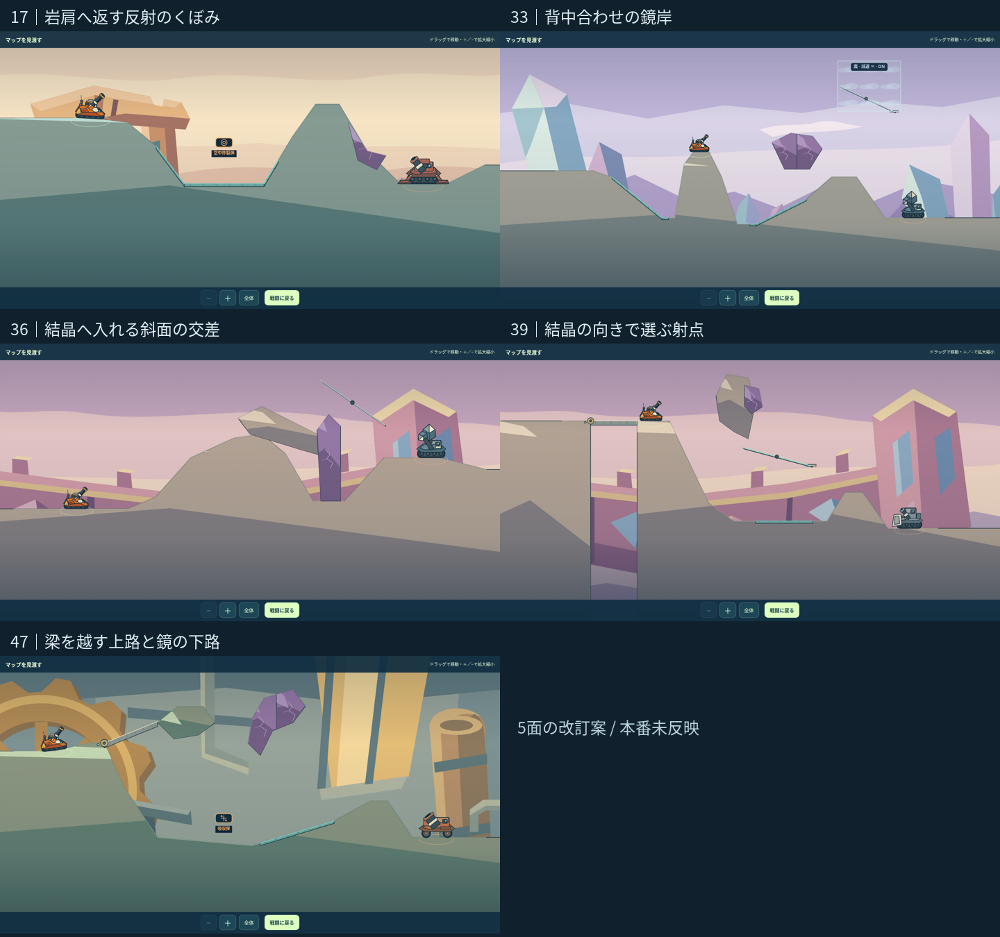

# ARCLINE｜企画を選択適用した5面の改訂レビュー

17・33・36・39・47面だけの改訂案。0.24.0（`74aed2b`）を基準に、1面ずつ制作 → 実ゲーム描画 → 内部確認 → 改善 → 再確認を行い、レビューをここにまとめた。ゲーム正本・生成物・他95面は変更していない。



[画像一覧を開く](index.html) · [記録した例の再生結果](minimum_checks.json)

## 採用した核と形の違い

| 面 | 企画 | 改訂案 | 比較 | 実ゲーム |
|---:|---|---|---|---|
| 17 | E01 反射のくぼみ | [岩肩へ返す反射のくぼみ](stage_017_review.md) | [現行／改訂](stage_017_compare.svg) | [描画](stage_017_actual.png) |
| 33 | E10 反射で回り込む壁 | [背中合わせの鏡岸](stage_033_review.md) | [現行／改訂](stage_033_compare.svg) | [描画](stage_033_actual.png) |
| 36 | E08 斜面の交差 | [結晶へ入れる斜面の交差](stage_036_review.md) | [現行／改訂](stage_036_compare.svg) | [描画](stage_036_actual.png) |
| 39 | E18 結晶の向きで選ぶ射点 | [結晶の向きで選ぶ射点](stage_039_review.md) | [現行／改訂](stage_039_compare.svg) | [描画](stage_039_actual.png) |
| 47 | E20 小さな多経路 | [梁を越す上路と鏡の下路](stage_047_review.md) | [現行／改訂](stage_047_compare.svg) | [描画](stage_047_actual.png) |

17面は浅いくぼみの一回反射、33面は中央の射点から左右の鏡、36面は斜面と梁の交差、39面は高岸と低い裾から結晶の向きを読む構成、47面は短い橋と鉱車棚による上下路。共通の谷形や同じ攻略手順を次の面へ流用せず、それぞれの地形から作った。

23・27・28・35・44・48面と、51〜99面の追加企画は今回の差し替え対象に含めない。35・44面は現行を残すという検討結果を維持する。

## 確認した範囲

5面とも実エンジンで自機・敵の安全配置、開始位置からの中心間の見通し遮断、自機上方の空間、カプセルの埋没、反射材が床だけを覆うことを確認。通常弾の実弾道、必要な歩行・転移、36面の門の開閉、39・47面の両姿勢を限定して確認した。通常弾はGun、在庫なし、固定seed 4697。

下表は記録した角度・威力に対し、角度±3度・威力±5の9点で「敵に0.5以上、自機に0.1以下のダメージ」を満たす例の数。反射の例では同じ経路条件も確認した。全て操作可能な範囲内の入力であり、勝率・全解法・プレイヤーの成功率を表さない。

| 面 | 実射例 | 表示角／威力 | 敵ダメージ | 近傍 |
|---:|---|---|---:|---:|
| 17 | AからW一回 | -6°／60 | 1.5 | 4/9 |
| 33 | 右W一回 | 3°／65 | 1 | 5/9 |
| 33 | 左W一回 | 24°／80 | 1.5 | 6/9 |
| 36 | AからK一回 | 45°／75 | 1.5 | 2/9 |
| 36 | Bから門破壊後・Kなし | 33°／55 | 1.5 | 9/9 |
| 39 | 西岸・K向きA | 0°／40 | 1.5 | 3/9 |
| 39 | 東裾・K向きB | 78°／65 | 1.5 | 5/9 |
| 39 | Wだけの別解 | 39°／45 | 1.5 | 3/9 |
| 47 | 下段W・橋A | -9°／60 | 1 | 3/9 |
| 47 | 上段の梁越え・橋A | 57°／55 | 1.5 | 5/9 |
| 47 | 下段W・橋B | -9°／60 | 1 | 3/9 |
| 47 | 上段の梁越え・橋B | 57°／55 | 1.5 | 5/9 |

36面の門経路は、同じ入力33°／55で、開く前は門に遮られて敵ダメージ0、開いた後はKなしで1.5。開閉によって使える射線が変わることも確認した。

36面のK一回（2/9）、39面の西岸（3/9）、47面の下段（3/9）は、最後の対戦確認で操作負荷を重点的に見る。36面はKの命中全体では3/9だが、表では一回反射に限定して数えた。33面は庇を越す放物線の別解も残す。見通し遮断の確認を「反射以外では絶対に命中しない」という証明には使わない。

`round3` の姿勢資料は、実装の境界処理だけを進めて作った状態。敵ターンを経た対戦記録ではない。門破壊の画像も、移動・破壊後の状態を示す資料。

## 残す最終工程

ユーザー指定に従い、今回専用の個別回帰テストや大量対戦は追加していない。共通の [記録例の再生スクリプト](replay_examples.cjs) で12例を再生し、実際の描画を内部確認した。現行100面の対戦再実行は、今回の案が未統合のため行わない。

最終デザインレビュー後にまとめて、採用した地形の正本反映、取得物の取得経路と台帳、敵の移動・学習・反撃、行動上限内の攻略、難易度別の実戦、実機表示を確認する。本番マージ・公開は未実施。HP・行動上限・AI・物理・セーブ形式はこの案でも変更しない。

## 元資料と再確認

- [正式指示書](https://github.com/bittrove88/bittrove88.github.io/blob/review/arcline-map-redesign-handoff-20261105/ARCLINE/design/stage_reviews/ARCLINE_MAP_DESIGN_SINGLE_SOURCE_OF_TRUTH_20261106.md)
- [難度別精査結果](https://github.com/bittrove88/bittrove88.github.io/blob/review/arcline-map-redesign-handoff-20261105/ARCLINE/design/map_brainstorm/MAP_IDEA_DIFFICULTY_REVIEW_JA.md)
- [E企画20案](https://github.com/bittrove88/bittrove88.github.io/blob/review/arcline-map-redesign-handoff-20261105/ARCLINE/design/map_brainstorm/20261106_early_mid_20/README.md)

再生はリポジトリルートから次を実行する。大量探索は行わず、JSONに記録した例だけを使う。

```sh
node ARCLINE/design/stage_reviews/idea_refinement_20261107/replay_examples.cjs
```

提案JSONの `blueprintCandidate` は差し替え候補。`before` は0.24.0の記録、`after` は図と取得物の候補、`qualityEvidence` は限定確認の記録。承認済み地形やゲーム正本として自動採用しない。
