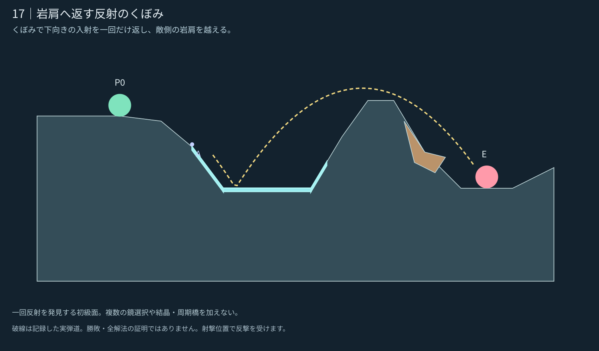

# 17｜岩肩へ返す反射のくぼみ

**設計承認済み・0.24.1へ統合。** [統合・検証記録](../../../docs/releases/0.24.1.md)。 [5面の一覧へ](README.md)

[現行／改訂の比較](stage_017_compare.svg) · [実ゲームの改訂案](stage_017_actual.png) · [現行0.24.0](stage_017_before.png) · [候補JSON](stage_017_proposal.json)

## 攻略の核

くぼみで下向きの入射を一回だけ返し、敵側の岩肩を越える。

開始点上の屋根を設けず、鏡への入口を開いた。任意の欠けた岩縁は右斜面に接続する。

一回反射を発見する初級面。複数の鏡選択や結晶・周期橋を加えない。

## 内部確認からの改善

浮いた上部岩を除去し、反射底を広げ、敵側を低い裾へ整理。狙いが鏡の角に偏らないよう入射面と着弾先を調整した。

## 地形の役割

- **W：** 下向きの弾を敵側へ返す。
- **岩肩：** 反射後に越える地盤の輪郭。登る・回る場合の支持面も持つ。
- **欠けた岩縁：** 右斜面に接続する任意の一片。開始側や鏡への入射を覆わない。

## 記録した確認

| 例 | 角度／威力 | 敵ダメージ | 近傍 |
|---|---|---:|---:|
| AからW一回 | -6°／60 | 1.5 | 4/9 |

開始位置の安全・見通し遮断・上方の空間・取得物の埋没を確認。近傍の意味と未確認事項は[共通記録](README.md#確認した範囲)を参照。ここまでの図は設計時の限定確認。承認後の敵の反撃・手数内攻略は0.24.1の対戦記録へ分離した。

企画の核は [E01 反射のくぼみ](https://github.com/bittrove88/bittrove88.github.io/blob/review/arcline-map-redesign-handoff-20261105/ARCLINE/design/map_brainstorm/20261106_early_mid_20/README.md) から選択適用し、形状は現行の実装仕様に合わせて新しく制作した。
