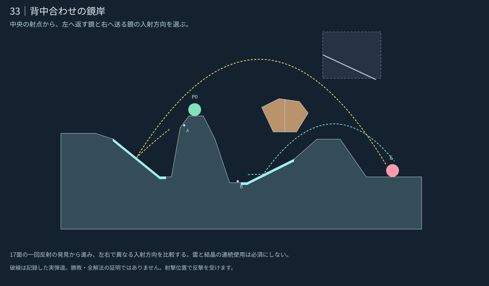

# 33｜背中合わせの鏡岸

**設計承認済み・0.24.1へ統合。** [統合・検証記録](../../../docs/releases/0.24.1.md)。 [5面の一覧へ](README.md)

[現行／改訂の比較](stage_033_compare.svg) · [実ゲームの改訂案](stage_033_actual.png) · [現行0.24.0](stage_033_before.png) · [候補JSON](stage_033_proposal.json)

## 攻略の核

中央の射点から、左へ返す鏡と右へ送る鏡の入射方向を選ぶ。

二つのWは別々に一回だけ使える。庇は破壊可能な岩として直射を遮り、CとKは上側の任意経路に残す。

17面の一回反射の発見から進み、左右で異なる入射方向を比較する。雲と結晶の連続使用は必須にしない。

## 内部確認からの改善

直射を遮る庇を西へ寄せ、左Wは上、右Wは下を通すよう調整。庇は既存の破壊片の役割を引き継ぐ一体の岩とし、Wが上面へ付かない形にした。二つのWは各6/9・5/9の近傍例を確認。

## 地形の役割

- **左W：** 左へ投げた弾を傾斜面から右へ返す。
- **右W：** 右下へ入れて短い東庇の下へ送る。
- **東庇：** 直射を遮り、左Wは上・右Wは下へ通す。破壊すると遮蔽と射撃空間が変わる。
- **C/K：** 東庇の上に残す任意の経路。両方を連続で使うことを要求しない。

## 記録した確認

| 例 | 角度／威力 | 敵ダメージ | 近傍 |
|---|---|---:|---:|
| 右W一回 | 3°／65 | 1 | 5/9 |
| 左W一回 | 24°／80 | 1.5 | 6/9 |

開始位置の安全・見通し遮断・上方の空間・取得物の埋没を確認。近傍の意味と未確認事項は[共通記録](README.md#確認した範囲)を参照。ここまでの図は設計時の限定確認。承認後の敵の反撃・手数内攻略は0.24.1の対戦記録へ分離した。

企画の核は [E10 反射で回り込む壁](https://github.com/bittrove88/bittrove88.github.io/blob/review/arcline-map-redesign-handoff-20261105/ARCLINE/design/map_brainstorm/20261106_early_mid_20/README.md) から選択適用し、形状は現行の実装仕様に合わせて新しく制作した。
