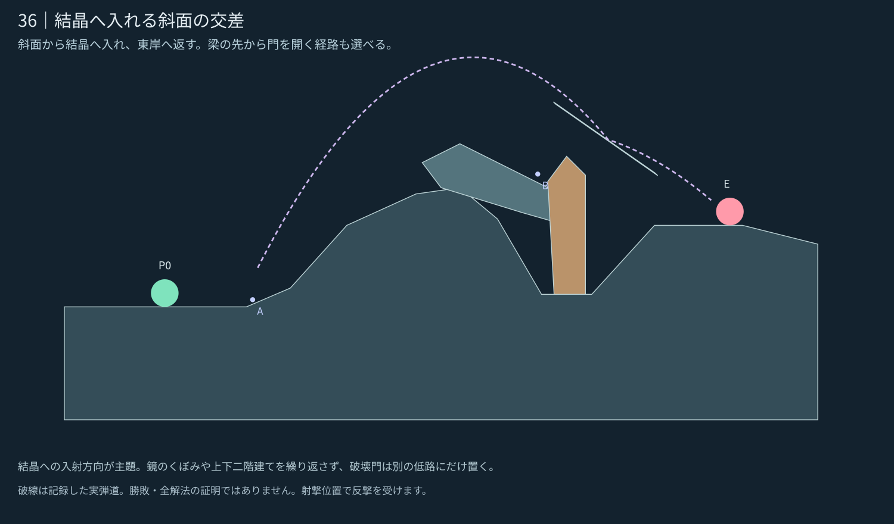

# 36｜結晶へ入れる斜面の交差

**設計承認済み・0.24.1へ統合。** [統合・検証記録](../../../docs/releases/0.24.1.md)。 [5面の一覧へ](README.md)

[現行／改訂の比較](stage_036_compare.svg) · [実ゲームの改訂案](stage_036_actual.png) · [現行0.24.0](stage_036_before.png) · [候補JSON](stage_036_proposal.json)

## 攻略の核

斜面から結晶へ入れ、東岸へ返す。梁の先から門を開く経路も選べる。

主経路のKは門を壊さず使える。門を選ぶ場合は梁の東端へ転移し、開いた後に結晶の下から東岸へ入れる。

結晶への入射方向が主題。鏡のくぼみや上下二階建てを繰り返さず、破壊門は別の低路にだけ置く。

## 内部確認からの改善

結晶の出口を遮っていた梁を短くし、結晶を東へ移動。第二射点を梁の東端へ定め、門の開閉で同じ入力が遮られる／Kを使わず命中することを比較した。

## 地形の役割

- **K：** 梁を越えて入る弾を東岸へ返す。
- **固定梁：** 地盤と違う傾斜を持つ第二射点。先側から門へ低く入れられる。
- **破壊門：** 梁の先から東岸へ向かう経路を遮る。Kを使う経路は壊さず選べる。

## 記録した確認

| 例 | 角度／威力 | 敵ダメージ | 近傍 |
|---|---|---:|---:|
| AからK一回 | 45°／75 | 1.5 | 2/9 |
| Bから門破壊後・Kなし | 33°／55 | 1.5 | 9/9 |

[門を開いた実ゲームの状態](stage_036_gate_open.png)。同じ33°／55の弾が門の開く前は遮られ、開いた後はKなしで命中する。

開始位置の安全・見通し遮断・上方の空間・取得物の埋没を確認。近傍の意味と未確認事項は[共通記録](README.md#確認した範囲)を参照。ここまでの図は設計時の限定確認。承認後の敵の反撃・手数内攻略は0.24.1の対戦記録へ分離した。

企画の核は [E08 斜面の交差](https://github.com/bittrove88/bittrove88.github.io/blob/review/arcline-map-redesign-handoff-20261105/ARCLINE/design/map_brainstorm/20261106_early_mid_20/README.md) から選択適用し、形状は現行の実装仕様に合わせて新しく制作した。
