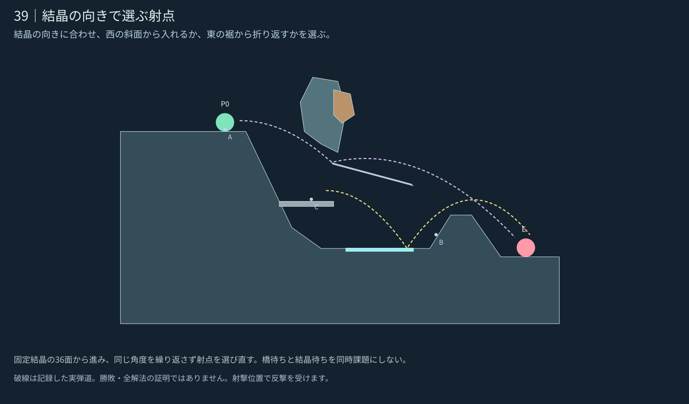

# 39｜結晶の向きで選ぶ射点

**設計承認済み・0.24.1へ統合。** [統合・検証記録](../../../docs/releases/0.24.1.md)。 [5面の一覧へ](README.md)

[現行／改訂の比較](stage_039_compare.svg) · [実ゲームの改訂案](stage_039_actual.png) · [現行0.24.0](stage_039_before.png) · [候補JSON](stage_039_proposal.json)

## 攻略の核

結晶の向きに合わせ、西の斜面から入れるか、東の裾から折り返すかを選ぶ。

向きAは開始点の西岸、向きBは東の裾。橋を中腹へ移し、閉じるとW射撃用の足場、開くと既存の下床への着地と低い射線を遮る面になる。

固定結晶の36面から進み、同じ角度を繰り返さず射点を選び直す。橋待ちと結晶待ちを同時課題にしない。

## 内部確認からの改善

役割の弱かった左端の橋と孤立岸を撤去し、橋を中腹の地盤へ接続。閉じた橋上からW一回反射、開いた後の約96px下の固定床への着地と140px歩行を確認。橋をまたぐ低い射線も開閉で変わる。西岸・東裾のK経路は保持した。

## 地形の役割

- **K：** 既存の90度切替。向きAでは西から、向きBでは東の裾から入れる候補を比較する。
- **西の高岸：** 頭上を開けた第一射点。
- **東の裾：** 結晶の反対側へ回り込む広い支持面。
- **B：** 閉じるとWを使う横長の射撃足場。開くと低い射線を遮り、橋上の機体は既存の下床へ着地する。
- **W：** 西の斜面から入れる一回反射の別解。Kと連続使用しない例を記録。
- **結晶前の庇：** 浅い直射を遮り、K左端へ下向きに入れる低い入口を残す。

## 記録した確認

| 例 | 角度／威力 | 敵ダメージ | 近傍 |
|---|---|---:|---:|
| 西岸・K向きA | 0°／40 | 1.5 | 3/9 |
| 東裾・K向きB | 78°／65 | 1.5 | 5/9 |
| Wだけの別解 | 0°／30 | 1 | 6/9 |

左端の橋と孤立岸を解消し、橋を地盤に接続した。閉じた橋上CからW一回反射（近傍6/9）。開くと約96px下の固定斜面Lへ着地し、そこから140px歩ける。橋をまたぐ低い射線は、閉じた状態では通り、開いた状態ではBに遮られる。敵反撃への防御効果は総合検証時に確認する。

[閉じた橋上C](stage_039_bridge_closed.png) · [開いた後の着地点L](stage_039_bridge_open.png)。実際に転移して橋上に乗せ、境界更新で開閉させた状態資料。敵ターンを経た対戦ではない。

[結晶・橋の姿勢Bの図](stage_039_phase3.svg) · [実ゲーム描画](stage_039_phase3.png)。境界だけ更新した姿勢資料で、実戦経過ではない。

開始位置の安全・見通し遮断・上方の空間・取得物の埋没を確認。近傍の意味と未確認事項は[共通記録](README.md#確認した範囲)を参照。ここまでの図は設計時の限定確認。承認後の敵の反撃・手数内攻略は0.24.1の対戦記録へ分離した。

企画の核は [E18 結晶の向きで選ぶ射点](https://github.com/bittrove88/bittrove88.github.io/blob/review/arcline-map-redesign-handoff-20261105/ARCLINE/design/map_brainstorm/20261106_early_mid_20/README.md) から選択適用し、形状は現行の実装仕様に合わせて新しく制作した。
