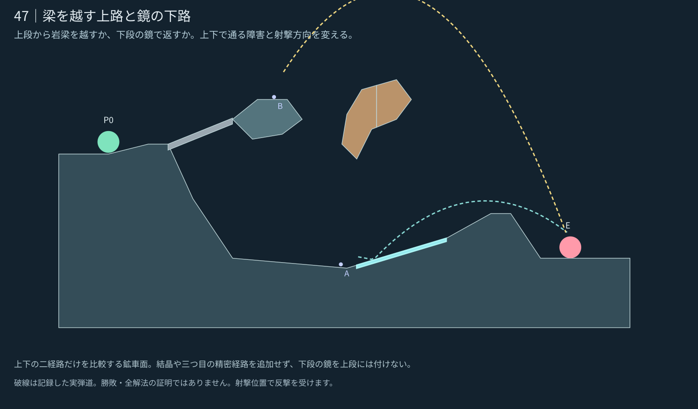

# 47｜梁を越す上路と鏡の下路

**設計レビュー用・本番未反映。** [5面の一覧へ](README.md)

[現行／改訂の比較](stage_047_compare.svg) · [実ゲームの改訂案](stage_047_actual.png) · [現行0.24.0](stage_047_before.png) · [候補JSON](stage_047_proposal.json)

## 攻略の核

上段から岩梁を越すか、下段の鏡で返すか。上下で通る障害と射撃方向を変える。

上段は梁の上へ曲射、下段は傾斜したWから一回反射。Wの横範囲を上段棚・橋と重ねない。

上下の二経路だけを比較する鉱車面。結晶や三つ目の精密経路を追加せず、下段の鏡を上段には付けない。

## 内部確認からの改善

上段棚を短くして下段への入口を広げた。下段Wを緩い上りに沿わせ、東の岩肩を下げて反射後の出口を確保。破壊梁は左端を下げ右端を上げ、上段の直線だけを遮って下段の反射出口を開いた。Wは床だけを覆い、上段と橋には付かない。

## 地形の役割

- **上段：** 広い固定棚から破壊梁の上を越す。梁を壊すと射撃空間も変わる。
- **下段W：** 低い発射点から傾斜鏡へ入れ、一回反射で東の肩を越える。
- **B：** 上段への渡り方と西岸側の遮蔽を変える。下段Wの出口を塞がない。
- **東の岩肩：** 開始点から敵への直射を遮る。上下の弾道が違う高さで越える。

## 記録した確認

| 例 | 角度／威力 | 敵ダメージ | 近傍 |
|---|---|---:|---:|
| 下段W・橋A | -9°／60 | 1 | 3/9 |
| 上段の梁越え・橋A | 57°／55 | 1.5 | 5/9 |
| 下段W・橋B | -9°／60 | 1 | 3/9 |
| 上段の梁越え・橋B | 57°／55 | 1.5 | 5/9 |

開始位置の安全・見通し遮断・上方の空間・取得物の埋没を確認。近傍の意味と未確認事項は[共通記録](README.md#確認した範囲)を参照。敵AI・反撃・手数内攻略を含む対戦検証は未実施。

企画の核は [E20 小さな多経路](https://github.com/bittrove88/bittrove88.github.io/blob/review/arcline-map-redesign-handoff-20261105/ARCLINE/design/map_brainstorm/20261106_early_mid_20/README.md) から選択適用し、形状は現行の実装仕様に合わせて新しく制作した。
