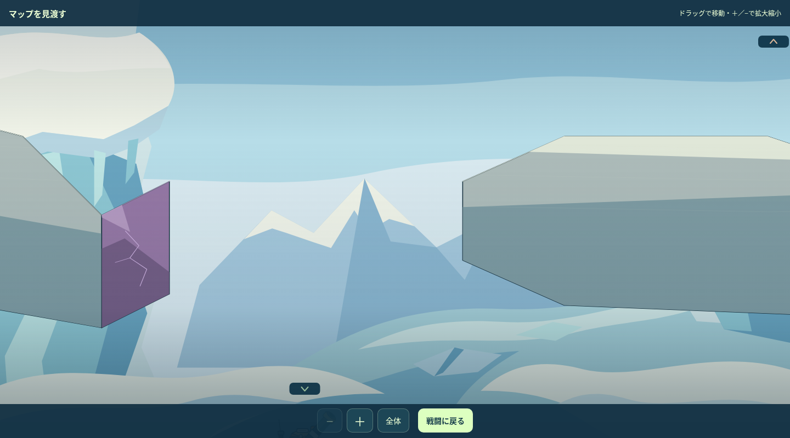
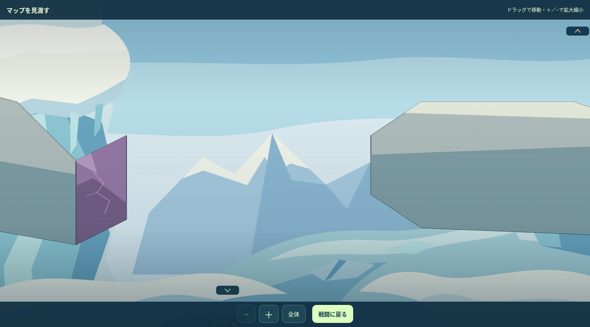
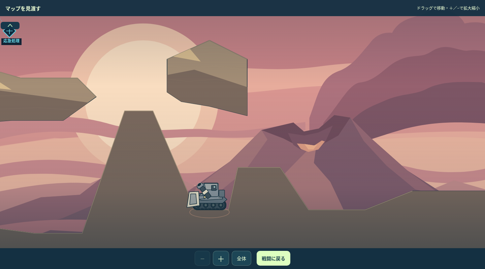
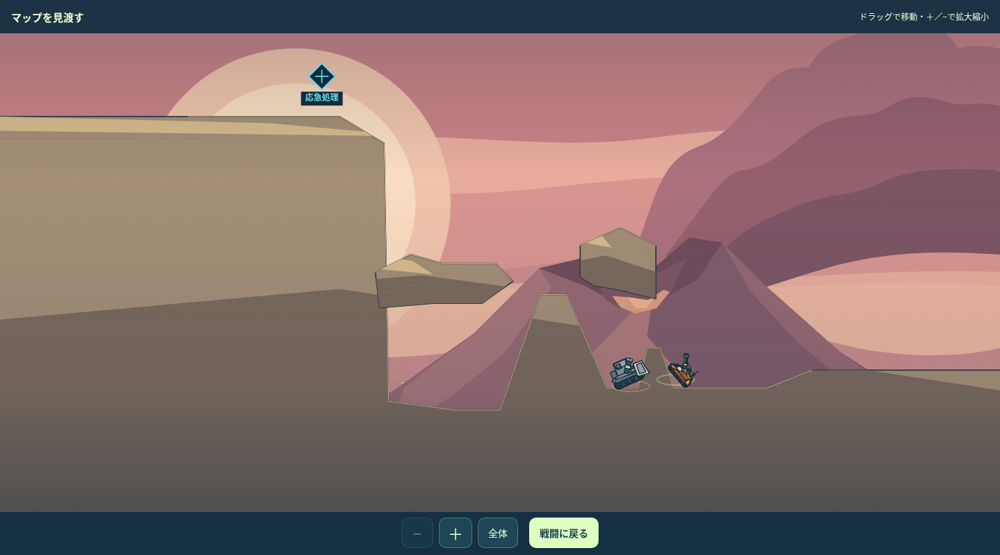
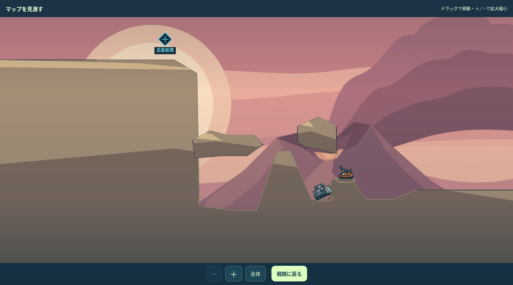
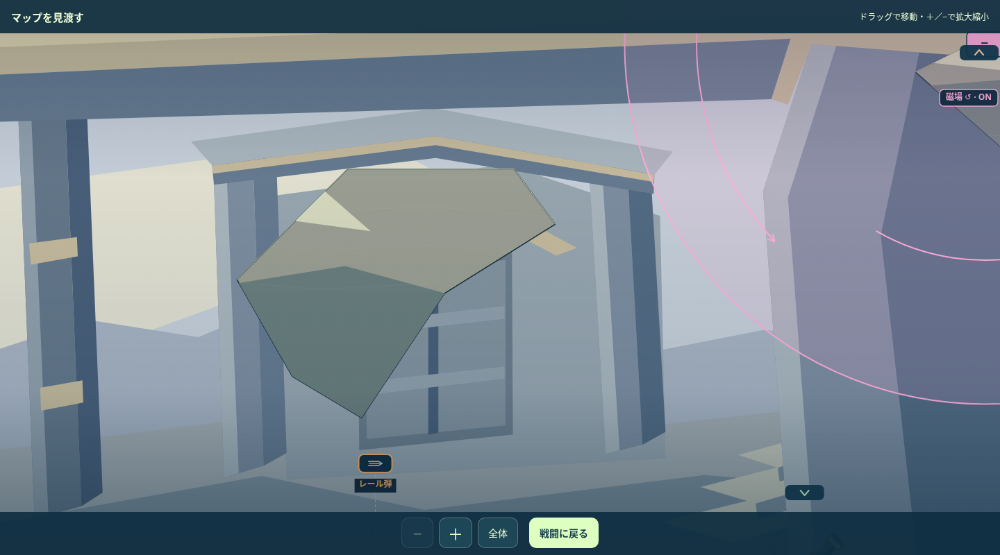
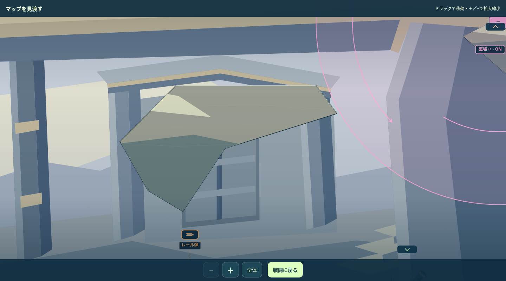
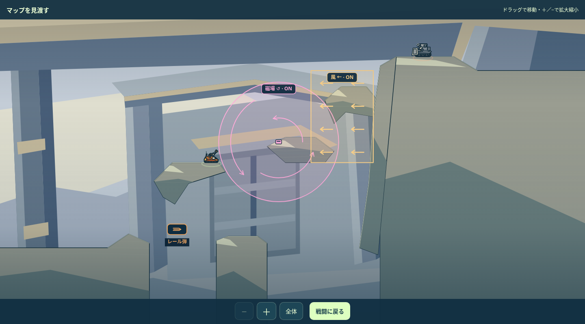

# ARCLINE｜影響の小さい3面の調整・まとめ確認

2026-11-07／現行0.24.1基準。**58・64・92面を、一面ずつ制作 → 実ゲーム描画 → 内部確認 → 改善 → 限定再検証まで実施。まとめてデザイン確認待ち。**

ゲーム正本・生成物・版数は未変更。候補JSONを実エンジンへ一時的に読み込んで描画・操作したレビューです。全100面の案は[個別改善案](../MAP_IMPROVEMENT_PROPOSALS_001_100_20261107.md)を参照。

[比較画面](index.html)／[記録例の再生結果](minimum_checks.json)

## 今回の変更

| 面 | 小さく変えた部分 | 確認した効果 |
|---:|---|---|
| 58 | 中層西端を30px引き、開口を260→290pxへ。 | 既存の上層への転移・着地位置・反撃結果と、その後の通常弾を維持。 |
| 64 | 右側の水平部を30→90pxへ。右の上りは71.6→56.3度。 | 同じ転移・歩行入力で、斜面で止まっていた状態から水平な射点へ到達。 |
| 92 | 西の棚の水平部を120→200pxへ。 | 同じ転移入力の着地後の車体角が約53度→0度。磁場・風を使う通常弾も確認。 |

**各面とも既存形状の2頂点の横座標だけを変更。計6頂点。** 高さ・自機と敵の初期配置・ギミックの位置／種類／周期・取得物・HP・行動上限・AI・物理・保存を保持しています。最大の頂点移動は58面30px、64面90px、92面80pxです。値はゲーム内の座標であり、画像上のピクセル数ではありません。

## 58｜ずれた氷裂の三層洞

中層西端を30px引き、開口を260→290pxへ。 既存の上層への転移・着地位置・反撃結果と、その後の通常弾を維持。

中層西端は30px短くなります。中央の広い受け面、上層、破壊片、風は保持しています。

| 現行・拡大 | 調整案・拡大 |
|---|---|
|  |  |

[現行全景](stage_058_before.png)／[調整案全景](stage_058_after.png)／[候補データと限定確認](stage_058_proposal.json)

内部改善では、受け面を張り出す案が従来の上層への転移を遮ったため撤回。最終案は岩先を引いて通過する開口だけを広げました。従来の転移入力66／100で同じ上層へ着地することを再確認しています。

## 64｜崖下盆地の裏へ回る

右側の水平部を30→90pxへ。右の上りは71.6→56.3度。 同じ転移・歩行入力で、斜面で止まっていた状態から水平な射点へ到達。

原形の大きな崖と庇、敵の位置、左高所からの射撃を保ち、右側の床だけを調整しています。

| 現行・拡大 | 調整案・拡大 |
|---|---|
|  |  |

[現行全景](stage_064_before.png)／[調整案全景](stage_064_after.png)／[候補データと限定確認](stage_064_proposal.json)

同じ転移入力で、敵の反撃を1回経た状態の比較です。64面では同じ短い歩行入力も実行しています。

| 現行・実入力後 | 調整案・実入力後 |
|---|---|
|  |  |

記録例では、反撃で自機に1.05の内部ダメージが発生しています。変更は無敵の足場を作るものではなく、反撃後に水平な位置を取れる改善です。取得物SK064は同じ入力で接触を確認しています。

## 92｜折り返す保全棚の使い分け

西の棚の水平部を120→200pxへ。 同じ転移入力の着地後の車体角が約53度→0度。磁場・風を使う通常弾も確認。

棚の高さと下側の役割を維持し、右端だけを80px延長しています。

| 現行・拡大 | 調整案・拡大 |
|---|---|
|  |  |

[現行全景](stage_092_before.png)／[調整案全景](stage_092_after.png)／[候補データと限定確認](stage_092_proposal.json)

同じ転移入力で、敵の反撃を1回経た状態の比較です。64面では同じ短い歩行入力も実行しています。

| 現行・実入力後 | 調整案・実入力後 |
|---|---|
|  |  |

転移入力84／70の角度±2・出力±3の固定9例では、西棚の水平部への着地が0/9→6/9でした。人の成功率・勝率の測定ではありません。取得物W14は同じ入力で接触を確認しています。

## 今回は見送ったもの

53面は低棚の水平部を広げて実描画・着地・反撃後の射撃を確認しましたが、受け面だけの小変更でK経路の利点が増したとは確認できず、採用候補から除外しました。現行K経路が不可能だと断定する検証ではありません。15・45面の部位と射点の見直し、84面の開始位置変更も、この小変更のまとまりには含めません。

## 確認した範囲

- 新規の専用回帰テストや全件対戦は追加していません。共通の再生スクリプトで、3面それぞれの現行／候補について、記録した転移 → 敵の自律反撃 → 必要な短い歩行 → 通常弾一発を再生しています。Gun／Normal／seed4697、入場在庫なし、有限武器・スキルは使用していません。
- 初期の支持・めり込み、形状の自己交差、変更範囲、元データと候補の一致を確認。64の従来の上からの射撃、64・92の既存取得物への接触も保持。敵の反撃込み勝利や全別解・全難易度の確認は、まとめ確認後の正本反映・最終検証へ残します。
- 実ゲームの全景・拡大・入力後の姿勢を内部確認済み。拡大図は同じ描画処理のカメラ位置を変更したものです。矢印などの周期表示が入力後に変わるのは実際に敵手番と境界処理を経たためで、ギミック仕様の変更ではありません。

リポジトリルートから記録例だけを再生できます。探索・全件戦闘は行いません。

```sh
node ARCLINE/design/stage_reviews/low_impact_20261107/replay_recorded_examples.cjs
```

この3面の形状と調整量をまとめて確認するための資料です。設計承認・正本への反映・本番公開はそれぞれ別に記録します。
