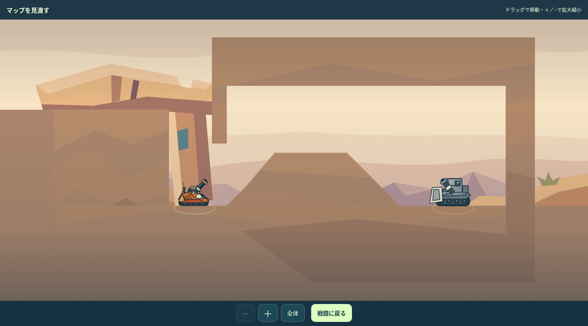
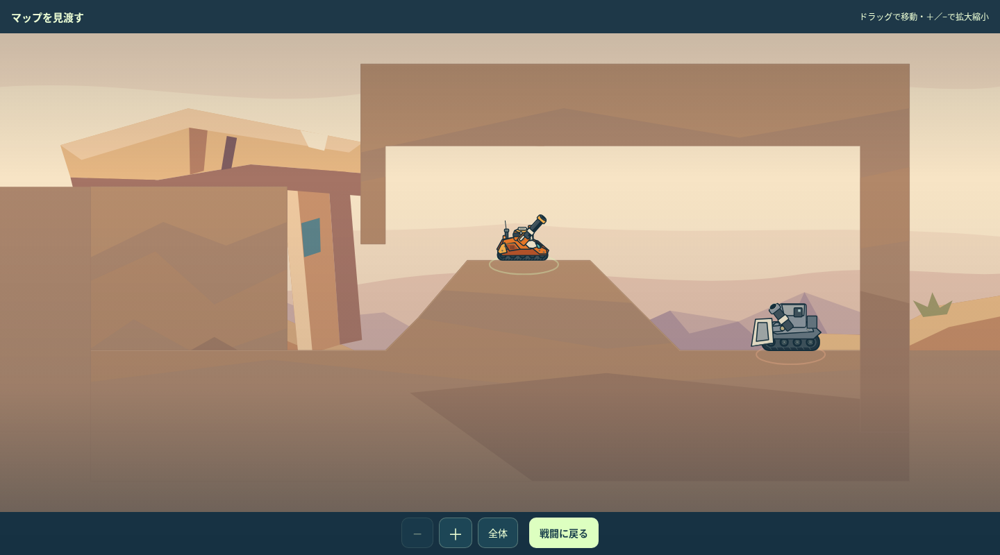

# 敵側の天井と16面の修正レビュー

2026-11-07／PR115・0.25.0候補。前回レビュー版e3e4a4aからの修正。2026-11-07にユーザー承認を受領。

[実画面で比較](index.html) · [19面全体](../README.md) · [限定確認の記録](REVIEW.json)

敵の屋根・ブロックが近い11面を、一面ずつ制作・実ゲーム描画・確認・改善した。自機が収まる寸法だけで判断せず、砲口と弾道、周囲への転移の余裕を広げた。64面は敵の足元から天井まで220pxあり、58・92面などとともに追加変更していない。

| 面 | 今回の修正 | 足元から天井まで（前→後） |
|---|---|---:|
| 3 | 入口の低い張り出しを保ち、奥の空間を広げた。歩いて前へ出ると低い角度で狙える。 | 87.2 → 184.4px |
| 4 | 岬の上の岩を下面から削った。裏岸へ転移する経路を保持。 | 110 → 190px |
| 7 | 岩門の一片を壊す入口は保持し、奥の天井を削った。 | 115 → 195px |
| 8 | 敵側の屋根を削り、反射面を前方の斜めの下面へ絞った。一回返して下へ送る。 | 153.3 → 196.1px |
| 16 | 敵側の天井を広げ、岩肩を追加。低所から曲射するか、中腹へ転移して低く撃つかを選ぶ。 | 110 → 250px |
| 18 | 入口の梁高を保ち、奥の下面を持ち上げた。登って前へ出る射点を保持。 | 95.7 → 207.8px |
| 19 | 敵側の岩を上へ移し、高い中継棚から狙う経路を保持。 | 120 → 200px |
| 23 | 雲の出口側の張り出しを保ち、敵側の下面を削った。雲を通す入力は維持。 | 106.3 → 196.3px |
| 26 | 右の庇だけ上へ移し、下の鏡棚への入射と反射後の出口を保持。 | 110 → 190px |
| 27 | 格納庫の庇を上へ移した。雲を通す射撃と、歩いて雲を抜けた射撃を選べる。 | 128.8 → 208.8px |
| 29 | 敵側の庇を上へ移した。中継デッキの手前に遮蔽を設け、遠側へ転移して同高度から狙う利点を残した。 | 72.5 → 182.5px |

距離は敵の開始位置における垂直の足元〜天井。車体上端の余白とは異なる。数値を全マップへ一律適用する基準にはしない。

## 16面の二つの選択

- **低所から曲射：** 門を壊して降り、岩肩に直射を遮られる位置から弧を通す。54°/55の周囲9入力中5入力で命中。
- **中腹へ転移：** 降りた後にもう一手使って岩肩の上へ移る。−12°/60の周囲9入力中9入力で命中する一方、準備中の敵手番でダメージを受ける。

両ルートとも通常弾・Gun・開始在庫なし・固定seed4697で、敵の実手番を含め勝利まで確認した。低所は5行動、中腹は5行動。どちらも残HP5だった。近傍入力数は限定的な狙いの余裕であり、人の勝率ではない。

## 検証と反映範囲

修正11面のNormal実戦を記録し直し、16面の別ルートを追加。19面のNormal19戦＋16面の別ルート1戦＋後半Hard3戦で計23戦。今回形状を変えていない8面とHard3戦の入力記録は保持。未変更81面はmain0.24.3と完全一致を検査する。HP・AI・弾道・行動数・在庫・保存の仕様は変更していない。

面ごとの専用回帰テストは追加せず、既存の単体・生成整合性・影響箇所のブラウザチェックを最後にまとめて実行する。実機と人の初見プレイは未確認。変更後レビュー承認済み。本番マージ・公開は未実施。
