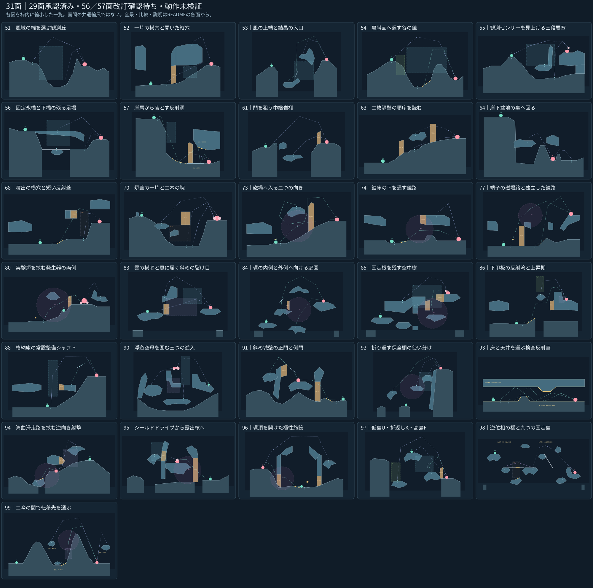

# ARCLINE｜残り31面の一括設計レビュー

**31面を個別に制作・Chromiumで実描画・内部確認・必要な改善・再確認まで完了。今回の31面は全件未承認・動作未検証。** 承認済み18面の設計とゲーム本体は変更していない。設計と承認状態は別で、これにより全49面が承認されたとは扱わない。

[全31面の一覧画像](OVERVIEW_31.svg) ／ [ローカルで開くレビュー画面](gallery.html) ／ [横断した差別化の確認](DIVERSITY_REVIEW.md)

制作は一面ずつ進め、完成した面から次面へ移った。前の面の座標・輪郭を次面のひな形として使わず、各面自身の旧JSONとレビューを起点にした。個別の実射・実歩行・転移・AI検証は追加せず、形状、支持、代表位置、直射の遮断、構想射撃空間、Bの必要な二状態を最低限確認した。77面は横断確認でT/M側とW側をさらに分離し、再描画した。

**破線は構想空間で、実弾道・転移成功・勝利の記録ではない。** 射撃後はその位置で敵の反撃を受ける。通常歩行は左右累計140pxで、転移・破壊・端子操作・待機の手数は無料にしない。総合動作検証は全49面の設計承認後にまとめて行う。

## 各面のレビュー

| 面 | 全景 | プレイヤーの判断 | 比較・説明・座標 |
|---|---|---|---|
| 51 | [風域の端を選ぶ観測丘](stage_051_full.svg) | 130pxの山肩移動と、風域を外す谷出口を比較する。 | [旧比較](stage_051_compare.svg) ／ [レビュー](stage_051_review.md) ／ [JSON](stage_051_proposal.json) |
| 52 | [一片の横穴と開いた縦穴](stage_052_full.svg) | 横穴を壊して低く通すか、開いた縦穴から断崖上へ出る。 | [旧比較](stage_052_compare.svg) ／ [レビュー](stage_052_review.md) ／ [JSON](stage_052_proposal.json) |
| 53 | [風の上端と結晶の入口](stage_053_full.svg) | 高棚で風を避けるか、低棚からKと風を使う。 | [旧比較](stage_053_compare.svg) ／ [レビュー](stage_053_review.md) ／ [JSON](stage_053_proposal.json) |
| 54 | [裏斜面へ返す谷の鏡](stage_054_full.svg) | 非対称な二峰の背後へ、風の山越えか谷のW反射を送る。 | [旧比較](stage_054_compare.svg) ／ [レビュー](stage_054_review.md) ／ [JSON](stage_054_proposal.json) |
| 55 | [観測センサーを見上げる三段要塞](stage_055_full.svg) | 上段から高いセンサー、中段から装甲の縁、下段から側方の開口を狙う。 | [旧比較](stage_055_compare.svg) ／ [レビュー](stage_055_review.md) ／ [JSON](stage_055_proposal.json) |
| 56 | [固定氷橋と下橋の残る足場](stage_056_full.svg) | 下橋が開いても固定桟橋に残れることを読み、横断と射撃を分ける。 | [旧比較](stage_056_compare.svg) ／ [レビュー](stage_056_review.md) ／ [JSON](stage_056_proposal.json) ／ [周期2](stage_056_phase2.svg) |
| 57 | [崖肩から落とす反射洞](stage_057_full.svg) | 崖肩の銃口を外へ出し、落差を使って床Wへ落とす。 | [旧比較](stage_057_compare.svg) ／ [レビュー](stage_057_review.md) ／ [JSON](stage_057_proposal.json) |
| 61 | [門を狙う中継岩棚](stage_061_full.svg) | 門前へ渡る準備と、高尾根から門を越す照準を比較する。 | [旧比較](stage_061_compare.svg) ／ [レビュー](stage_061_review.md) ／ [JSON](stage_061_proposal.json) |
| 63 | [二枚隔壁の順序を読む](stage_063_full.svg) | 手前を開いて途中射点を作り、奥の片を狙う。高棚なら手前を迂回する。 | [旧比較](stage_063_compare.svg) ／ [レビュー](stage_063_review.md) ／ [JSON](stage_063_proposal.json) |
| 64 | [崖下盆地の裏へ回る](stage_064_full.svg) | 上から開口へ落とすか、盆地の右裏へ回って左向きに低く送る。 | [旧比較](stage_064_compare.svg) ／ [レビュー](stage_064_review.md) ／ [JSON](stage_064_proposal.json) |
| 68 | [噴出の横穴と短い反射蓋](stage_068_full.svg) | 常設の下側横穴を進んで噴出口から送るか、上の一片を開いてWで短く返す。 | [旧比較](stage_068_compare.svg) ／ [レビュー](stage_068_review.md) ／ [JSON](stage_068_proposal.json) ／ [周期2](stage_068_phase2.svg) |
| 70 | [炉蓋の一片と二本の腕](stage_070_full.svg) | 炉上から奥の腕、噴出の出口から手前の腕へ入れる角度を選ぶ。 | [旧比較](stage_070_compare.svg) ／ [レビュー](stage_070_review.md) ／ [JSON](stage_070_proposal.json) ／ [周期2](stage_070_phase2.svg) |
| 73 | [磁場へ入る二つの向き](stage_073_full.svg) | 下段から横に入るか、高棚から折り返して同じ磁場へ入る。 | [旧比較](stage_073_compare.svg) ／ [レビュー](stage_073_review.md) ／ [JSON](stage_073_proposal.json) |
| 74 | [鉱床の下を通す鏡路](stage_074_full.svg) | 床の鏡から鉱床の下へ通すか、鉱床上から右の出口へ落とす。 | [旧比較](stage_074_compare.svg) ／ [レビュー](stage_074_review.md) ／ [JSON](stage_074_proposal.json) |
| 77 | [端子の磁場路と独立した鏡路](stage_077_full.svg) | 開始近くでTとMを選ぶか、横扉の先のWへ移って反射する。二経路を同じ弾の必須連鎖にしない。 | [旧比較](stage_077_compare.svg) ／ [レビュー](stage_077_review.md) ／ [JSON](stage_077_proposal.json) |
| 80 | [実験炉を挟む発生器の両側](stage_080_full.svg) | 炉と磁場の間から始め、左の制御域へ戻るか、右の点検床へ渡る。 | [旧比較](stage_080_compare.svg) ／ [レビュー](stage_080_review.md) ／ [JSON](stage_080_proposal.json) |
| 83 | [雲の横窓と風に届く斜めの裂け目](stage_083_full.svg) | 横窓から雲を長く通すか、斜めの裂け目から雲の上端を越えて風へ入れる。 | [旧比較](stage_083_compare.svg) ／ [レビュー](stage_083_review.md) ／ [JSON](stage_083_proposal.json) |
| 84 | [環の内側と外側へ向ける庭園](stage_084_full.svg) | 下の島から中央Mへ向けるか、左の島から外向きのKへ向ける。 | [旧比較](stage_084_compare.svg) ／ [レビュー](stage_084_review.md) ／ [JSON](stage_084_proposal.json) |
| 85 | [固定根を残す空中樹](stage_085_full.svg) | 根橋上からFを横切る弧で給水ユニットへ入れるか、根先の開口からMで撃ち上げる。 | [旧比較](stage_085_compare.svg) ／ [レビュー](stage_085_review.md) ／ [JSON](stage_085_proposal.json) |
| 86 | [下甲板の反射湾と上昇棚](stage_086_full.svg) | 作業桁の下を通した反射弾を雲へ入れるか、上昇棚からUで船外へ送る。 | [旧比較](stage_086_compare.svg) ／ [レビュー](stage_086_review.md) ／ [JSON](stage_086_proposal.json) |
| 88 | [格納庫の常設整備シャフト](stage_088_full.svg) | 開いた整備口の底からFへ入れるか、東庇の上からKの角度を使う。 | [旧比較](stage_088_compare.svg) ／ [レビュー](stage_088_review.md) ／ [JSON](stage_088_proposal.json) |
| 90 | [浮遊空母を囲む三つの進入](stage_090_full.svg) | 船尾の上向き弧、中央通路の射出口、船首砲座上からの浅い弧を使い分ける。 | [旧比較](stage_090_compare.svg) ／ [レビュー](stage_090_review.md) ／ [JSON](stage_090_proposal.json) |
| 91 | [斜め城壁の正門と側門](stage_091_full.svg) | 右の正門だけを開いて床Wで返すか、左の側門だけを開いてKから落とす。 | [旧比較](stage_091_compare.svg) ／ [レビュー](stage_091_review.md) ／ [JSON](stage_091_proposal.json) |
| 92 | [折り返す保全棚の使い分け](stage_092_full.svg) | 中央下から西のM入口へ戻るか、東の風棚へ進む。必要な棚だけを選ぶ。 | [旧比較](stage_092_compare.svg) ／ [レビュー](stage_092_review.md) ／ [JSON](stage_092_proposal.json) |
| 93 | [床と天井を選ぶ検査反射室](stage_093_full.svg) | 左から右へ、天井→床の二反射か、床→天井→床の三反射を構想する。 | [旧比較](stage_093_compare.svg) ／ [レビュー](stage_093_review.md) ／ [JSON](stage_093_proposal.json) |
| 94 | [湾曲滑走路を挟む逆向き射撃](stage_094_full.svg) | 右の高い構造材から雲を通して外板の一片へ落とすか、左船首へ回りWとMから逆向きに送る。 | [旧比較](stage_094_compare.svg) ／ [レビュー](stage_094_review.md) ／ [JSON](stage_094_proposal.json) |
| 95 | [シールドドライブから露出核へ](stage_095_full.svg) | 右下Mで既存のシールドドライブを狙い、破壊後は左の風窓から同座標の露出核へ角度を変える。 | [旧比較](stage_095_compare.svg) ／ [レビュー](stage_095_review.md) ／ [JSON](stage_095_proposal.json) |
| 96 | [環頂を開けた極性施設](stage_096_full.svg) | 環の内側から西門を一片開きW/Mをつなぐか、開いた環頂から外周棚へ出る。 | [旧比較](stage_096_compare.svg) ／ [レビュー](stage_096_review.md) ／ [JSON](stage_096_proposal.json) |
| 97 | [低島U・折返しK・高島F](stage_097_full.svg) | 低島からUで開始島を越すか、中段からKへ一度逆向きに入れるか、高島からFと窓を使う。 | [旧比較](stage_097_compare.svg) ／ [レビュー](stage_097_review.md) ／ [JSON](stage_097_proposal.json) |
| 98 | [逆位相の橋と九つの固定島](stage_098_full.svg) | 西の橋が水平な間に中継へ渡り、東の橋が下降した間の降下帯を使う。次の状態では東側の独立低島を選ぶ。 | [旧比較](stage_098_compare.svg) ／ [レビュー](stage_098_review.md) ／ [JSON](stage_098_proposal.json) ／ [周期2](stage_098_phase2.svg) ／ [状態A/B](stage_098_states.svg) |
| 99 | [二峰の間で転移先を選ぶ](stage_099_full.svg) | 中央の短い中継島、谷の低い鏡島、敵側の外周高所から、弧・W/C/M・逆向き射撃を選ぶ。 | [旧比較](stage_099_compare.svg) ／ [レビュー](stage_099_review.md) ／ [JSON](stage_099_proposal.json) |

## 専用コンセプトと判断が必要な変更

- **93面：** 左開始・右敵の上下全面反射室。床Wと固定ポリゴンのreflectiveUndersideを用い、最小内高140px・通常220px。V/Kは主題と独立した役割を作れないため削除を提案。天井外殻上面にもWが作用することは明示し、室内経路には使わない。
- **98面：** 九つの固定島と逆位相のB二本。状態1で開く中央射点の降下帯・西中継は、状態2でそれぞれB2・B1に遮られる。これは静的交差の確認であり命中証明ではない。東の固定低島が代替候補。V/Wは任意補助として残し、B1水平時の一部W化も意図した配置。Uや新スイッチは追加していない。
- **99面：** 自然な非対称二峰と、中央中継・低い鏡島・敵側外周の三種類の転移候補。旧案の内側、W/C/M複合、外周逆向き射撃を屋外へ継承し、巨大核空洞や隔壁は引き継がない。

## 確認範囲と引継ぎ

JSONと図の地形・部品・ギミック・初期位置を照合。代表位置の支持と明白なめり込み、部品ID、自己交差、構想空間を確認し、各面の実描画で修正点を記録した。98面は二橋の二姿勢を同縮尺で並べ、状態による遮断を確認。敵種、HP欄、行動上限、推奨キャラ、誤差・ダメージ係数、歩行上限、既存取得物データは元案から維持。ボスの本体・部位HPと攻撃は既存定義を使用する。

残るのは実歩行、実際の転移着地、砲身と弾の通路、反射・領域の実作用、命中の許容幅、敵の移動・AI・反撃、装備・複数条件での手数内勝利。旧形状の試験記録を新形状の成功証拠には使わない。取得物には元からの再検証指定を維持している。図と候補JSONはゲームへ自動適用していない。

座標は1単位10px、上向きをhとして記載。複数地盤はafter.floorsとblueprintCandidate.floorSegmentsを参照。全取得物はafter.pickupsと候補JSONに保持。gallery.htmlはフォルダ一式をダウンロードしてブラウザで開ける。GitHubではこのREADMEとSVGを直接参照できる。内部用の生成・確認スクリプト、個別テスト群は提出物へ追加していない。

## 制作正本

[正式指示書](https://github.com/bittrove88/bittrove88.github.io/blob/review/arcline-map-redesign-handoff-20261105/ARCLINE/design/stage_reviews/ARCLINE_MAP_DESIGN_SINGLE_SOURCE_OF_TRUTH_20261106.md) ／ [難度別企画精査](https://github.com/bittrove88/bittrove88.github.io/blob/review/arcline-map-redesign-handoff-20261105/ARCLINE/design/map_brainstorm/MAP_IDEA_DIFFICULTY_REVIEW_JA.md) ／ [面別起点](https://github.com/bittrove88/bittrove88.github.io/blob/review/arcline-map-redesign-handoff-20261105/ARCLINE/design/stage_reviews/PR74_IN_PROGRESS_STAGE_SOURCE_INDEX_20261106.md)

93・98・99面は各専用企画も参照した。正式指示書の一案優先を適用し、今回の会話で承認された「一面ずつ仕上げ、最終レビューを一括」に従った。過去資料の一面ごとの承認待ちへ進行を戻していない。

## 変更していない承認済み18面

承認状態の基点は62面v2承認を含むfa7bcc7877cefe1fb3a6a5d3289941ded504da0d。75面はA v4。PRのマージ状態と設計承認を混同せず、いずれも総合動作検証は別工程。

| 面 | 維持する版 | 参照 |
|---|---|---|
| 58 | v5 | [承認基点の設計](https://github.com/bittrove88/bittrove88.github.io/blob/fa7bcc7877cefe1fb3a6a5d3289941ded504da0d/ARCLINE/design/stage_reviews/stage_058_proposal_v5.json) |
| 59 | v5 | [承認基点の設計](https://github.com/bittrove88/bittrove88.github.io/blob/fa7bcc7877cefe1fb3a6a5d3289941ded504da0d/ARCLINE/design/stage_reviews/stage_059_proposal_v5.json) |
| 60 | v4 | [承認基点の設計](https://github.com/bittrove88/bittrove88.github.io/blob/fa7bcc7877cefe1fb3a6a5d3289941ded504da0d/ARCLINE/design/stage_reviews/stage_060_proposal_v4.json) |
| 62 | v2 | [承認基点の設計](https://github.com/bittrove88/bittrove88.github.io/blob/fa7bcc7877cefe1fb3a6a5d3289941ded504da0d/ARCLINE/design/stage_reviews/stage_062_proposal_v2.json) |
| 65 | v3 | [承認基点の設計](https://github.com/bittrove88/bittrove88.github.io/blob/fa7bcc7877cefe1fb3a6a5d3289941ded504da0d/ARCLINE/design/stage_reviews/stage_065_proposal_v3.json) |
| 66 | v4 | [承認基点の設計](https://github.com/bittrove88/bittrove88.github.io/blob/fa7bcc7877cefe1fb3a6a5d3289941ded504da0d/ARCLINE/design/stage_reviews/stage_066_proposal_v4.json) |
| 67 | v4 | [承認基点の設計](https://github.com/bittrove88/bittrove88.github.io/blob/fa7bcc7877cefe1fb3a6a5d3289941ded504da0d/ARCLINE/design/stage_reviews/stage_067_proposal_v4.json) |
| 69 | v2 | [承認基点の設計](https://github.com/bittrove88/bittrove88.github.io/blob/fa7bcc7877cefe1fb3a6a5d3289941ded504da0d/ARCLINE/design/stage_reviews/stage_069_proposal_v2.json) |
| 71 | v5 | [承認基点の設計](https://github.com/bittrove88/bittrove88.github.io/blob/fa7bcc7877cefe1fb3a6a5d3289941ded504da0d/ARCLINE/design/stage_reviews/stage_071_proposal_v5.json) |
| 72 | v4 | [承認基点の設計](https://github.com/bittrove88/bittrove88.github.io/blob/fa7bcc7877cefe1fb3a6a5d3289941ded504da0d/ARCLINE/design/stage_reviews/stage_072_proposal_v4.json) |
| 75 | A v4 | [承認基点の設計](https://github.com/bittrove88/bittrove88.github.io/blob/fa7bcc7877cefe1fb3a6a5d3289941ded504da0d/ARCLINE/design/stage_reviews/stage_075_proposal_v4.json) |
| 76 | v5 | [承認基点の設計](https://github.com/bittrove88/bittrove88.github.io/blob/fa7bcc7877cefe1fb3a6a5d3289941ded504da0d/ARCLINE/design/stage_reviews/stage_076_proposal_v5.json) |
| 78 | v2 | [承認基点の設計](https://github.com/bittrove88/bittrove88.github.io/blob/fa7bcc7877cefe1fb3a6a5d3289941ded504da0d/ARCLINE/design/stage_reviews/stage_078_proposal_v2.json) |
| 79 | v3 | [承認基点の設計](https://github.com/bittrove88/bittrove88.github.io/blob/fa7bcc7877cefe1fb3a6a5d3289941ded504da0d/ARCLINE/design/stage_reviews/stage_079_proposal_v3.json) |
| 81 | v2 | [承認基点の設計](https://github.com/bittrove88/bittrove88.github.io/blob/fa7bcc7877cefe1fb3a6a5d3289941ded504da0d/ARCLINE/design/stage_reviews/stage_081_proposal_v2.json) |
| 82 | v2 | [承認基点の設計](https://github.com/bittrove88/bittrove88.github.io/blob/fa7bcc7877cefe1fb3a6a5d3289941ded504da0d/ARCLINE/design/stage_reviews/stage_082_proposal_v2.json) |
| 87 | v2 | [承認基点の設計](https://github.com/bittrove88/bittrove88.github.io/blob/fa7bcc7877cefe1fb3a6a5d3289941ded504da0d/ARCLINE/design/stage_reviews/stage_087_proposal_v2.json) |
| 89 | v2 | [承認基点の設計](https://github.com/bittrove88/bittrove88.github.io/blob/fa7bcc7877cefe1fb3a6a5d3289941ded504da0d/ARCLINE/design/stage_reviews/stage_089_proposal_v2.json) |
