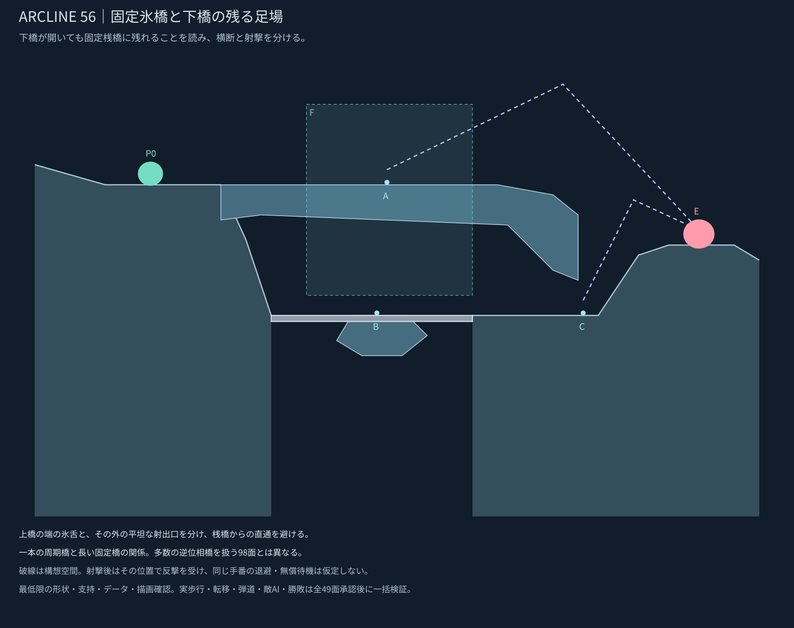
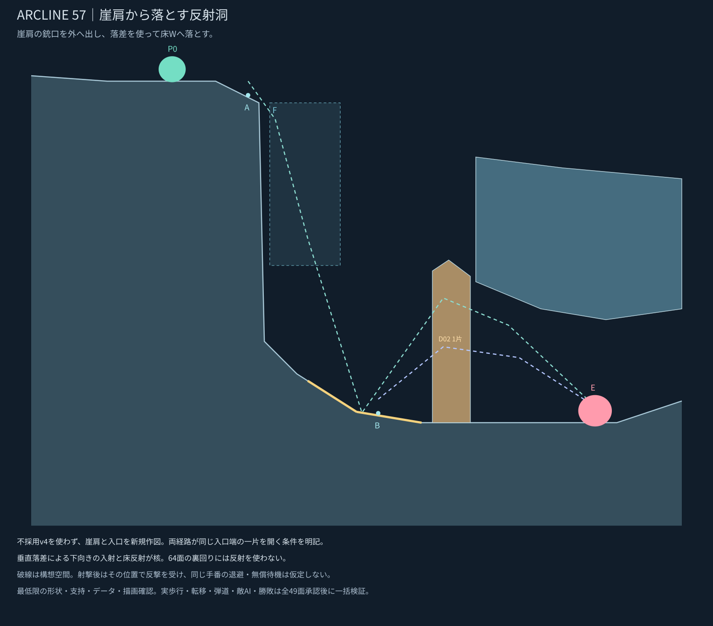

# 56・57面｜画像指示による部分修正

指定された箇所を修正し、実描画・内部確認・最低限の形状再確認を完了。他29面は「他はok」に基づき設計承認を記録し、地形・ギミック等のデータを維持した。

## 56面

左の橋接合部の下側と、右下の氷舌先端を削った。橋の二姿勢、固定桟橋、射点と初期位置は維持。

[前提示版との比較](stage_056_compare.svg) ／ [周期2](stage_056_phase2.svg) ／ [座標](stage_056_proposal.json)

## 57面

崖肩の上角と屋根左下を削り、青線位置の床と天井下面へ反射面を追加。削った部分にあった候補Aは手前の支持面へ移動した。自機・敵の初期位置、入口一片、既存の風と床Wは維持。

床の板は既存の水平Kを床へ固定し、天井は既存reflectiveUndersideを使用。指定されていない屋根上面を反射化しない。実際の衝突面の位置と種類だけを軽量確認し、実弾道・命中の成功とは扱わない。

[前提示版との比較](stage_057_compare.svg) ／ [座標](stage_057_proposal.json)

[29面の承認記録](APPROVAL_29_20261107.md) ／ [全体一覧](README.md)

設計承認と実動作検証は別工程。全49面の設計承認後に詳細検証をまとめ、今回ゲーム本体への適用・マージ・公開は行っていない。
