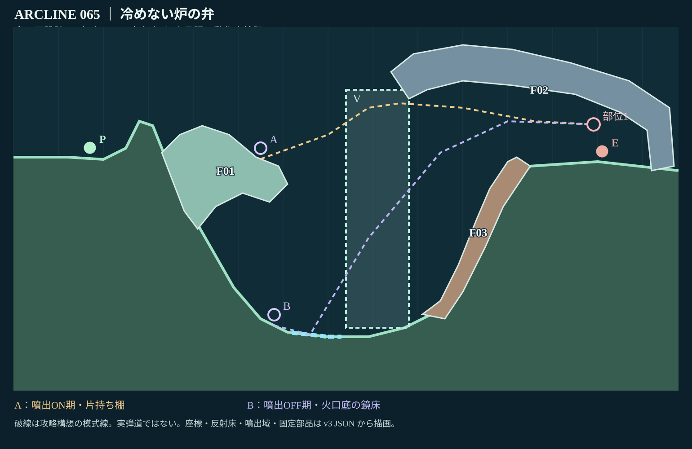
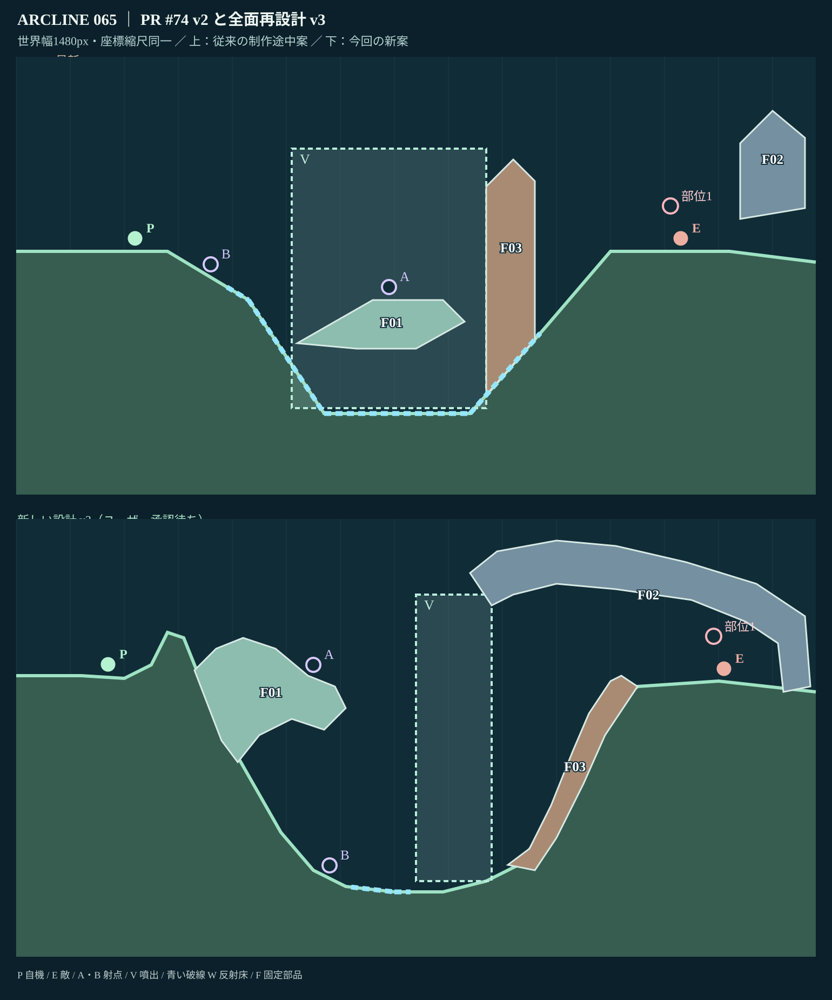

# STAGE 065｜冷めない炉の弁｜全面再設計 v3

**状態：設計レビュー待ち（R指定／未承認／総合動作未検証）**　2026-11-06

参照：PR #74 [最新設計 v2](stage_065_proposal_v2.json)・[個別レビュー](stage_065_review_v2.md)・[全49面の継承インデックス](https://github.com/bittrove88/bittrove88.github.io/blob/review/arcline-map-redesign-handoff-20261105/ARCLINE/design/stage_reviews/PR74_IN_PROGRESS_STAGE_SOURCE_INDEX_20261106.md)・[65面のR指定](https://github.com/bittrove88/bittrove88.github.io/blob/review/arcline-map-redesign-handoff-20261105/ARCLINE/design/stage_reviews/STAGE_051_099_REDESIGN_BRIEFS_20261105.md)・[マップ改訂必達事項](https://github.com/bittrove88/bittrove88.github.io/blob/review/arcline-map-redesign-handoff-20261105/ARCLINE/design/stage_reviews/MAP_DESIGN_NONNEGOTIABLE_REQUIREMENTS_20261106.md)。

実装規則の出典：`ARCLINE/design/expedition_013/stage_blueprints.json` stage65 ／ `game/tools/build_campaign.py` ／ `game/dist/geometry.js`。**ゲーム本体は未変更。** 新[座標JSON](stage_065_proposal_v3.json)の`after`は描画用、`blueprintCandidate`は正本へ移せる構造の設計候補。承認前にゲーム本体へ反映しない。

## 全体図と比較

**図の限界：** 現行 `geometry.js` とレビューギャラリーの床・部品の座標解釈（x×10／y＝500−h×10）を使用した**設計図レンダリング**。実ゲームを起動したスクリーンショットではない。線は経路の模式図であり、命中・移動の実証ではない。

## 継承・刷新・判断

**旧案から継承：** 火口の世界観、噴出V（初期OFF・周期切替）、反射床W、中ボス `midboss:cinder-chef`、圧力弁、行動上限24、噴出上向きと火口底反射を別経路とする狙い。敵能力・部位耐久は変更しない。

**再設計理由：** PR v2はP0からの条件付き通常命中が残り、3つの部品（小棚／炉壁／岩脊）と広すぎるV/Wが、噴出を使う必要性を弱めていた。座標の局所修正ではなく、火口の使い方から設計をやり直した。

**ラフA案：** 火口周囲の二段作業棚から上下を選ぶ。構造が66面の「大小二段棚」に似やすく不採用。**ラフB案（採用）：** 左岸の天然片持ち棚と深い鏡床、右岸に根を持つ大天蓋の下のボス室。上向き噴出と下からの反射は**同じ炉室に異なる高さから入る**。シルエットと攻略判断を一体化できる。

**今回の形状：** 左の崖肩（x25–31）でP0の平射を制限。火口左岸から張り出す固定岩棚 **F01** を射点Aの支持体とし、底の **x62–73** に反射床Wを集約。噴出Vを **x74–88** の中心部へ絞り、右岸に接続した自然天蓋 **F02** で上側を覆う。右斜面の圧力脊 **F03** は下面との間に通り道を作る。3部品は固定で、破壊一本道にしない。最初のP0=(17,45.6875)、敵=(131,44.889)。

## 想定攻略の違い

| 経路 | 空間と利点 | 負担 |
|---|---|---|
| **A・噴出ONを想定** | (55,45.6)の片持ち棚へ位置を変え、上がる噴出を横切って圧力弁前へ上向きの射角を探る | 高所で敵に露出しやすく、噴出で上げすぎるとF02天蓋に遮られる |
| **B・噴出OFFを想定** | (58,8.5)の下盆地へ降り、W反射床からF03上・F02下の空間を狙う | 落差が大きく準備・移動が必要。反射角の失敗とON期の噴出に左右される |

これは攻略の**設計仮説**で、実射・実着地・最適な周期は未検証。ボス部位表示(129.1,53.29)も既存部位を踏まえたレビュー用候補であり、実ボスとの正確な衝突位置は最終段階で照合する。

**隣接面との違い：** 64面の一方向の断崖盆地、66面の二段作業棚とは異なり、65面は広い火口の上下を使う反射／噴出の時間差選択と、上方天蓋による射線制限が主題。

## 最低限の点検

[静的結果JSON](stage_065_static_check_v3.json)。構文・床21点のx単調増加・画面範囲・固定3部品のユニークID・ポリゴン自己交差なし・P0/敵/A/Bの支持高度・射点傾斜35度未満・Wと固定部品のx重複なしは**静的PASS**。全景図で、F01は左岸、F02は右端、F03は右斜面との接続を確認。固定部品同士の独立衝突IDを保持し、破壊片は追加していない。明白な図形破綻は見つかっていない。

**総合検証へ持越し：** ゲーム本体の実画面・砲身とボス部位の干渉、A/Bへの歩行や転移、噴出のON/OFF効果、W反射の命中、敵AI・反撃・24行動内攻略、全キャラ・複数seed。PR #74の旧弾道ログを新地形の合格記録には流用しない。

**ユーザーによる設計承認：未取得。** 65面の承認前に66面以降の改修には着手しない。
