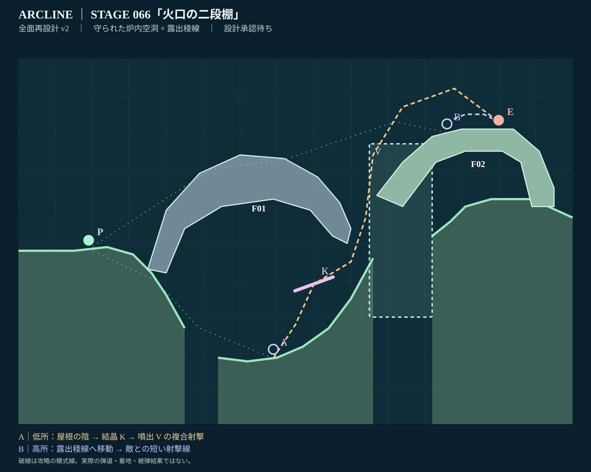
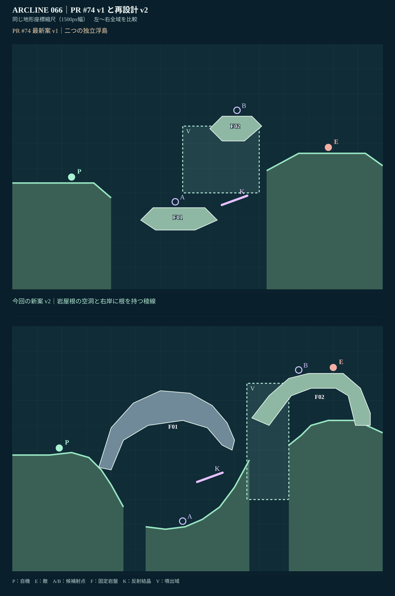

# STAGE 066｜火口の二段棚｜R全面再設計 v2

**2026-11-06／設計レビュー待ち／動作未検証。** 65面の設計承認（2026-11-06）を受けて着手。67面には未着手。

## 参照

- [PR #74 最新設計v1](stage_066_proposal_v1.json) と [同版個別レビュー](stage_066_review_v1.md)、[PR #74](https://github.com/bittrove88/bittrove88.github.io/pull/74)。
- [面別改修指示／66面R](https://github.com/bittrove88/bittrove88.github.io/blob/review/arcline-map-redesign-handoff-20261105/ARCLINE/design/stage_reviews/STAGE_051_099_REDESIGN_BRIEFS_20261105.md)。指摘：「低棚・高棚という似た浮島二つ。K/Vが違いを決めていない」。要求：「露出稜線と守られた炉内の別空間を、岩壁と窪みごと新規作図」。
- [全マップの必達事項](https://github.com/bittrove88/bittrove88.github.io/blob/review/arcline-map-redesign-handoff-20261105/ARCLINE/design/stage_reviews/MAP_DESIGN_NONNEGOTIABLE_REQUIREMENTS_20261106.md)。
- 技術出典：`design/expedition_013/stage_blueprints.json`／`game/tools/build_campaign.py`／`game/dist/geometry.js`。ゲーム本体は未変更。

## 全景と比較

**両画像はv2設計JSONの座標から実ゲームと同じx×10／y＝500−h×10、床・部品・K/Vの規則で描画した設計図。ゲーム実画面のスクリーンショットではない。** A/B の軌道線と移動線は模式線。実命中や実着地を意味しない。

## 継承する価値と作り直した骨格

**継承：** 火口炉の世界観、反射結晶K、周期的噴出V、敵 `enemy:volt`、敵HP5、行動上限16、低所は結晶経由／高所は直接短射という攻略の得失、独立固定地形。既存の敵・武器・難度・保存・アイテムには変更なし。

**刷新：** 旧案の同程度の二つの六角形浮島を全廃。左岸に根を持つ長い岩屋根 **F01（066-FURNACE-VAULT）** が深い窪地を覆い、下側に安全寄りの炉内射撃室をつくる。右岸に根を持つ斜面と広い頂部の稜線 **F02（066-EXPOSED-RIDGE）** を高く設置し、敵をその露出稜線上へ移す。3つの離れた床区間は、落差のある左岸→低い炉内→右岸に分かれ、転移を伴う場所選択に意味を持つ。

**Rのラフ二案：** A「2枚の浮島を橋でつなぐ」なら高低の違いは出るが旧案と近い。B「岩屋根の炉内空洞＋右岸の露出稜線」は、低所の遮蔽をとるか上段で短射するかの得失が明確になる。**B採用**。

## この面で生まれる攻略判断

| 経路 | 位置・攻撃方針（設計仮説） | 利点と負担 |
|---|---|---|
| **主A・守られた炉内** | P0(19,38.444)から谷へ降り、炉内床A(69,8.875)へ。頭上のF01に隠れながらK(80,29)に入射し、V領域(x95–112)から高い敵稜線へ導く | 敵からの低い射線を屋根で遮りやすいが、転移準備・高低差・結晶反射と噴出タイミングが難しい |
| **別解B・露出稜線** | 岩屋根上の移動または転移を経て、F02上のB(116,70)を狙う。敵(130,71)との短い射撃線へ出る | K/Vに頼らない単純な短射撃の可能性があるが、遮蔽がなく反撃を受けやすい |

**P0万能化対策：** 高い屋根F01が初期位置から右岸高所への直接視界を遮るように配置。初期位置で全攻略が完結するかどうかの実測は最終検証へ回す。

**空間設計：** 炉内Kは地面・屋根と離して配置。炉口x90では床h25・屋根下面h40で高さ150pxの目視開口を維持。右側のVは洞口と稜線の間の上昇帯に置き、低所から高所を狙う時に意味を持たせる。二つの部品は固定で、破壊作業を必須にしていない。

**隣接面との差：** 承認65面は低いW鏡床の反射と上側Vの噴出で、敵を天蓋の下に収める。66面は**低い炉内にK、敵を上側の露出稜線に置く**。低い遮蔽か高い短射かという選択軸、敵の高さ、反射材の種類が異なる。

## 軽量品質確認

[静的チェックJSON](stage_066_static_check_v2.json)。世界幅1500px、床3区間・計20頂点、固定2部品、K/Vの2ギミック。床のx昇順・区間分離・頂点範囲・固定ID・各ポリゴン自己交差なし・初期自機と敵の支持高度・A/B支持・Kの空間・炉口の高さ150px・部品相互の非接触を**静的PASS**。

**持越し：** 実ゲームのCanvasによる表示一致、砲身と敵の形状の干渉、歩行／転移、K反射からVへつながる実射、周期・反撃・AI・16行動以内の勝敗・複数seed・全機体。過去PR #74の旧形状の入力証跡は新案の合否として流用しない。

**設計上の受入れ判定候補：** 独自シルエット／二つの対照的な攻略判断／ギミックに仕事がある、という3要素を満たす設計。**ユーザー承認は未取得。** 次の67面への着手は66面の設計承認後に限定。

