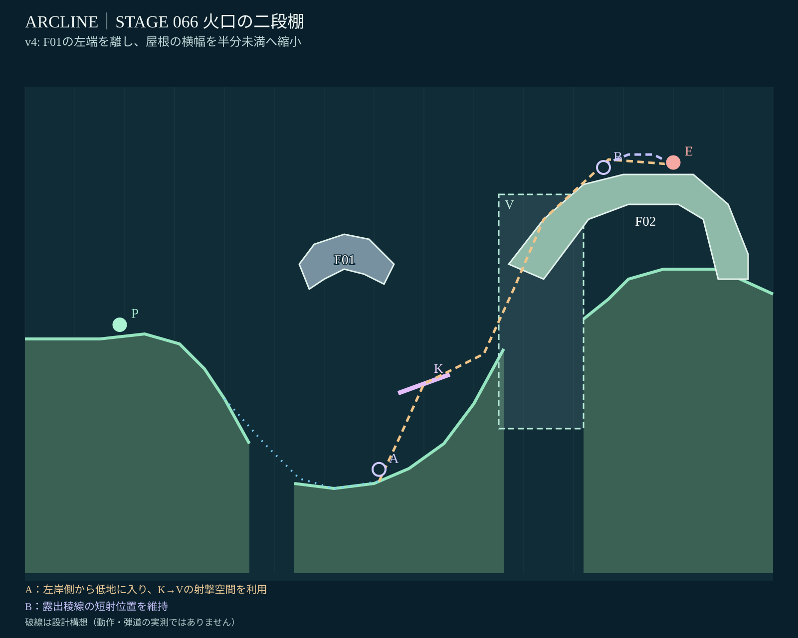
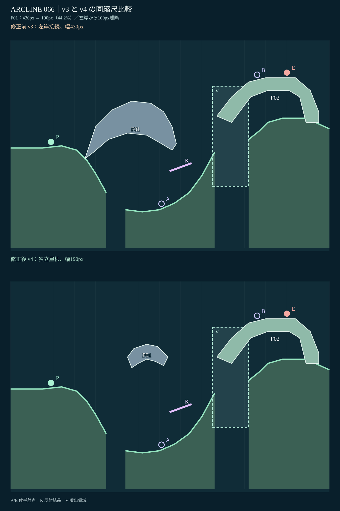

# STAGE 066｜火口の二段棚｜全面再設計 v4（設計承認済み・動作未検証）

**対象はステージ66のみ。2026-11-06。ユーザーによるv3修正指示「屋根の左側を接着せず離す」「屋根を半分以下の横幅に」に対応。**

## 参照と引継ぎ

[PR #74の制作途中v1](stage_066_proposal_v1.json)／[個別レビュー](stage_066_review_v1.md)／[直前のGitHub v2](stage_066_proposal_v2.json)／[v4候補JSON](stage_066_proposal_v4.json)。

v3は前回のチャットでローカルファイルと画像として提示した版であり、GitHubには保存していなかった。今回のv4は、そのv3の縮小屋根に対して、さらに**左岸から切断・横幅を半分未満**とした正式な設計改訂候補。

## 全景と比較

SVGは `geometry.js` と同じ `x×10 / y=500-h×10`、床、固定ポリゴン、K/Vの座標から描いた設計図。**実ゲームのスクリーンショットではない。** ルート線は設計仮説で、命中・転移・実通行の測定結果ではない。

## 変更点と意図

| 項目 | v3 | v4 |
|---|---|---|
| 屋根F01の範囲 | x35–78（横幅430px） | **x55–74（横幅190px）** |
| 横幅比 | 100% | **44.2%（半分未満）** |
| 左岸との関係 | 左岸につながる | **左岸終端x45と屋根始点x55の間に水平100pxの隙間** |
| 屋根の形状 | 大きい岩屋根 | 小さく薄い非対称の独立火山岩天蓋 |
| 射点A | (71, 9.429) | **維持** |
| 結晶K・噴出V | K(80,29)／V(x95–112) | **維持** |
| 別解B・敵 | B(116,70)／敵(130,71) | **維持** |

固定F01は遮蔽としてP0の正面方向を遮る役割を残しながら、左岸から中段谷底へ降りる想定経路と、低所A→K→Vの上方・前方射撃空間を開放する。現在のF01は**接地していない独立した火山岩塊**であり、見た目の「固定部品」と、ゲームの重力で落下する部品は区別する。右の固定稜線F02は変更しない。

**主攻略（A）：** 左側から火口底へ降りた後、遮蔽の下でK反射を狙い、V噴出を利用して高所の敵へ近づく射撃。低い場所の安全性と長い複合射撃の難しさが交換条件。

**別解（B）：** 右の露出稜線へ転移し、短い直射を選ぶ。その代わり敵の反撃を受けやすくなる。66面の敵種 `enemy:volt`、HP5、行動上限16は変更しない。

## 最低限の静的確認

[チェックJSON](stage_066_static_check_v4.json)：

- 床とF01の接触なし。左岸との水平離隔100px。
- 屋根幅190pxはv3の430pxの44.2%。自己交差なし、全頂点が表示幅1500px内。
- **A→結晶K、左岸下部→A** の仮想直線がF01に交差しない（静的形状確認）。
- P0→敵中心の直線はF01に交差し、初期位置の万能射点化を抑える意図を維持。
- 地盤・固定F02・A/B・K/V・初期敵味方位置は据え置き。構造とIDの大きな矛盾なし。

**未確認：** 実ゲームでの着地と転移、砲身可動域、K反射・V噴出の実弾道・命中、AIと反撃、16行動内勝敗、全seedや実機。これは全49面の設計承認後にまとめて検証する。

**状態：v4設計承認済み・動作未検証。2026-11-06、対話上でユーザーが明示承認。** 承認範囲は地形・攻略意図のみ。ゲーム内総合動作検証は49面の設計承認後。次のR対象は67面。
