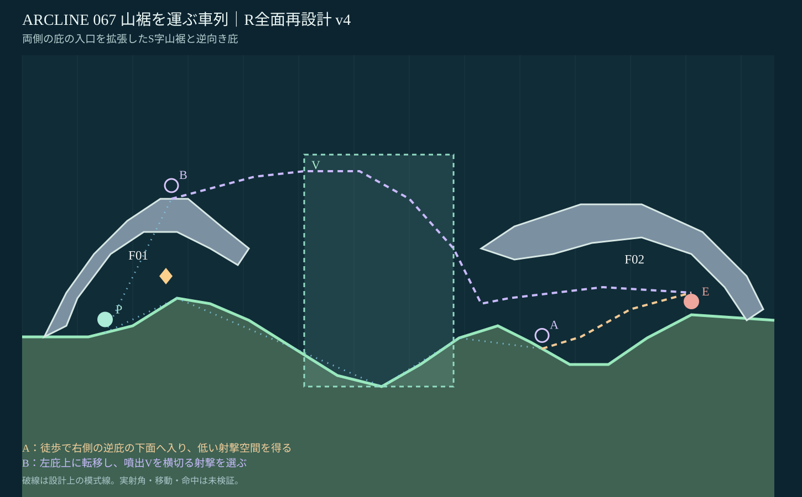
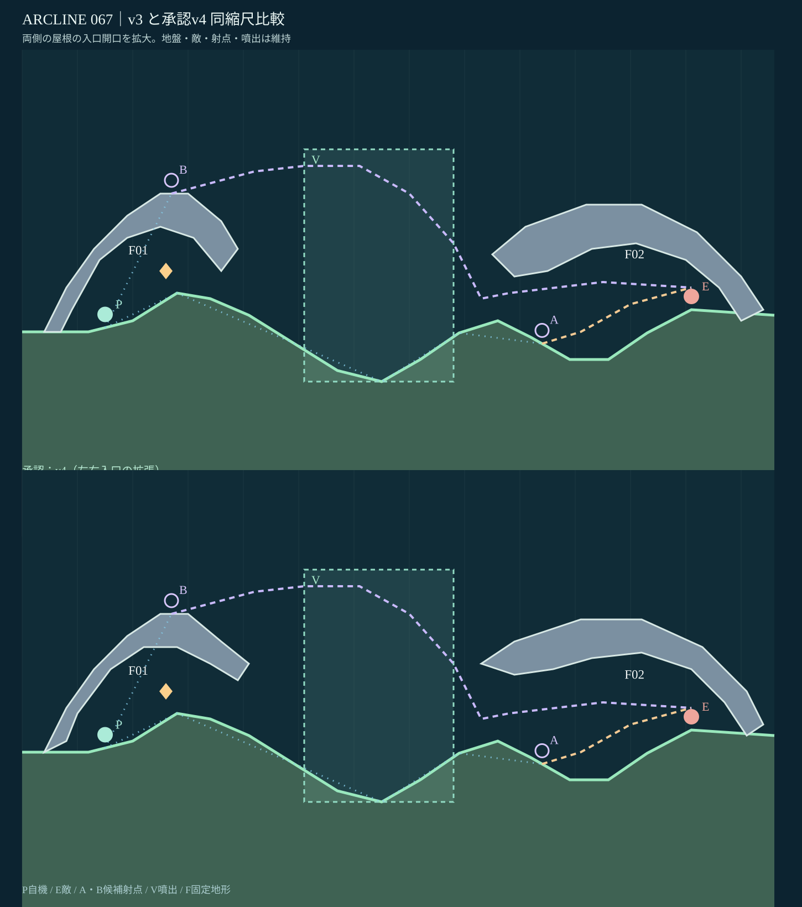

# STAGE 067｜山裾を運ぶ車列｜全面再設計 v4（設計承認済み）

**2026-11-06｜R・設計承認待ち・ゲーム総合動作未検証。**

## 出典と差分

[PR #74の最新設計v2](stage_067_proposal_v2.json) ／ [同版レビュー](stage_067_review_v2.md) ／ [面別改修指示（67面）](https://github.com/bittrove88/bittrove88.github.io/blob/review/arcline-map-redesign-handoff-20261105/ARCLINE/design/stage_reviews/STAGE_051_099_REDESIGN_BRIEFS_20261105.md) ／ [全マップ共通必達事項](https://github.com/bittrove88/bittrove88.github.io/blob/review/arcline-map-redesign-handoff-20261105/ARCLINE/design/stage_reviews/MAP_DESIGN_NONNEGOTIABLE_REQUIREMENTS_20261106.md)。

旧PRの最新版v2は開始床を浅く起伏させていたが、P0から通常弾の条件付き命中が残り、岩屋根は一つだった。継承する価値は**山裾の輸送回廊、屋根下の地表攻撃、屋根上の転移、周期噴出V、敵enemy:blast、敵HP5、16行動、試用W07のID・数量と出現ターン**。

今回の改訂は初期床の部分修正ではなく、**地続きS字斜面と、互いに逆向きの自然庇2個**へ全面刷新。F01は左の地盤から右へ張り出す薄い庇、F02は右岸から左へ伸びる重い逆庇。幅・厚み・遮蔽方向が異なる2つの固定部品。3枚の島を並べる型は避け、地表の歩行が主役になるようにした。

**RラフA（不採用）：** 高低の浮島2枚と谷。66面の構造・転移優先の攻略に近い。

**RラフB（採用）：** 左の右向き庇→S字の地表谷→右の左向き庇。地続きの移動で丘肩・谷底・庇下の見通しが変わり、転移は危険な高路という別の価値を持つ。

## 全景と比較

図は[設計候補JSON](stage_067_proposal_v4.json)と一致する床・固定ポリゴン・V矩形を `x×10, y=500−h×10` で表示した**座標準拠の設計ビュー**。実ゲームのスクリーンショットではなく、破線は物理計算で成功した弾道ではない。

## 主攻略と別解

| 選択 | 射点と経路 | 得失 |
|---|---|---|
| **主A** | P0 (15,29.75)→地続きのS字谷を**徒歩**で進み→右庇F02下の (94,26.857) から敵 (121,33) を狙う | **歩行に距離・手数が要る**が、敵側の低い遮蔽空間とVを避けた射撃を使う |
| **別解B** | 左庇F01頂部 (27,54) へ早期**転移**し→噴出V(x51〜78,h20〜62)の作用域を横切る上向き射撃を狙う | **近道と高い射点**を得る代わりに露出・噴出の周期依存・右庇の射撃制限を引き受ける |

P0→敵の**中心直線**は左の丘肩と交差するため、P0に地形上の弱みがある。ただし全発射角が無効とまでは検証していない。VはBの構想経路に交差し、Aには使わずに済む選択を用意した。位置だけ変えた似た浮島ではない。

**隣接面との違い：** 65面の深い反射火口、66面の炉内と露出稜線の選択に対し、67面は**歩くほど変わる一本の山裾**に意味を持たせる。既存の試用W07は候補(26,40)で床と屋根の間へ移した。別正本 `pickup_placements.json` は未変更。

## 最小限の品質確認

[静的チェック結果](stage_067_static_check_v4.json)。幅1360px、床18頂点、傾斜最大約34.44°、固定庇2部品（破壊片なし）、噴出V1区画。座標・部品ID・自己交差なし・P0/敵/Aの支持高度・Bの上面・W07の床上配置を点検。地表x15〜94で代表的なキャラ頭部高さの試料点に屋根のめり込みがない。A→敵の概念線分はF02と交わらず、Bの模式線はVを通りF01/F02と交わらない。

**未検証：** 実際の歩行・転移・砲身位置、射角・噴出効果・命中、敵AI・反撃、W07取得、16行動での攻略、実機・複数seed・全キャラ。これらは全49面の設計承認後にまとめて検証。画像の点線を実入力の成功と扱わない。

**67面v4を2026-11-06にユーザーが承認。総合動作は未検証。次はR指定の69面。** ゲーム本体・セーブ・AI・他面は一切変更していない。

## v4の承認差分

両屋根の入口側下面を上げ、左はx36地点で38px、右はx89地点で40pxの開口高さ増を静的計測。W07、V、地盤、敵味方、A/B、攻略分岐は据え置き。ユーザーが明示承認したのはこのv4図面であり、v3ではない。
