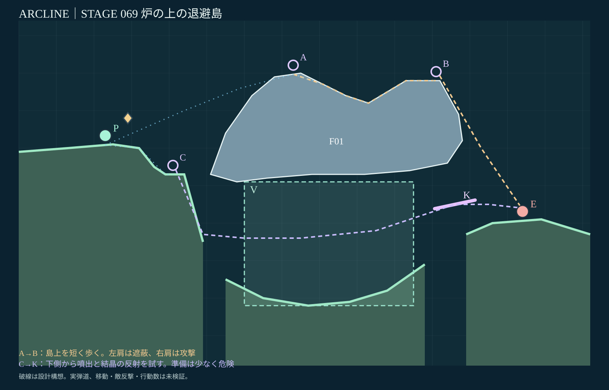
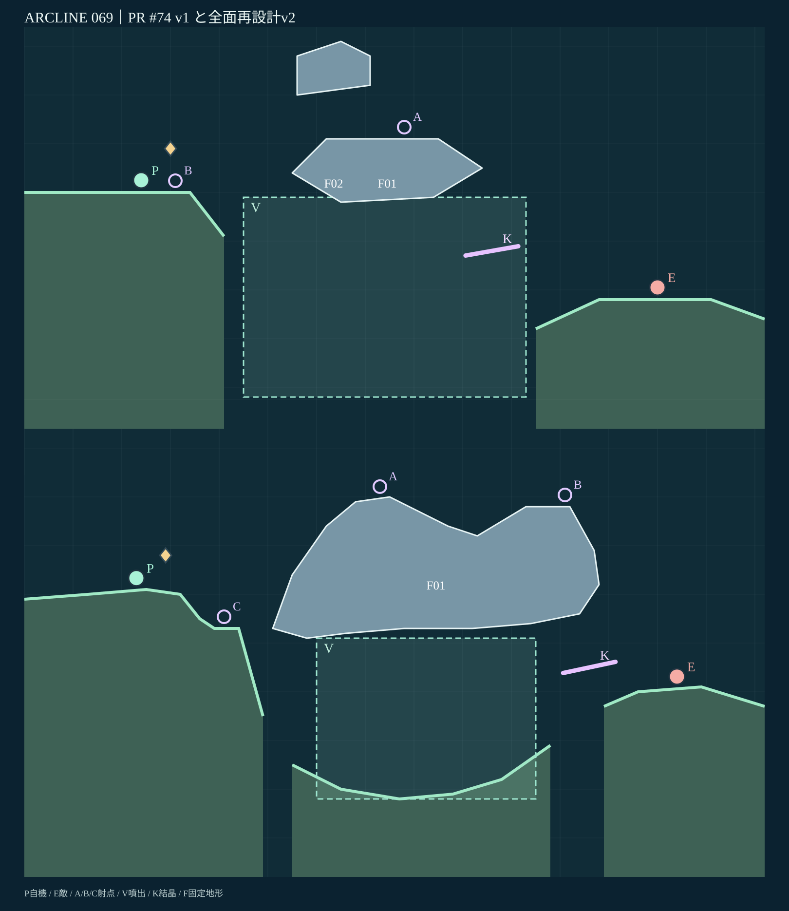

# STAGE 069｜炉の上の退避島｜R全面再設計 v2

**2026-11-06／設計レビュー待ち・動作未検証。** R優先順65→66→67（いずれも設計承認済み）→69に従い制作。68面へは未着手。

## 参照

[PR #74の最新案v1](stage_069_proposal_v1.json) ／ [個別レビューv1](stage_069_review_v1.md) ／ [R追加レビュー（69面）](https://github.com/bittrove88/bittrove88.github.io/blob/review/arcline-map-redesign-handoff-20261105/ARCLINE/design/stage_reviews/STAGE_051_099_REDESIGN_BRIEFS_20261105.md) ／ [品質必達事項](https://github.com/bittrove88/bittrove88.github.io/blob/review/arcline-map-redesign-handoff-20261105/ARCLINE/design/stage_reviews/MAP_DESIGN_NONNEGOTIABLE_REQUIREMENTS_20261106.md)。

現行実装のデータ形式：`ARCLINE/design/expedition_013/stage_blueprints.json`、`ARCLINE/game/tools/build_campaign.py`、`ARCLINE/game/dist/geometry.js`。図は座標準拠で、ゲーム本体のスクリーンショットではない。

## 全景・旧案比較

[候補座標JSON](stage_069_proposal_v2.json) ／ [軽量静的チェック](stage_069_static_check_v2.json)。

## 継承点と作り直す点

**継承：** 巨大炉の上にある避難島、周期噴出V、結晶K、敵`enemy:blast`、HP5、16行動、推奨sora、SK069（`S_BARRIER`・数量2・出現5ターン）、上の退避島と下の結晶経路。

**再設計理由：** 旧案は平頂の退避島に着いたら終わりになりがちで、島の左右の役割が分かれない。P0からの固定敵単発命中も残っていた。小さな浮遊遮蔽F02は用途が薄く、自然な大島の輪郭に防御効果をまとめるため撤去。旧案の頂点だけを少し動かす修正はしない。

**RラフA（不採用）：** 退避島を2つに割り、左は防御、右は攻撃。65・66の上下空間の選択に似やすく、単独の島上の歩行を主役にできない。

**RラフB（採用）：** 非対称の大型の「くぼんだ島」。左肩は少し高く広く安全、中央は浅いくぼみ、右肩は狭く前に飛び出して攻撃できる。**同じ固定島の内部を歩くことで攻防の意味が変わる**構造。見た目・用途とも旧案から刷新。

## 攻略設計の得失

| 場所 | 主な判断 | 利点と負担 |
|---|---|---|
| **A：左肩** (73,69.714) | 退避島へ転移して待機、右肩の地形に敵の直射を遮らせる | **遮蔽を得るが、同じ右肩に自分の射線も遮られる**。攻撃には移動を要する |
| **B：右肩** (111,68) | 島のくぼみを徒歩で越えて敵(134,30.615)へ高所から角度を取る | **直接狙える想定空間を得る代わりに敵からも露出**する。上面のA→Bは主要斜面で35°未満 |
| **C：左岸の低い縁** (41,43) | P0(23,50.833)から左の崖縁まで徒歩。島の下へ落とし、噴出Vと結晶Kを使う | **上島への転移準備を減らせる**が、下側の射撃と周期タイミング・反射の調整が難しい |

**地形とギミックの関係：** Vは島の下方（x60–105、h8–41）、Kは右下出口(116,35)。上のA/Bは噴出帯に直接触れず、下のCを選んだときにVとKが関係する。使う/使わないが「高さ」だけでなく防御・手数・射角を分ける。

**P0との違い：** P0から敵中心へ結ぶ静的直線は大島と交差する。左肩Aからの直線も島の右肩で遮られ、右肩Bからの直線は島に交差しない。**これらは地形上の見通し検査で、実弾道の命中実績ではない。**

## 隣接面との差

65面は噴出・鏡床の火口上下、66面は小さな独立屋根と露出稜線、67面は地続きS字の徒歩回廊。69面は**くぼんだ単独島の表面を短く歩くと安全と攻撃が逆転する**設計で、上下に同形足場を積んでいない。68面の破壊窓、70面の縦坑・橋とも異なる。

## 軽量チェック

[static_check_v2](stage_069_static_check_v2.json)でJSON、1520px内、床3区間、19頂点の単純な固定島、ID独立、開始地点の支持高度、射点支持、高低別V/K配置、左肩の遮蔽・右肩の静的見通し、A→B上面の斜面角35°未満、下側経路の岩盤非交差を確認した。**全て設計上の静的結果。**

**後工程に送る事項：** 転移着地・歩行・砲身と身体の実衝突、K反射・噴出Vの作用と最終命中、敵の反撃・AI・16行動攻略、アイテム取得、複数seed・全キャラ・本体実画面。旧PRのログは新地形の合格証明に流用しない。

**ユーザーの69面承認：未取得。69面の承認前に71面へは着手しない。**
