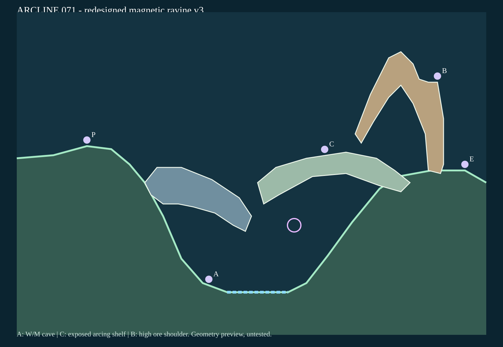
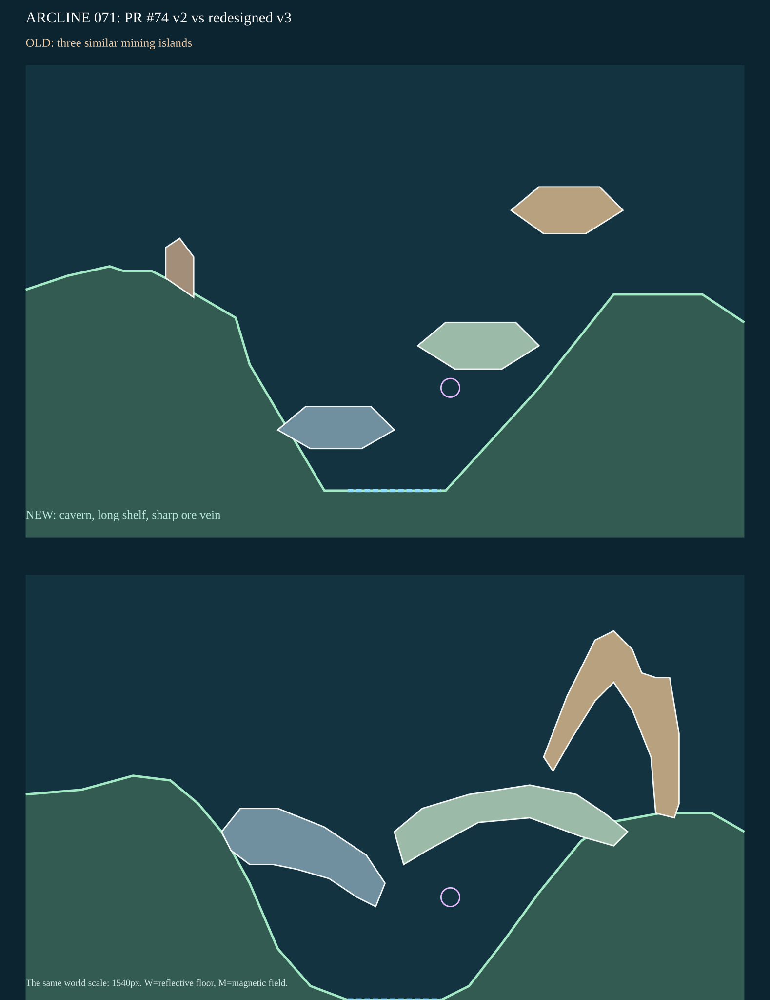

# STAGE 071｜鉱石を引く二つの線｜R全面再設計 v3

**2026-11-06・設計承認待ち・動作未検証。** 旧PR #74の[最新案v2](stage_071_proposal_v2.json)、[個別レビュー](stage_071_review_v2.md)、R指定、全マップ品質必達事項を継承。

**継承：** 磁性谷、M磁場、W反射床、低所の複合射撃、高所の短射、敵enemy:pole、HP5、16行動。敵の自律転移は未実装。**改修理由：** 旧案は似た六角棚3枚でP0から単発命中例があり、地形の使い分けが弱かった。

**Rの骨格ラフ：** A「同形3棚を上下左右に変形」は差が薄く不採用。B「低い岩窟・横へ長い岩棚・鋭い高所鉱脈」は射撃方法と遮蔽が異なるため採用。

[候補座標JSON](stage_071_proposal_v3.json)／[静的点検](stage_071_static_check_v3.json)。図は地形データからの座標準拠描画で、実ゲーム画面ではない。破線は模式線。

**主A（63,9.25）：** 西側の岩窟F01下で遮蔽を得て、水平な谷底W(x69～89)と磁場M(91,29)を狙う。複合射撃の角度調整が負担。図示はMまでで最終命中は未検証。

**中段C（101,51.923）：** 横長棚F02から鋭い鉱脈F03の上越し射撃を探る。広い曲射空間がある一方、露出しており低角度は鉱脈に遮られる。

**別解B（138,76）：** 鉱脈の右肩から敵(147,47)へ短射する。鉱脈に自分の射線を遮られないが、反撃にも露出する。

**静的PASS（限定）：** 幅1540px、床19頂点、固定3部品の単純ポリゴンと一意ID、初期位置と3射点の支持面、低い洞穴の頭上空間、Mの非埋没、W水平床、P0の中心直線の遮蔽、Bの中心直線の非遮蔽を確認。

**持越し：** 実徒歩・転移・射撃・W/M作用・敵AI/自律転移・反撃・16行動勝敗・全seed/キャラ・ブラウザ表示。全49面の設計承認後に検証する。旧PRの命中ログは新案へ流用しない。

**ユーザー未承認。72面は未着手。** ゲーム本体・他ステージは未変更。
