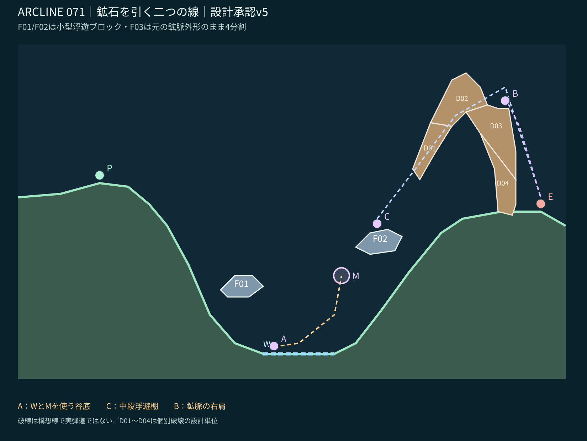
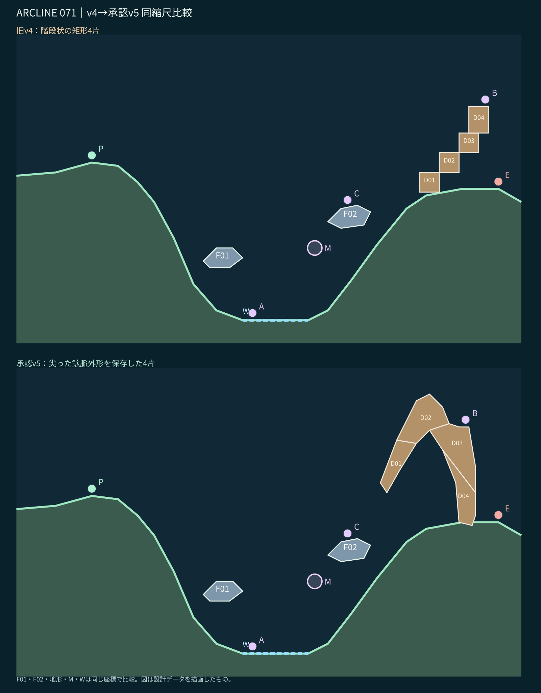

# STAGE 071｜鉱石を引く二つの線｜v5【設計承認済み・動作未検証】

**2026-11-06にユーザーがv5の地形と攻略意図を明示承認。** PR #74最新版v2の個別レビューと、R全面再設計の必達事項に準拠する。

## 地形

F01とF02は谷底を塞がない小型の浮遊ブロックで、谷底W・磁場Mの空間を広く保つ。F03は旧v3の**尖った鉱脈の外形を完全に維持**し、D01～D04の4連結ポリゴンに分割。v4で提示した階段状の矩形連結は破棄。分割は外形を変えず、共有境界を持つよう設計されている。

**A (72,7)：** 谷底W→Mを使う低い射撃経路。**C (101,41.4)：** 浮遊ブロックF02上から鉱脈の上越しを狙う。**B (137,76)：** 鉱脈右肩から短射を狙う。射路は模式線であり、実着弾の証明ではない。

## 4つの独立破壊単位

- D01: `071-CHAINED-ORE-BARRIER-1`
- D02: `071-CHAINED-ORE-BARRIER-2`
- D03: `071-CHAINED-ORE-BARRIER-3`
- D04: `071-CHAINED-ORE-BARRIER-4`

上記は [設計JSON](stage_071_proposal_v5.json) の `after.parts[2].renderUnits` で外形を分割表示し、ゲームの `build_campaign.py` の仕様に合わせて `blueprintCandidate.parts` にも**4件の独立した breakable=true エントリ**で登録した。親F03を1つだけ渡すと独立破壊にならないため、移植時にはこの区別が必須。

## 最低限のチェックと未検証

[静的チェック](stage_071_static_check_v5.json)で座標範囲・床x昇順・ポリゴン自己交差なし・支持高度・浮遊ブロック下の空間・鉱脈元輪郭一致・4片の面積合計一致・ユニークIDを確認。**実ゲームでの歩行・転移・個別破壊・弾道・M/W・敵AI・反撃・16行動勝敗・全seedは未検証**。49面の設計承認後に総合検証する。

ゲーム本体や71面以外の正本は変更していない。次はR指定の72面を1面ずつ制作する。
