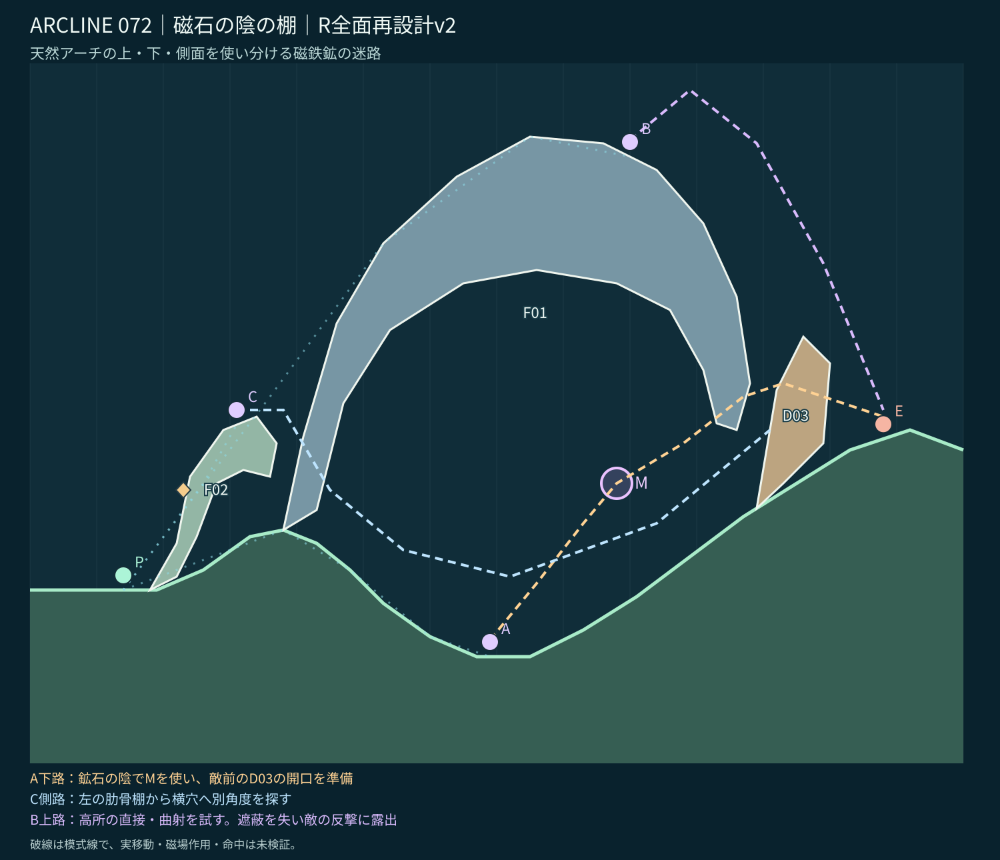
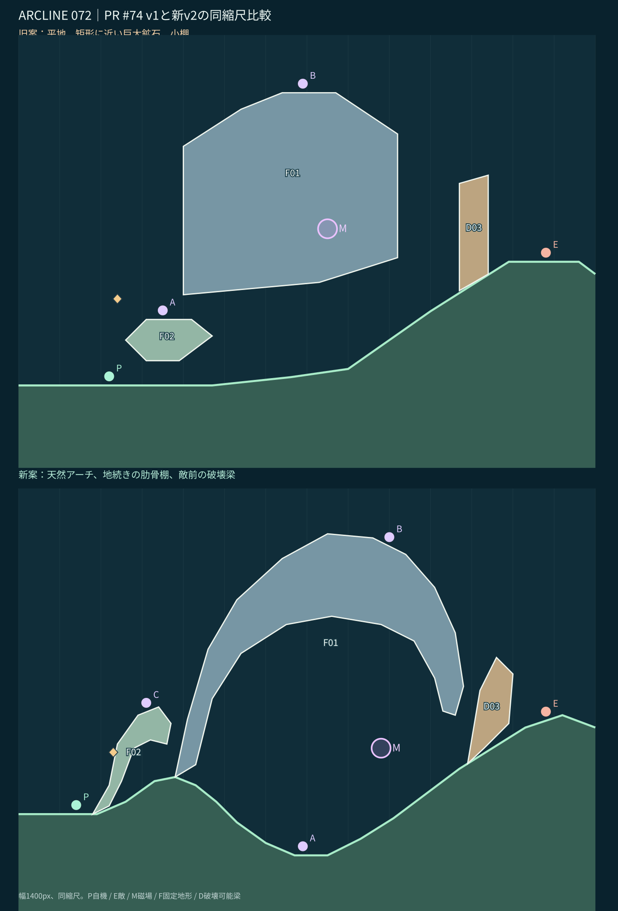

# STAGE 072｜磁石の陰の棚｜R全面再設計 v2【設計承認待ち】

2026-11-06。71面v5の設計承認後、R優先順に72面のみ再設計。**実戦・移動・射撃・磁場作用・敵AIは未検証**。

## 引継ぎとRの判断

[PR #74の最新案v1](stage_072_proposal_v1.json)・[同版レビュー](stage_072_review_v1.md)・[面別R指定](https://github.com/bittrove88/bittrove88.github.io/blob/review/arcline-map-redesign-handoff-20261105/ARCLINE/design/stage_reviews/STAGE_051_099_REDESIGN_BRIEFS_20261105.md)・[全マップの必達事項](https://github.com/bittrove88/bittrove88.github.io/blob/review/arcline-map-redesign-handoff-20261105/ARCLINE/design/stage_reviews/MAP_DESIGN_NONNEGOTIABLE_REQUIREMENTS_20261106.md)を基準とする。PR版は大きな矩形的鉱石の上越しが強く、陰ルートは6度付近の狭い射角しかなかった。形状上、下ルートが弱いため**古いポリゴンを少し直すのでなく骨格から刷新**する。

**継承：** 巨大磁鉄鉱の下空洞、磁場M・初期極性−1、敵側の破壊梁、上越し代替、敵`enemy:mole`・HP5・16行動、試用W09のID/数量/出現ターン。旧ログの命中・転移は現形状の実証として扱わない。

**ラフA（不採用）：** 大鉱石を左右2島へ分けて間に転移。71面の小島＋高い鉱脈に近くなり、下の陰の価値を作りにくい。

**ラフB（採用）：** 山肩に根を持つ巨大な**天然磁鉄鉱アーチ**。アーチの下面は広い洞内、左は地続きの肋骨状側面棚、上は露出した頂部。右端に壊せる斜め梁を配置し、上／下／横の天然迷路を一体化する。

## 全景と旧案比較

[設計座標JSON](stage_072_proposal_v2.json)／[静的チェック](stage_072_static_check_v2.json)。図はゲームの座標仕様（10px/単位）から描く**設計ビュー**で、実ゲームのスクリーンショットではない。破線は狙いの模式線で弾道シミュレーションではない。

## 3つの位置と攻略の得失

| 位置 | 利点 | 負担・狙い |
|---|---|---|
| **A 下の陰 (69,8)** | 巨大鉱石の下面に守られ、磁場M(88,34)を使う安全寄りの射撃場所 | P0から長い坂を降りる必要があり、右側の破壊梁D03を開けると**自分を守る遮蔽も一部失う**。Mで曲がる経路の実角度は後工程で検証 |
| **C 左の側面棚 (31,42.8)** | 磁場の外に位置し、下の洞口へ違う方向から入射できる中継射点 | 入口の角度調整が要る。横穴を使わなければ下Aより優れているとは限らない |
| **B 鉱石の右上面 (90,83)** | Mや梁の破壊に依存せず上越し射撃を狙える。右寄りの上面で巨石自身に直線を塞がれない | 高所へ移る準備、敵の反撃に対する露出が最大 |

**Mの意味：** 洞内下路のAと敵側梁の間に置き、遮蔽の下面に留まる射撃と、右岸を狙う射角を変えるために使用。Mは岩盤内には埋まっていない。梁は1つの独立破壊IDで、壊す前後の攻防の変化を設計課題とする。**破壊せずに梁を抜けるか、破壊後に射角余裕が十分に確保できるかは未検証。**

初期P0=(14,18)、敵=(128,40.667)。P0→敵中心への静的直線は左側面棚および敵前梁に遮られる。アーチ内の代表断面では、地盤上から屋根下面までの空きはx60～96で約392～578pxあり、旧版の陰ルートの「細い線だけ」という問題に空間の大きさから対応。右端の出口でも高さ約138pxの隙間を確保した（砲身や身体を実際に通せる保証ではない）。

**隣接面との差：** 71は小さな浮遊ブロック2個と分割鉱脈、W/Mの複合。72は一枚の**巨大アーチの下を安全な磁場射路として使う**ことが主題。73は端子Tを使った極性切替門、70は噴出Vと作業橋。地形と攻略方法の反復を避ける。

## 軽量確認と持越し

[チェックJSON](stage_072_static_check_v2.json)で世界幅1400px、地表x増加、部品3件の自己交差なし、意図しない重なりなし、敵・自機・A/C/Bの支持、アーチ空洞の高さ、磁場の非埋没、初期中心直線の遮蔽を確認。W09のID・数量・出現ターンを継承し、座標候補のみ変更。

**後工程へ：** 実歩行／転移、砲身衝突、Mによる射角余裕・弾道・命中、梁の破壊後、敵の反撃・AI・自律転移、16行動攻略、全seed・全キャラ・実画面。ユーザーの72面設計承認前に75面へは進まない。
