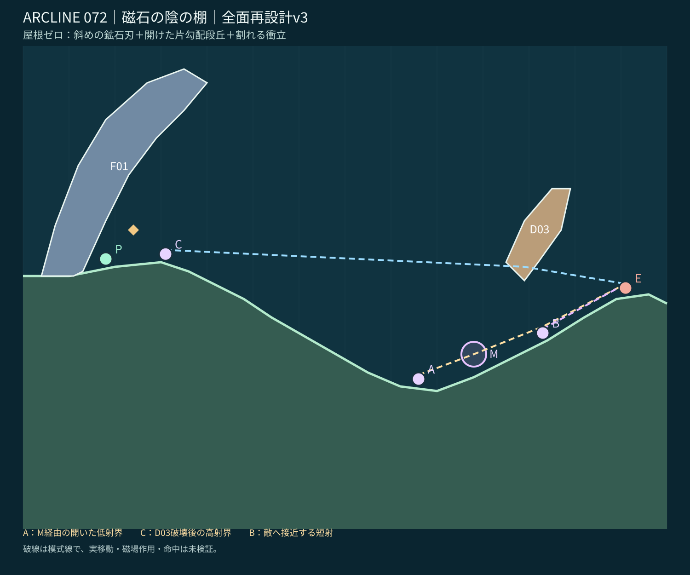
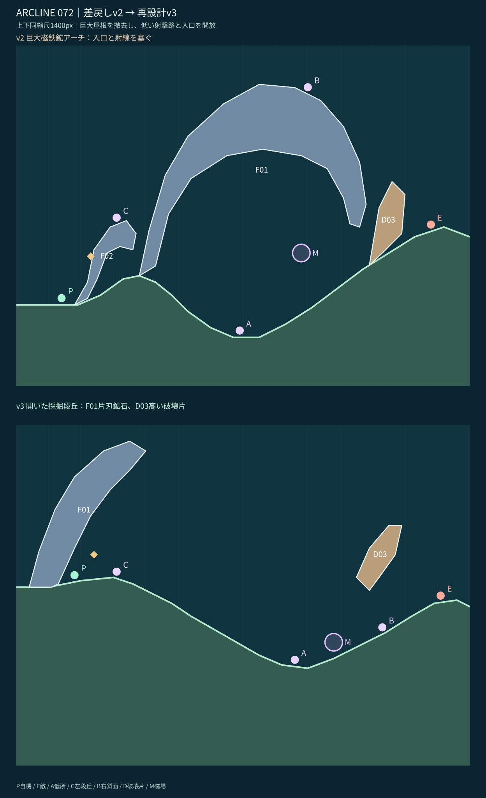

# STAGE 072｜磁石の陰の棚｜R全面再設計 v3（差戻し修正版／設計承認待ち）

**2026-11-06、ユーザーがv2を明示NG。** 理由は巨大屋根の同型反復、他面と似た谷、入口を塞ぐ形状、敵への射線欠落。承認済みの71面v5を維持し、72面だけ全面的に再設計した。

## PR #74の引継ぎとv2差戻し

[PR #74の最新v1](stage_072_proposal_v1.json)／[個別レビュー](stage_072_review_v1.md)／[R面の方針](https://github.com/bittrove88/bittrove88.github.io/blob/review/arcline-map-redesign-handoff-20261105/ARCLINE/design/stage_reviews/STAGE_051_099_REDESIGN_BRIEFS_20261105.md)／[必達事項](https://github.com/bittrove88/bittrove88.github.io/blob/review/arcline-map-redesign-handoff-20261105/ARCLINE/design/stage_reviews/MAP_DESIGN_NONNEGOTIABLE_REQUIREMENTS_20261106.md)。

**継承**：磁鉄鉱・M（極性-1）・敵側破壊物・磁場を使う下路と使わない上路の比較・敵enemy:mole・HP5・16行動・試用W09のID/数量/出現ターン。**撤去**：v2の谷を覆う大きなアーチF01、入口の小庇F02、入口を遮る地形。v2は設計不合格として記録し承認対象にしない。

**ラフA（不採用）**：アーチを二つの屋根と狭い横穴に分ける。入口と射線が詰まりやすく、71面の鉱脈・浮遊遮蔽とも似るため不採用。

**ラフB（採用）**：開けた片勾配の長い採掘段丘。左岸だけに地盤から**斜め上へ伸びる一枚の磁鉄鉱の刃F01**を立て、敵寄り上空に細い**破壊可能な斜めの衝立D03**を置く。屋根部品0、全て地表の自然な勾配と露天通路。左の高台Cと右の露出坂B、低いM射点Aが「高低の棚」ではなく同じ一本の開放された採掘路上に並ぶ。

## 全景と比較

[座標とゲーム形式の候補JSON](stage_072_proposal_v3.json) ／ [最低限の静的チェック](stage_072_static_check_v3.json)。図は設計JSONの座標から描いたマップビューであり、実ゲームのスクリーンショットではない。破線は模式線で実弾道の測定値ではない。

## 移動と射撃の分岐

| 位置 | 地形と攻め方 | 利点と負担 |
|---|---|---|
| **A（86,23.5）** | P0から緩い切土路を下り、M(98,31)近傍を通る低い射撃を構想 | **未破壊D03の下でも敵方向に地形で塞がれない直線空間**がある。進入は長いが破壊不要。磁場の偏向は実測していない |
| **C（31,50.6）** | 左段丘から初期の高い直射はD03と交差する。D03破壊で別の射線を開く | 移動は短いが破壊コスト。低所と違いMを通さない角度を探る |
| **B（113,33.5）** | 右側の露出斜面を前進し、敵(131,43.286)への短い射線を選ぶ | M依存と破壊を避けられる反面、接近移動が必要で反撃にも露出 |

P0(18,49.6)の水平に近い敵方向の直線はD03で遮られる。よって初期位置が万能になることを抑える。実際の高角射撃による回避までは未実証。

**Aの最重要チェック：** [Aの足元+3](86,26.5)→[敵の足元+3](131,46.286)の直線について、地盤・F01・未破壊D03と交差せず、M中心との最短距離が約0.71単位であることを静的検査した。少なくとも**直線状の設計空間は実在**し、v2のように巨大屋根が入口と線分を覆う欠陥はない。実射角・球の大きさ・Mの作用・命中を保証しない。

**71面との差**：71面は下の反射床W・Mと小型浮遊ブロック、右の4分割鉱脈。72面は**屋根ゼロ・露天の片勾配採掘路・斜めの左岸鉱石刃**。右の露出坂へ危険を取って接近するか、左から衝立を壊すか、低いMルートを使うかが違い。

## 最低限の品質検査

[結果](stage_072_static_check_v3.json)：床20頂点がx増加、最大局所傾斜33.69°で35°未満。F01/D03は自己交差なし・画面内、足元支持点P0/E/A/B/C、A/Bの敵方向の直線の地盤・部品非干渉、C/P0直線のD03による遮蔽、M非埋没、W09の識別子・数量・出現ターンを静的確認した。

**未検証：** 歩行・転移着地・砲身の衝突、磁場Mの実作用と命中幅、破壊後の実射撃、敵AI・反撃、16手クリア、複数seed・全キャラ・実ゲーム画面。実エンジンの最終検証は49面の設計承認後。

**72面v3はユーザー設計承認待ち。75面以降は未着手。** ゲーム正本・他面は未変更。
