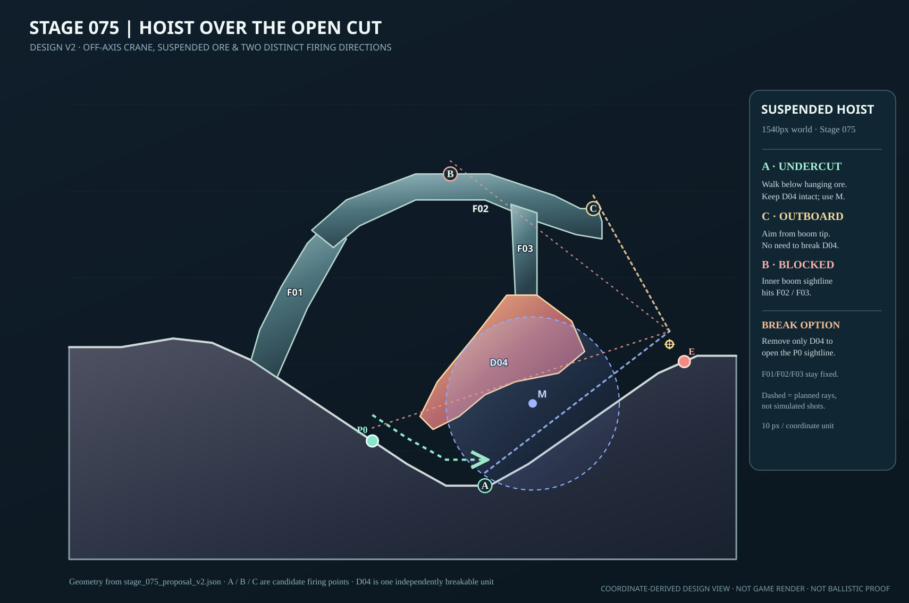
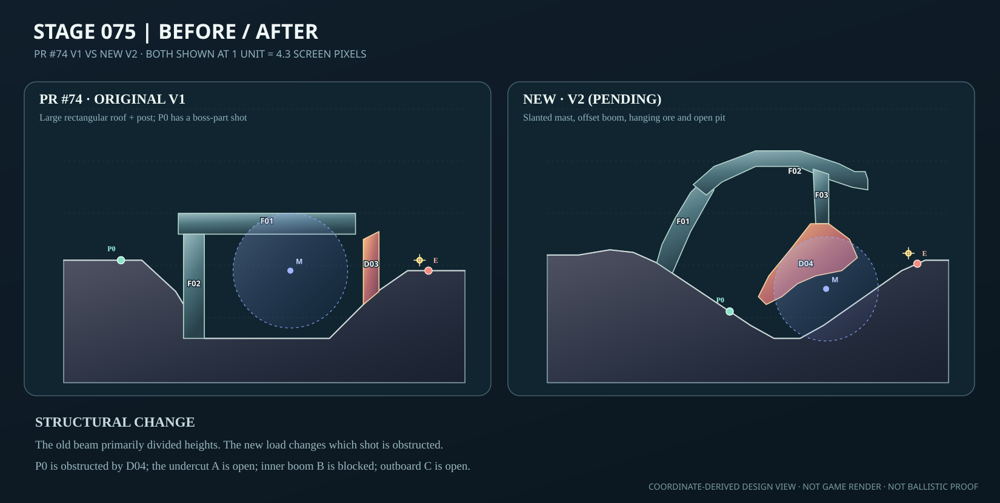
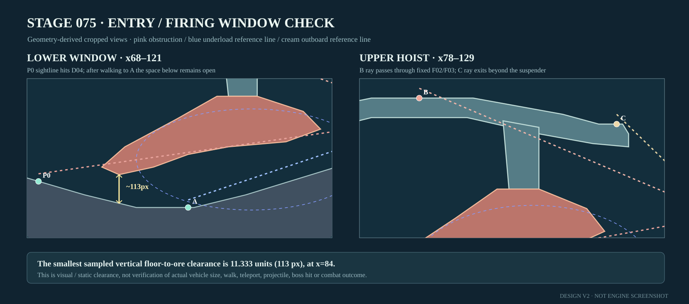
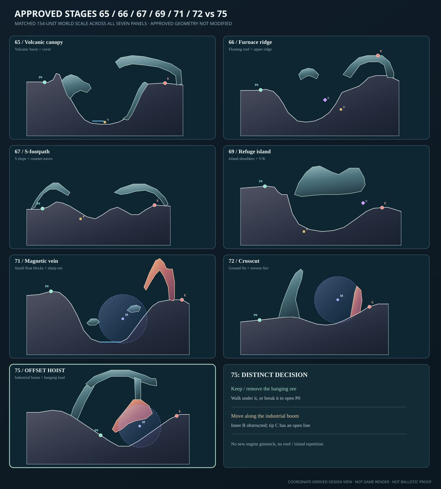

# STAGE 075｜荷を吊る鉱底｜R全面再設計 v2（設計承認待ち）

**2026-11-06｜設計提出。ゲーム本体未実装、総合動作未検証。** 本作業ブランチは**72面v4の設計承認済みPR #84**（`design/arcline-stage072-open-fault-flank-v4-20261106`）から分岐。承認済み65・66・67・69・71・72面は保護し、**75面の新案のみ**作成。76面以降には着手しない。

## 1. 継承・再構築の判断

- **参照原本：** [PR #74のStage 75 v1座標](https://github.com/bittrove88/bittrove88.github.io/blob/design/arcline-compendium-051-099/ARCLINE/design/stage_reviews/stage_075_proposal_v1.json) ／ [個別レビュー](https://github.com/bittrove88/bittrove88.github.io/blob/design/arcline-compendium-051-099/ARCLINE/design/stage_reviews/stage_075_review_v1.md)。両方とも本ブランチで歴史資料として**上書きしない**。
- **追加判定：** [面別R/S/K方針](https://github.com/bittrove88/bittrove88.github.io/blob/review/arcline-map-redesign-handoff-20261105/ARCLINE/design/stage_reviews/STAGE_051_099_REDESIGN_BRIEFS_20261105.md)、[必達品質](https://github.com/bittrove88/bittrove88.github.io/blob/review/arcline-map-redesign-handoff-20261105/ARCLINE/design/stage_reviews/MAP_DESIGN_NONNEGOTIABLE_REQUIREMENTS_20261106.md)、[65〜72類似監査](https://github.com/bittrove88/bittrove88.github.io/blob/review/arcline-map-redesign-handoff-20261105/ARCLINE/design/stage_reviews/STAGE_065_072_APPROVAL_AND_DIVERSITY_AUDIT_20261106.md)、[1面受入れテンプレート](https://github.com/bittrove88/bittrove88.github.io/blob/review/arcline-map-redesign-handoff-20261105/ARCLINE/design/stage_reviews/SINGLE_STAGE_ACCEPTANCE_TEMPLATE_20261105.md)。
- **旧案の良い点：** 採掘坑と磁力クレーンの世界観、固定支持体を残して破壊可能な鉱石だけを壊す役割分担、M（極性−1）、中ボス `midboss:ore-shepherd` の「マグネットアーム」部位。
- **旧案の問題：** 幅約680pxにわたる長大な水平長方形クレーン屋根＋垂直支柱。旧レビューの実入力では**P0からもボス部位命中例があり**、梁上移動が攻略の必然性に乏しい。高所と低所の2射点だけでは他面の型を繰り返す。
- **守る仕様：** 世界幅1540px、ギミック種M、既存ボス名・部位数と能力、`enemyHp`欄5、上限24行動、推奨`mogu`、歩行140pxの規則。敵・自機位置と地形はR対象につき再配置する。ボスの部位候補位置はPR #74での敵からの相対量（x−3.4、h＋4）を継承した**設計マーカー**であり、エンジン実配置は未検証。
- **刷新：** 旧F01水平クレーン梁、F02真っ直ぐな柱、敵の手前に直立したD03を撤去。新設F01斜マスト、F02非対称片持ち吊腕、F03非破壊吊金具、D04斜めに垂下する単独破壊鉱石へ全体再構成。D03→D04は設計上の破壊部品IDの再編であり、既存の旧PRログを流用しない。

## 2. 座標作成前の骨格ラフ2案

| ラフ | 地形骨格 | その面で生む行動 | 採否 |
|---|---|---|---|
| **A：斜吊りホイスト＋露天の掘割** | 地表から曲がって上る斜マスト、厚みが一様でない細い片持ち腕、垂下する一体の鉱石、左右非対称の深い露天掘り | **鉱石を残して下を通る／鉱石を壊して開始射線を開ける／梁の内側を見切って外端に移る** | **採用**。高さそのものより吊荷・固定吊金具・射撃位置の関係を読む |
| B：平行二段門型クレーン | 長い長方形梁を上下に重ねた二層設備 | 上下のどちらの梁から撃つか | 不採用。旧案の矩形屋根の反復で、65・66・67の上／下射撃パターンとも重複 |

**このステージ固有の問い：** 「鉱石を壊して邪魔な遮蔽を消すか、吊荷を温存して**下を抜ける**か。吊腕に乗ったとき、内側と外端でボス部位への視界が逆転することに気づけるか。」

## 3. 新v2全景／資料

[座標JSONとゲーム向けblueprintCandidate](stage_075_proposal_v2.json) ／ [最小静的チェック](stage_075_static_check_v2.json)。

**新構造：** 床はx0〜154の両岸から中央へ下がる非対称の掘割。傾斜最大34.992°、坑底はx87〜97のh12。西側マストF01は左岸に根を張り、F02の片持ちブーム（頂部h84）を支える。F03は先端近くからh56まで垂下する細い固定吊金具。D04はF03から斜め左下に伸びる尾のある吊り鉱石で、**一つだけの独立破壊単位**。部品はすべて画面内、固定支持部と破壊片のIDを分ける。

| 射撃／移動位置 | x,h | 設計上の判断と利益 | 設計上の負担 |
|---|---|---|---|
| **P0 初期** | (70,22.333) | 鉱石の尾部がマグネットアームへの静的直線を塞ぐ。D04破壊を選べばここからの中心線が開く | D04の破壊という手数・吊荷の遮蔽喪失（敵の反撃変化は未測定） |
| **A 坑底** | (96,12) | P0から床を歩いて鉱石の**下へ潜る**。D04を壊さず部位方向の広い直線帯があり、M=(107,31,半径20,極性−1)を試す | 移動が要る。Mによる偏向の得失・命中は未検証 |
| **B 吊腕内側** | (88,84) | ブーム上への移動候補。ただし静的な部位方向の直線が**F02とF03の両方に当たる** | 高い場所に乗るだけでは直接撃てず、外端への位置替えが必要 |
| **C 吊腕外端** | (121,76) | 吊金具F03より右へ出たところから、**破壊不要でマグネットアーム方向への静的直線が開く** | 上部外端への到達・着地、近距離での砲身角は未検証 |

敵は(142,40.667)、マグネットアームの**相対座標を保った候補マーカー**は(138.6,44.667)。ボス部位の耐久値・本体挙動は一切変更しない。

**主攻略の仮説：** P0から坑底Aへ歩き、吊荷を残したまま磁場Mの下側を使って部位へ撃つ。**別解1：** D04だけ破壊してP0からの遮蔽を解除し、固定F01/F02/F03は残す。**別解2：** Cへ転移して吊金具の外側から部位へ射撃し、D04を壊さない。上部Bを単なる安全な高台として設定しないことが重要。

## 4. 直近承認6面との5軸重複チェック

| 面 | A：地形骨格 | B：移動 | C：射線の切替 | D：ギミック・破壊 | E：トレードオフ |
|---|---|---|---|---|---|
| **65** | 火口＋大自然天蓋 → 工業用の支柱＋細い吊腕＋吊荷 | 噴出上下 → 坑底の徒歩と吊腕の外端への移動 | 上下経路 → 吊鉱の下側と吊金具外端 | V/W → M＋独立吊鉱破壊 | 周期/反射 → 温存/破壊/外端移動 |
| **66** | 小型浮遊岩屋根＋稜線 → 固定機械吊腕 | 谷底と右稜線 → 一続きの坑底歩行とブーム端 | 高い直射／低いK・V → **高い内側Bが塞がる** | K/V → M＋D04を任意破壊 | 露出高所vs守り低所ではなく鉱石温存の価値 |
| **67** | S字地続き山裾＋庇 → 露天掘割＋吊りクレーン | 徒歩で山肩 → 吊鉱の下を通り越す | 庇の入口の上下 → 吊荷の下空間／吊金具の外側 | V → Mと独立吊鉱 | 高低ではなく破壊か移動か |
| **69** | 火口上の大島 → 地面に支持された片持ち人工構造 | 島内の左肩→右肩 → 深い坑底移動／ブームの金具外へ | 左肩遮蔽・右肩攻撃 → **支持金具と自分の梁**が上部Bを塞ぐ | V/K → M＋選択破壊 | 退避・露出ではなく吊鉱を残すか壊すか |
| **71** | 小浮遊ブロック＋4分割鉱脈 → 固定大型ホイスト＋単一吊荷 | 谷底＋鉱脈上 → 一本の坂道＋工業吊腕端 | 中段・鉱脈肩 → 部位へ下を抜ける／吊金具を避ける | W/M複合＋4片破壊 → M単独＋D04一片だけ | 分割破壊の順序 → 温存と射点の組合せ |
| **72** | 地付き斜断層＋小遮蔽 → 片持ちクレーンと吊荷 | 断層越え転移／敵背後 → **床面の歩行で吊荷をくぐる**／吊腕端へ転移 | 敵の左右からの逆向き射撃 → 同じボス部位への吊荷下と外側照準 | 敵前破壊D03＋M → 吊荷D04任意破壊＋M | 背後へ回る負担 → 吊荷温存、移動、破壊の交換 |

**事前判定：** 近い72面とも、少なくともA（骨格）、B（移動）、C（遮蔽の因果）、E（得失）が質的に異なる。Dは同じM・単独破壊という記号を含むが、使う意味（敵前衝立 vs 吊り下げた荷重）が異なる。近い面の**屋根と上下二択を形だけ調整した案ではない**。

## 5. 軽量形状品質ゲート

| チェック | 判定 | 根拠と限界 |
|---|---|---|
| JSONの設計候補／参照原本 | **PASS** | v2独立ファイル。旧v1は一切変更せず残す。ゲーム本体への反映なし |
| 床の整合・造形 | **PASS（静的）** | 17頂点、x増加、最大局所勾配**34.992°**。長い平地に同形島を並べない |
| 部品形状 | **PASS（静的）** | F01・F02・F03・D04の自己交差0、全頂点世界内。F01/F02とF02/F03の取付部は支持のため意図的に接する／一部重なる |
| 足元支持 | **PASS（代表点）** | P0(70,22.333)、敵(142,40.667)、A(96,12)が床補間と一致。B(88,84)、C(121,76)はF02上面頂点間の高さと一致 |
| 吊荷下面の通路 | **PASS（静的な開口の存在）** | x81〜119の吊荷底面と床の距離を0.25単位刻みで観察。最小約**11.333単位=113px**（x84）。実車体当たり判定と全幅歩行は未検証 |
| 狙う方向の空間 | **PASS（中心線の幾何）** | P0→腕はD04、B→腕はF02/F03に交差。一方、A→腕、C→腕の線分は固定・破壊部品および床に非交差。線分は弾道ではない |
| 破壊IDの分離 | **PASS（設計データ）** | 固定F01/F02/F03と破壊D04は独立。D04を除いても吊金具F03を残すモデル |
| 表示／比較 | **PASS（座標資料）** | 全景、v1同縮尺比較、6面同縮尺比較、開口拡大図のSVGタグと描画要素を確認。さらに独立した座標プレビューでシルエットを目視。**ゲーム実画面の描画検証は未実施** |

**最後まで残す検証：** 足場での実歩行・車体や砲身の当たり、Cへの転移着地、吊腕先端の反動・被弾、磁場Mの曲射と実命中、D04の独立破壊、実際のore-shepherd部位座標・防御と反撃、全24行動・複数seed・全キャラのゲーム実戦。過去PR #74の成功ログをこの新座標の保証に流用しない。

## 6. 承認依頼

**担当者判定：Stage 75 v2、地形と攻略の設計承認候補。ユーザー判定：未承認・レビュー待ち。**

これまでの承認済み6面（65・66・67・69・71・72）の設計やゲーム本体は変更していない。**75面のユーザー承認が出るまで、次の76面へは進まない。**
