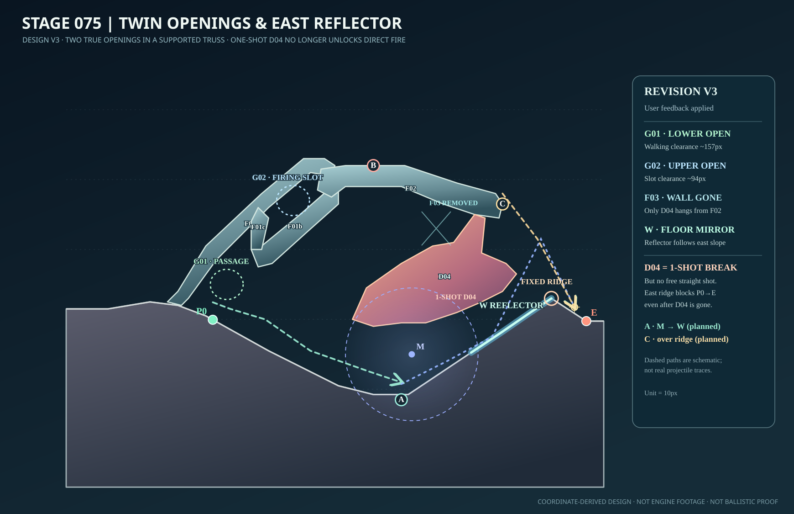
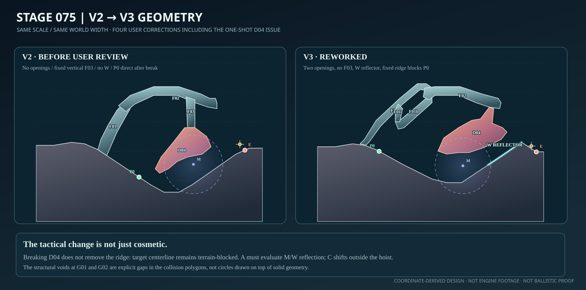
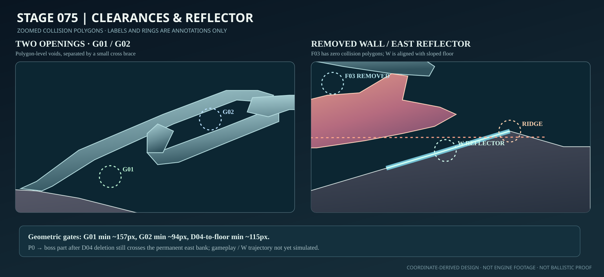
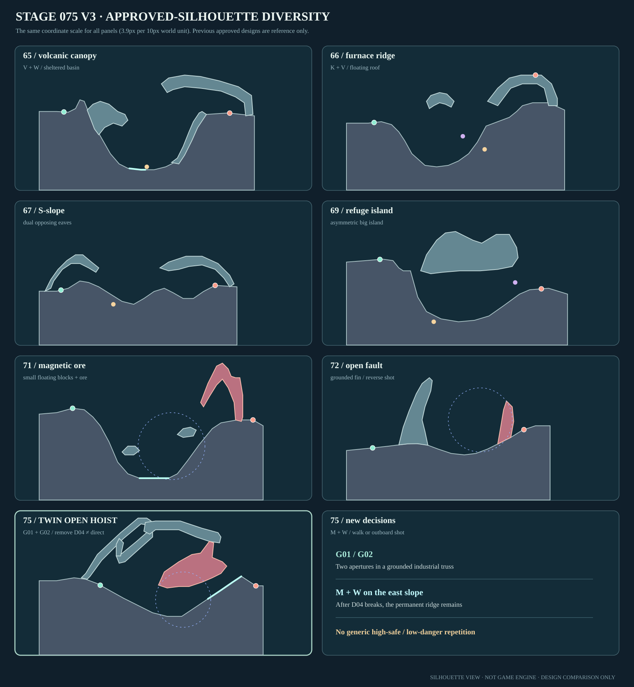

# Stage 075｜吊荷と二つの透過窓｜v3 修正設計・承認待ち

**2026-11-06：ユーザーの画像への赤字指示3点＋D04一撃破壊の追加指摘に対応。** 75面の設計のみ修正。ゲーム正本・承認済み65・66・67・69・71・72面・76面以降は変更しない。元のv2は比較用に残し、**v3を最新のレビュー対象**とする。

## 1. 元の指示と改修箇所

| 指摘 | v3の実装済み設計変更 | 位置・効果 |
|---|---|---|
| **①「穴を開ける」2か所** | 斜マストを固定の**上弦F01a・下弦F01b・横つなぎF01c**に分割し、上弦／地面の下部G01と上弦／下弦の上部G02を、実際にポリゴンがない開口として形成 | **G01：x42〜52、最小垂直余白約157px**。低地への床伝いの移動構想に使う。**G02：x60〜70、上弦下／下弦上の最小余白約94px**。別の弾道窓として使う。両方ともラベルの楕円で隠した空間ではない |
| **②「壁をなくす」** | **固定F03（縦長吊金具）をデータから完全撤去**。旧x102〜110/h56〜77付近の固定の縦壁は消えた | D04だけがF02右下面の一点(117,70)から斜めに吊られる。破壊後にF01a/b/cとF02は残る |
| **③「反射板を配置する」** | 既存ゲームの**床材反射ギミックW**を右岸斜面x116〜139に配置 | Wは既存地形の床に沿う反射材。x116/h30.5 → x125/h36.5 → x133/h42 → x139/h46で傾斜する。空中に隠れた板や新物理を作らない |
| **④「D04は一発で壊れ、直線の撃ち合いになる」** | **東岸の地続き稜線をx139/h46まで上げて自然に整形**。D04は1破壊単位のまま、壊しても右岸稜線は固定・非破壊 | **D04撤去後もP0→敵のマグネットアーム中心の静的直線は右岸地盤と交差**する。D04破壊の利益を「Wへの入射位置・角度を作りやすくする」に限定し、1撃破壊→即直射を主攻略にしない |

**制作判断：** 手数を強制的に増やすためにD04の耐久を上げたり、ボス能力・行動上限を変えたりしていない。**地形と反射板の位置関係だけで**戦術を変更した。D04を破壊すること自体は禁止せず、破壊した後にも射撃位置・射角を考える余地を残す。

## 2. 新全景・比較・拡大

[新しい座標JSON／blueprintCandidate](stage_075_proposal_v3.json) ／ [v3静的チェック](stage_075_static_check_v3.json)。

**図はJSONの座標に基づく設計ビュー**。破線は攻略の構想線であり、実際の砲弾の反射・命中経路、実ゲーム画面、プレイヤー着地の証拠ではない。

## 3. 新しい攻略の問い（1ステージ1コンセプト）

**「壊せる吊荷を壊すだけでは敵に届かない。二つの開口から射撃場所を選び、反射板で稜線を越すか、吊腕外端で別射角を取るかを考える。」**

| 場所・選択 | 地形上の役割 | メリット | 負担・リスク |
|---|---|---|---|
| P0 (42,39.889) | 固定フレーム下部G01へ入る手前の出発位置 | D04は破壊候補だが、1撃で消しても敵方向の直線は固定稜線が遮断 | 移動やWへの入射角度の調整を省略できない |
| **A 坑底 (96,18.5)** | G01から傾斜地を進み、吊鉱下の広い空間へ。M(99,30,r19,極性−1)とWを使って斜め反射を検討 | **D04を温存できる**。右岸Wで上へ跳ねさせれば稜線越しの新しい弾道を探せる | 弾道の反射・磁場の組合せが必要になる可能性。現時点では未検証 |
| G02 上の開口 (x60〜70, h約70〜80) | 上弦F01aと下弦F01bの隙間 | 下の歩行口とは別の射撃窓を作る | 車体の進入口ではなく弾の候補射路。入射角・砲身干渉は後工程 |
| B 吊腕内側 (88,84) | 比較位置 | 高所に立てる | ボス部位への中心線はF02とD04に遮られ、単に高い場所に転移するだけでは有利でない |
| **C 吊腕外端 (125,73)** | F02右端へ転移する候補射点 | D04・右岸の地盤を避けてボスのマグネットアーム方向への線分が開く | 外端への転移・着地、実射角・反撃は未検証 |
| D04の一撃破壊 | 懸垂する鉱石のみ除去 | **Wへ射線を通す準備**をしやすくなる可能性 | 右岸は壊れずP0直射はなお遮断、遮蔽も一部失う |

**反射材Wの形式：** `{"type":"W","v":[116,139,39]}`。現行 `ARCLINE/game/dist/geometry.js` を確認し、Wは床の実セグメントを反射材としてオーバーレイする既存仕様を使用した。第3値は従来のauthoring形式との互換フィールドで、**反射板の描画高さには使われない**。斜面に追従する可視反射材として全景へ描画した。磁場Mは保持しているが実偏向・反射との相性は最終動作検証待ち。

## 4. R面の骨格・最近承認面との比較

- **採用ラフA**：斜マストを二本の弦材＋短い連結材で支えた**穴あき工業トラス**、その外側に単一吊荷・右岸の反射斜面。屋根と上下二択ではなく、下の歩行路、上の射線窓、床反射、吊腕外端の位置判断を分ける。
- **却下ラフB**：水平二段門型クレーン。過去の長い屋根と上下の役割を繰り返すため、v2同様採用しない。

| 比較軸 | 既承認65・66・67・69・71・72面と異なる理由 |
|---|---|
| **地形骨格** | 屋根・浮島・庇・火口・地付き岩刃ではなく、荷重を支えるトラスに**異なる用途の2つの開口**を持たせる人工構造 |
| **移動判断** | G01は床に沿った徒歩、G02は射線窓、Cは高い吊腕の外端への転移という用途差。72の断層越え＋背後逆向き射撃とも違う |
| **射線と遮蔽** | 遮るのは壊せるD04だけでなく**壊せない東岸の地形**。D04破壊前後でP0からの万能直射を許さない |
| **ギミックの因果** | M単独ではなく、Mによる入射角の変化と**傾斜したW床面反射**を使い、固定稜線を越す弾道を構想する |
| **得失** | D04温存で手数を減らす、破壊でWの射界を広げる、Cへ移って直射角を探る。高低＝安全／危険の単純な反復ではない |

## 5. 最小静的品質検査

[静的検査JSON](stage_075_static_check_v3.json)を設計データから新たに作成。

| 項目 | 結果 |
|---|---|
| 形状とデータ | 床18頂点、x増加、最大局所勾配**34.509°**。5部品の各ポリゴンに自己交差・明白な地中への頂点潜りなし |
| 下側G01 | x42〜52で最小床～固定上弦下面間 **15.736単位 ≒157px**。代表中心(46,50)に部品ポリゴンなし |
| 上側G02 | x60〜70で上弦下面～下弦上面間 **9.375単位 ≒94px**。代表中心(65,74)に部品ポリゴンなし |
| F03・D04 | F03は部品IDごと撤去。破壊単位はD04一つのみ。D04下側と床の最小距離は **11.5単位=115px** |
| 反射W | x116〜139の既存床が斜めに連続し、反射材は床面に沿って配置。空中へ浮く孤立ポリゴンなし |
| D04破壊後P0中心線 | P0からマグネットアーム中心へ結んだ静的線は、**D04が存在しなくても**右岸の固定床と交差。最大の地面めり込み量は約**2.514単位** |
| C先端中心線 | Cから同部位中心への線分は、固定5部品・D04・地盤を静的に避ける |
| 実装の隔離 | 変更は75面の別途設計ファイルのみ。承認済み6面、ゲーム正本、76面以降は保護 |

**確認していないこと：** 実ゲーム描画、G01の車体幅付き歩行、G02の砲口・弾丸の衝突、Cへの転移・着地、Wの入射角・反射後の弾道と命中幅、Mの実作用、D04の実破壊と残存支持構造、中ボス部位・敵AI・反撃・24行動勝敗。これらは全49面設計承認後に実施する。上記の代表的な直線チェックは、成功する射撃や反射経路を実証するものではない。

## 6. 結論と承認状況

**担当者判定：v3設計レビュー提出。ユーザー判定：未承認。** ご指摘の4項目を**地形データの座標自体に反映済み**。v2案は修正前の記録として残し、v3を新たな承認対象とする。

PR #85は72面v4承認済みのブランチを基点とするドラフトPRのまま保持する。**75面v3の承認が出るまで76面以降には着手しない。**
