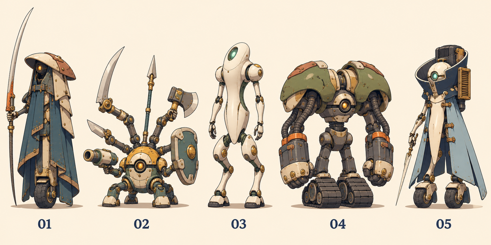
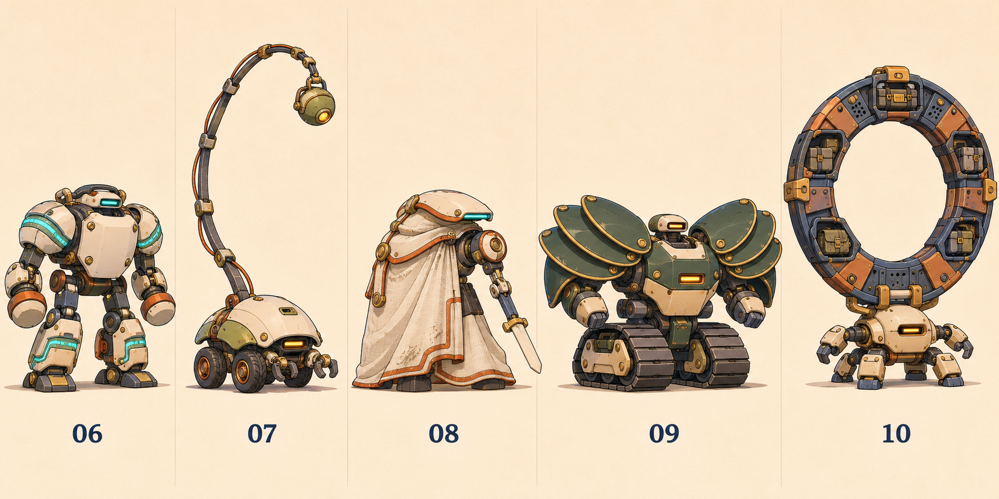
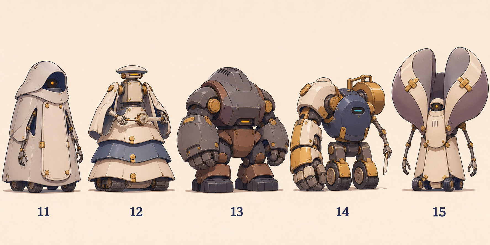
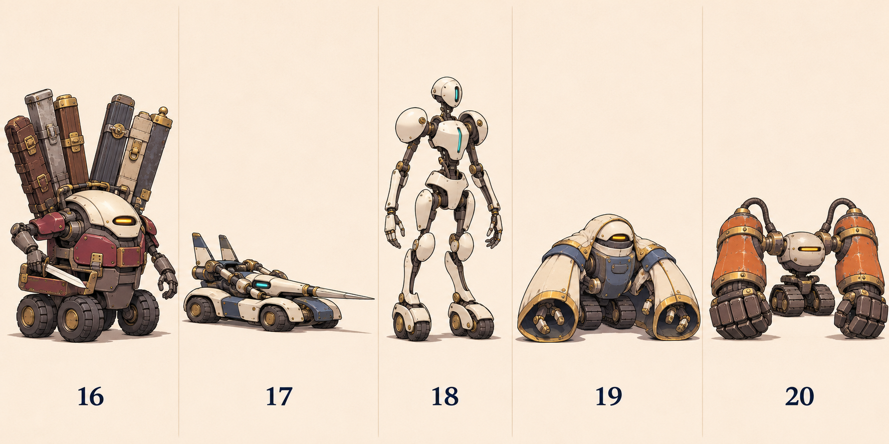

# 強敵の外観比較20案

長いマントと太刀、多腕、白く細い丸みのある体、大きく隆起した肩など、外観の設計から展開した比較画像です。5体ずつ4枚を生成し、全体が揃ってから一括保存しました。画像には比較番号のみを付けています。

[前回の造形比較20案](../strong-enemy-form-studies/README.md)とは別セットです。同じ番号でも別の案を指します。名前・職業・登場面・既存54体との対応は未決定です。

## 外観の方向

| 番号 | 外観の主な特徴 |
|---|---|
| 01 | 縦に長いマント、一輪の足回り、車体より長い細い太刀 |
| 02 | 小さい丸い本体、背中から伸びる6本の武装アーム |
| 03 | 白く細い一体外装、丸い肩と膝、武器を見せない姿 |
| 04 | 高く隆起した両肩、太い動力管、長い前腕と履帯 |
| 05 | 高い襟状の機関部、細い胴体、二つに分かれた長い後部外装 |
| 06 | 駆動部が見える軽装、左右対称の発光帯、短い打撃ユニット |
| 07 | 小型四輪の丸い本体、頭上へ大きく伸びる節状の尾 |
| 08 | 片側を覆う長いマント、反対側に露出した細い腕と短い刃 |
| 09 | 左右各3枚の扇状肩装甲、小さいセンサー、重い履帯 |
| 10 | 低い小型本体、背中に立つ巨大な収納環 |
| 11 | 頭上から裾までつながる外装、奥に引いた小さい光点 |
| 12 | 狭い上半身、横に広い三段の腰装甲、横向きに支える精密器具 |
| 13 | 首が埋まる厚い体、盛り上がる背面、短く太い脚と前腕 |
| 14 | 本体ほど大きい片腕、反対側の細い腕、背面の釣り合い重り |
| 15 | 小さい本体を囲む巨大な曲面の襟、低く垂れる細い腕 |
| 16 | 長いケース群を背負う丸い車体、前面の操作腕は2本 |
| 17 | 長く低い四輪車体、前後方向に揃えた細い槍状装置 |
| 18 | 白い装甲の間から細い骨格が見える体、長い前腕、車輪状の足 |
| 19 | 腕を隠す大きい袖状外装、内側の小さな操作腕、低い履帯 |
| 20 | 小さい中心部、地面近くまで下がる巨大な前腕、短い上腕 |

## 比較画像

### 01〜05

### 06〜10

### 11〜15

### 16〜20

## 画像を見ての評価

参照した人物の固有の髪型・顔・紋様・衣装と配色の組み合わせは避け、輪郭や装備比率を機械構造へ展開しています。特定作品との非類似を保証するものではなく、今回の見立てでは直接の連想より、長い刃・多腕・重量などの一般的なモチーフが前に出ています。

02・09・14・20はシルエットと機械の構造を結び付けやすい方向。01は長い刃と一輪、08は覆う部分と露出部分の非対称で個性が出ています。03・18は人型の比率が強いため、採用へ進む際は既存の小型機械との馴染みを比較したい。01・05・11は覆う外装の縦長シルエットが近く、色だけでなく姿勢・裾の形・移動方式をさらに分けられます。

生成画は外観比較用の主図です。02の6武装は読めますが、アーム接続の立体的な整合までは未確定。16の背面ケースは重なりがあり、6本の本数と収納方式を説明するには背面図が必要。19の袖内の操作腕も可動構造は未確定です。各装置の機能・動作・背面・縮小表示は、選定後の詳細設計で詰めます。

## 保存と検査

原画4PNGを再圧縮・トリミングせず保存。PNG復号、生成元とのSHA-256一致、20番号の一意性、相対リンクを確認しています。各画像5体と番号は目視でも確認しました。[画像台帳](manifest.json)に生成元ファイル名・寸法・ハッシュを記録。

ゲーム本体の変更はないため、ゲームの自動テスト・ビルド・実機確認は今回再実行していません。既存54体と前回の比較20案は保持し、今回の20案の正式採用・ゲーム統合・本番公開は未実施です。
