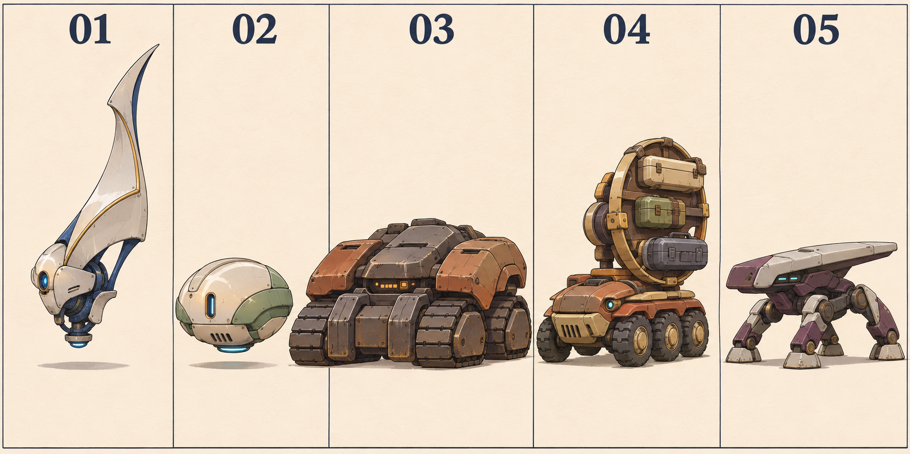
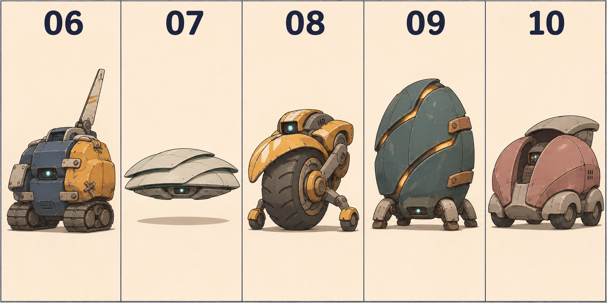
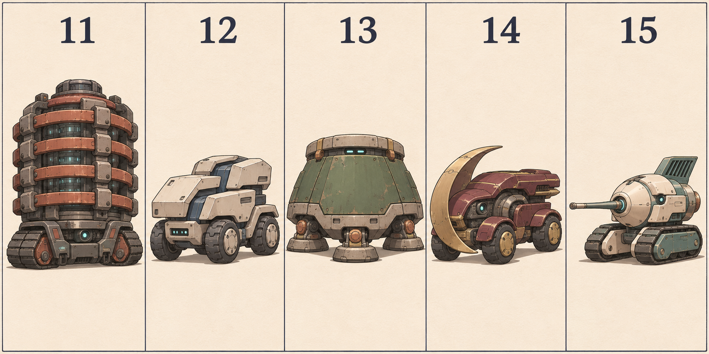
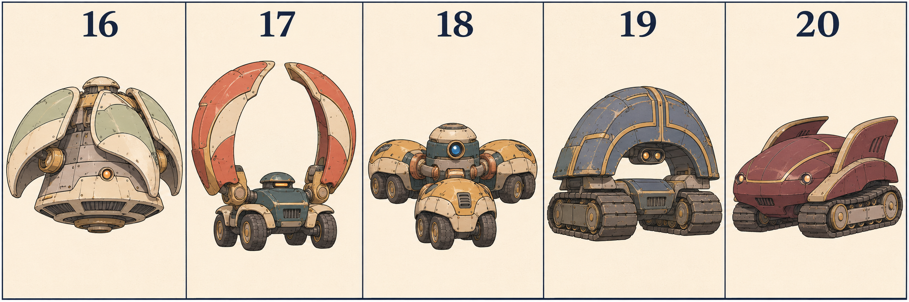

# 強敵の造形比較20案

**名前や職業を決めず、強さと存在感を形へ展開するための検討用20案です。** 既存の54体へ追加・置換することや、登場数・正式名・役割を確定した資料ではありません。

起点は「どんな強さを感じる存在か」。体格、姿勢、輪郭、装甲、装備配置へ展開します。ジョブ的な意匠は、その機体に合う場合だけ添えるモチーフで、職業を先に割り当てる設計にはしません。元になった作品の固有名や、敵キャラの仮名も画像には載せず、比較番号だけにしています。

初回の比較画像4枚をまとめて保存。単独の主図による方向比較で、部品数・可動域・背面・攻撃や動作の仕様は未確定です。強キャラとしての完成案とは扱いません。

## 20案の狙い

| 番号 | 感じさせたい強さ | 造形への展開 | キャラクターとしての方向 |
|---|---|---|---|
| [01](forms_01_05.png) | 静かな圧と孤高さ | 細い浮遊本体と、片側だけに高く伸びる一枚の装甲 | 少ない動作で場を支配する姿。装備量ではなく輪郭の異常さが印象に残る |
| [02](forms_01_05.png) | 小さな姿に収まった完成度 | 滑らかな小型の丸い車体、外へ出さない駆動機構 | 大きさと実力の落差。外見から能力の底が分からない |
| [03](forms_01_05.png) | 純粋な力と重量 | 横に広い装甲、低い重心、太い足回り | 踏ん張るだけで圧がある。正面から押し切る強さ |
| [04](forms_01_05.png) | 装備への執着と余裕 | 異なる収納ケースを背負う偏った回転フレーム | 装備を使い分ける個性。ただし現状は荷物の印象が強く、強者感を追加したい |
| [05](forms_01_05.png) | 鍛え抜かれた精密さ | 低く構える四脚、前へ伸びる薄い上部装甲 | 攻撃よりも構えの美しさで、隙の少なさを感じさせる |
| [06](forms_06_10.png) | 経験を重ねた底力 | 左右で異なる補修装甲、擦れた面、古い背面フィン | 旧式に見えて動作に迷いがない。傷と手入れが経験を伝える |
| [07](forms_06_10.png) | 何も乱されない静けさ | 薄い装甲を重ねた低い浮遊体 | 大きな反応をせず、最小限の移動で状況を変える方向 |
| [08](forms_06_10.png) | 大胆さと躍動感 | 大径の一輪と小さい支持輪、前へ流れる外装 | 不安定に見える構造を軽々と扱う、運動能力の格の違い |
| [09](forms_06_10.png) | 内側に眠る圧倒的な潜在力 | 閉じた縦長の殻、継ぎ目から見える内側、低い四脚 | 今見えている姿が全てではない、と感じさせる |
| [10](forms_06_10.png) | 穏やかさと読めなさ | 大きな左右の外装と、その奥へ引いた小さな本体 | 表面の柔らかさと、内側を見せない距離感 |
| [11](forms_11_15.png) | 制御が必要なほどの力 | 厚い帯と締結部で囲われた動力部、小さい台車 | 周囲の拘束部品そのものが、内側の力の大きさを物語る |
| [12](forms_11_15.png) | 適応し続ける完成度 | 位置のずれた複数の装甲と、その間のガイド | 戦いながら自分の構成を最適化していく方向 |
| [13](forms_11_15.png) | 動かせない存在感 | 大きな台形の胴体、極端に短く太い支持部 | 動かないこと自体に説得力がある、不動の圧 |
| [14](forms_11_15.png) | 一度の切り返しで決まる強さ | 片側に大きく回り込む三日月状の前部装甲 | 左右非対称の形から、独特の間合いと旋回を感じさせる |
| [15](forms_11_15.png) | 一点へ集中した研ぎ澄まし | 丸い前部から長く伸びる細い装置、簡潔な車体 | 得意分野が一つで、その完成度が突出している |
| [16](forms_16_20.png) | おおらかな姿と大きな力 | 丸い浮遊胴体、周囲を囲む大きな曲面装甲 | 穏やかな外見と、広い範囲へ及ぶ影響力の落差 |
| [17](forms_16_20.png) | 場を支配する大きな存在感 | 小さい本体を囲む二枚の高い曲面装甲と、大きな空間 | 本体の大きさ以上に、周囲の空間まで自分のものに見せる |
| [18](forms_16_20.png) | 一つに揃った意志 | 中心を囲む三つの駆動部と、整った接続 | 複数の部分が一体として正確に動く、乱れない協調 |
| [19](forms_16_20.png) | 古さの中にある洗練 | 大きなアーチ状の外装、古びた素材、整然とした装飾線 | 古いものを長く磨き上げた、静かな格 |
| [20](forms_16_20.png) | 努力を見せない余裕 | 滑らかな一体外装、流れる左右の装甲、簡潔な機器配置 | 構える前から落ち着いていて、能力を誇示する必要がない |

## 造形比較

### 01〜05

### 06〜10

### 11〜15

### 16〜20

## 現時点の見直し

01・09・11は輪郭だけで異常さや内在する力を感じやすく、既存敵と異なる強さを発展させやすい。03は重量、05は構え、17は占有する空間で強さを説明できる。

02・07・20のような簡潔な姿は、登場時の動作や戦い方を合わせて格を伝える必要がある。04は収納物が荷物に見えやすく、装備を誇る強者としての表現には追加検討が必要。全てを巨大化・武器増加・悪役顔へ揃えず、各方向の強さを個別に育てる。

ボスらしい存在感と、親しみのある機械の造形を両立する。顔は描き込みすぎず、機器の配置でそれとなく表情を作る。

## 保存検査

4PNGを復号し、生成元と保存先のSHA-256一致、番号01〜20の一意性、文書リンクを確認。原画は再圧縮・トリミングしていません。ゲーム本体は変更していないためゲームテストは再実行していません。画像の4枚・各5体は目視確認です。
