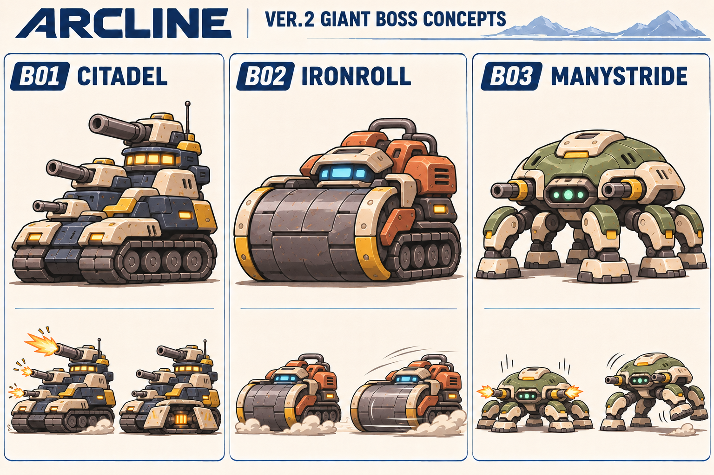
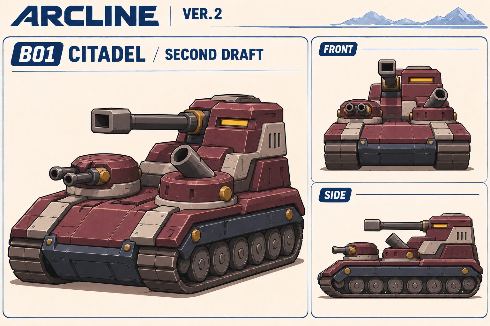

# B01 CITADEL：第二案

状態：新しい造形案を制作・目視確認。ユーザーによる最終承認は未取得。名前は引き続き仮称。管理IDはB01、コンセプトは12-2「多砲塔の戦車」を維持。

## 今回の問題設定

第一案は三つの似た砲塔を縦に積んだ構造で、通常戦車を増強した印象が強い。ボスの固有性を、装備の数・大きさ以外で伝えたい。

## キャラクターの核

**頑固で几帳面な移動城塞。ゆっくり相手へ向き直り、三つの異なる砲塔を順に構える。**

輪郭の核は、低く幅広い城壁状の車体と後方の角張った指揮塔。石の城や城壁の飾りを載せるのではなく、装甲面と重心で城塞を感じさせる。

## 第一案から変えたこと

| 項目 | 第一案 | 第二案 |
|---|---|---|
| 輪郭 | 似た砲塔が縦に三段重なる | 前方が低く広く、後方に指揮塔と主砲が立つ |
| 砲塔 | 三つとも単砲身で形が近い | 長い角形主砲・低い連装砲・短い臼砲の三種類 |
| 装甲 | 丸角の生成りパネルが多い | 大きな平面と段差のある厚い装甲 |
| 配色 | 濃紺と生成り、黄のアクセント | くすんだ赤紫を主色に、濃紺・薄い灰・真鍮色 |
| センサー | 複数の黄灯・窓が目立つ | 後方の細いセンサースリットを主な表情にする |
| 設定画 | 主図と小さい攻撃例 | 主図・正面・側面で配置を見る静的な設定画 |

## 造形の構成案

- 一体の車体に左右二本の長い履帯。分離・合体・歩行への変形は追加しない。
- 後方：角張った主砲塔と指揮部。一門の長い砲身、角形の砲口。
- 前方の二か所：低い連装砲塔と、短く太い臼砲塔。左右どちらを機体基準の正本にするかは次の上面図で固定する。
- 予備の砲や装置を足さず、三つの砲塔の違いを輪郭と動作へつなげる。

## 動き・戦闘の企画案

ゆっくり車体を向け、センサーが先に相手を捉える。連装砲・臼砲・主砲が順に向きを整える「几帳面な準備」で性格を出す。撃った後に一つずつ姿勢を戻す間も作る。

役割は、直接射撃・曲射・大きな一撃という三つの圧力の切り替え。すべてを同時に撃たせるのではなく、予兆と切替を読めるボスにする。実装方法、ターン内の扱い、攻撃数・威力・HP、弱点の仕組みは未確定で、現行ゲームの動作変更を指示するものではない。

## 画像を読み込んだセルフレビュー

- 主図では縦積みから前後・左右へ広がる輪郭に変わり、三種類の砲塔を見分けられる。
- 低い車体と後方の高い指揮部の重心差が明確になった。生成りの縁取りや持ち手状部品への依存も減った。
- 同じ一体型の機体として正面・側面を描けているが、完成した製造図・整合保証済みの三面図ではない。上面図・背面図がないため、砲塔の左右位置、回転時の干渉は未確定。
- 側面図は連装砲の片方が隠れる。隠れた部品を失ったものとは断定せず、上面図で二本の配置を確認する。
- 第一案より角張って硬派に寄った。ARCや通常敵と並べて、丸み・愛嬌を保てるかを見る必要がある。
- 名前が合う輪郭へ進んだが、静止画だけでは「頑固で几帳面」という振る舞いは検証できない。

## 残る作業

1. 今回の方向へのユーザーの意見を受ける。
2. ARCとの寸法比較を決める。まだ数値・倍率を確定しない。
3. 上面・背面を追加し、左右・砲塔位置・砲身干渉と履帯構造を固定する。
4. 予備動作と姿勢復帰の小図を作り、見た目だけで性格を説明できるか確認する。
5. ゲーム視点の縮尺で検証してから、戦闘仕様を具体化する。

## 原画比較

第一案の左列がB01です。

