# ARCLINE Ver.2 第二案・改訂セット

**設定画の改訂一巡を完了。54体の現時点の採用候補を統合しました。** 大ボス15体・中ボス8体・通常敵6体の29体を修正し、残る25体は第一案を継続。生成・修正は38回（上限100回）で、画像を読み直してから次の修正を行いました。ユーザーの最終承認・ゲーム統合はまだです。

大ボスの個性不足、フロントのさりげない顔らしさ、第一案レビューの主要構造課題を優先しました。途中案はGitへ小分けに保存せず、このセットとして一括保存します。

- [29体の採用原画と54体の台帳](manifest.json)
- [第二案のレビュー・修正完了範囲](REVIEW_JA.md)
- [38回の修正履歴](ITERATIONS.json)
- [大ボスの相対スケール設計案](SCALE_JA.md)
- [保存整合性検査](VALIDATION.json)
- [第一案54体・原画18枚](../ver2-first-proposal/README.md)

## 完了範囲

今回の「完了」はキャラクター設定画の改訂一巡です。主要な輪郭、個性、顔に見える機能部品、構成部品を読むための画像と設計メモを揃えました。精密な三面図の全寸法、動作素材、ゲーム視点の描画・対空仕様・当たり判定・ステージ配置・数値バランスは別工程です。

生成画像の補助図は構造を説明する参考図で、製造図ではありません。特に小さい転輪・羽根・通気口の微細な配置を、ゲーム実装が完了した根拠にしません。見つかった主脚数・車軸・節数・分離部品の不一致は、今回の採用案で整理しています。

## 54体の採用候補索引

「改訂」は第二案の個別原画、「継続」は第一案シートの該当列を参照します。第一案の原画18枚は変更していません。名前は仮称です。

| ID | 仮名 | カテゴリ名 | 現在のコンセプト | 状態・原画 |
|---|---|---|---|---|
| N01 | POCK | 履帯型 | 超小型戦車 | [第一案継続・第1列](../ver2-first-proposal/sheets/S01_N01_N02_N04.png) |
| N02 | SKID | 車輪型 | 二輪の高速機 | [第一案継続・第2列](../ver2-first-proposal/sheets/S01_N01_N02_N04.png) |
| N03 | ROLLO | 車輪型 | 大径輪の突撃機 | [第一案継続・第1列](../ver2-first-proposal/sheets/S02_N03_N05_N06.png) |
| N04 | TETRA | 歩行型 | 四脚の砲撃機 | [第一案継続・第3列](../ver2-first-proposal/sheets/S01_N01_N02_N04.png) |
| N05 | PAVIS | 防御型 | 大盾の装甲車 | [第一案継続・第2列](../ver2-first-proposal/sheets/S02_N03_N05_N06.png) |
| N06 | GLIDE | ホバー型 | 平たい滑走機 | [第一案継続・第3列](../ver2-first-proposal/sheets/S02_N03_N05_N06.png) |
| N07 | BRISK | 航空機型 | プロペラ戦闘機 | [第一案継続・第1列](../ver2-first-proposal/sheets/S03_N07_N08_N09.png) |
| N08 | MEND | 支援・観測型 | 修復支援機 | [第一案継続・第2列](../ver2-first-proposal/sheets/S03_N07_N08_N09.png) |
| N09 | HOPPA | 歩行型 | 二脚の跳躍機 | [第一案継続・第3列](../ver2-first-proposal/sheets/S03_N07_N08_N09.png) |
| N10 | SIGHT | 砲撃・射撃型 | 四輪の長砲身狙撃車 | [改訂 r2](revisions/N10_r02.png) |
| N11 | TWIN | 空中停止型 | ローター飛行機 | [第一案継続・第2列](../ver2-first-proposal/sheets/S04_N10_N11_N12.png) |
| N12 | NEST | 分離・合体型 | 親機と子機 | [第一案継続・第3列](../ver2-first-proposal/sheets/S04_N10_N11_N12.png) |
| N13 | RATTLE | 砲撃・射撃型 | ガトリング搭載車 | [第一案継続・第1列](../ver2-first-proposal/sheets/S05_N13_N14_N15.png) |
| N14 | POD | 砲撃・射撃型 | ミサイル搭載車 | [第一案継続・第2列](../ver2-first-proposal/sheets/S05_N13_N14_N15.png) |
| N15 | FLARE | 特殊放射型 | 火炎放射機 | [第一案継続・第3列](../ver2-first-proposal/sheets/S05_N13_N14_N15.png) |
| N16 | SPARK | 特殊放射型 | 電撃放射機 | [第一案継続・第1列](../ver2-first-proposal/sheets/S06_N16_N17_N18.png) |
| N17 | FOLD | 変形・展開型 | 折り畳み砲台 | [改訂 r2](revisions/N17_r02.png) |
| N18 | DART | 羽ばたき型 | 昆虫型の飛行機 | [第一案継続・第3列](../ver2-first-proposal/sheets/S06_N16_N17_N18.png) |
| N19 | SKIFF | 水上・水陸型 | 小型装甲ボート | [第一案継続・第1列](../ver2-first-proposal/sheets/S07_N19_N20_N21.png) |
| N20 | WADE | 水上・水陸型 | 固定浮体の水陸両用履帯機 | [改訂 r3](revisions/N20_r03.png) |
| N21 | BUZZ | 重機型 | 回転刃の切削機 | [第一案継続・第3列](../ver2-first-proposal/sheets/S07_N19_N20_N21.png) |
| N22 | LINK | 分離・合体型 | 複数機が合体する機体 | [改訂 r2](revisions/N22_r02.png) |
| N23 | MIRRA | 防御型 | 横長反射板の三輪防御機 | [改訂 r2](revisions/N23_r02.png) |
| N24 | FLUX | エネルギー兵器型 | 磁力発生機 | [改訂 r2](revisions/N24_r02.png) |
| M01 | LONGWATCH | 砲撃・射撃型 | 双眼測距箱の六輪狙撃機 | [改訂 r2](revisions/M01_r02.png) |
| M02 | DRUMMER | 砲撃・射撃型 | ガトリング搭載車 | [改訂 r2](revisions/M02_r02.png) |
| M03 | BORE | 重機型 | 中空コアドリルの掘削機 | [改訂 r2](revisions/M03_r02.png) |
| M04 | EMBER | 特殊放射型 | 圧力容器型の火炎放射機 | [改訂 r2](revisions/M04_r02.png) |
| M05 | SPRINGHEEL | 歩行型 | 二脚の跳躍機 | [第一案継続・第2列](../ver2-first-proposal/sheets/S10_M04_M05_M06.png) |
| M06 | HALO | 空中停止型 | 単一リフトファンのリング型飛行機 | [改訂 r2](revisions/M06_r02.png) |
| M07 | BASTION | 防御型 | バリア発生機 | [第一案継続・第1列](../ver2-first-proposal/sheets/S11_M07_M08_M09.png) |
| M08 | RESTOR | 支援・観測型 | 四履帯の修復支援機 | [改訂 r2](revisions/M08_r02.png) |
| M09 | FARWATCH | 支援・観測型 | 大型レーダーの索敵機 | [第一案継続・第3列](../ver2-first-proposal/sheets/S11_M07_M08_M09.png) |
| M10 | DRIFTKEEP | 空中停止型 | 小型飛行船 | [第一案継続・第1列](../ver2-first-proposal/sheets/S12_M10_M11_M12.png) |
| M11 | VEIL | 支援・観測型 | 煙幕の散布機 | [第一案継続・第2列](../ver2-first-proposal/sheets/S12_M10_M11_M12.png) |
| M12 | CONCERTINA | 変形・展開型 | 三段入れ子の伸縮砲台 | [改訂 r2](revisions/M12_r02.png) |
| M13 | CLEAVE | 分離・合体型 | 背中合わせに分割する機体 | [改訂 r3](revisions/M13_r03.png) |
| M14 | CARAVAN | 連結型 | 連結車両 | [第一案継続・第2列](../ver2-first-proposal/sheets/S13_M13_M14_M15.png) |
| M15 | FACET | 防御型 | 反射板の防御機 | [第一案継続・第3列](../ver2-first-proposal/sheets/S13_M13_M14_M15.png) |
| B01 | CITADEL | 砲撃・射撃型 | 多砲塔の戦車 | [改訂 r4](revisions/B01_r04.png) |
| B02 | IRONROLL | 重機型 | ローラーの圧砕機 | [改訂 r2](revisions/B02_r02.png) |
| B03 | MANYSTRIDE | 歩行型 | 多脚の重装機 | [改訂 r4](revisions/B03_r04.png) |
| B04 | BREAKWATER | 水上・水陸型 | 大型装甲外輪船 | [改訂 r3](revisions/B04_r03.png) |
| B05 | SALVO | 砲撃・射撃型 | 扇状の筒を持つミサイル搭載車 | [改訂 r2](revisions/B05_r02.png) |
| B06 | STAMPEDE | 車輪型 | 八輪の重装機 | [改訂 r2](revisions/B06_r02.png) |
| B07 | CROSSWIND | ホバー型 | 双胴の高速機 | [改訂 r3](revisions/B07_r03.png) |
| B08 | SKYFANG | 航空機型 | 固定翼の大型ジェット機 | [改訂 r2](revisions/B08_r02.png) |
| B09 | KESTREL | 羽ばたき型 | 鳥型の飛行機 | [改訂 r2](revisions/B09_r02.png) |
| B10 | SHOALWALKER | 水上・水陸型 | 水陸両用の歩行機 | [改訂 r4](revisions/B10_r04.png) |
| B11 | REVOLVER | 変形・展開型 | 回転装甲車 | [改訂 r2](revisions/B11_r02.png) |
| B12 | CONFLUENCE | 分離・合体型 | 複数機が合体する機体 | [改訂 r2](revisions/B12_r02.png) |
| B13 | LONGCOIL | 連結型 | 多節の機体 | [改訂 r2](revisions/B13_r02.png) |
| B14 | WAYFARER | 航空機型 | 飛行輸送機 | [改訂 r2](revisions/B14_r02.png) |
| B15 | LODESTAR | エネルギー兵器型 | 磁力発生機 | [改訂 r2](revisions/B15_r02.png) |

## 大ボス15体

### B01 CITADEL — 頑固で几帳面な指揮官

広い城塞車体と後方の指揮塔。顔の印象：指揮部の細い二窓と装甲のひさし。構成：三砲塔・左右二履帯・片側五主転輪。

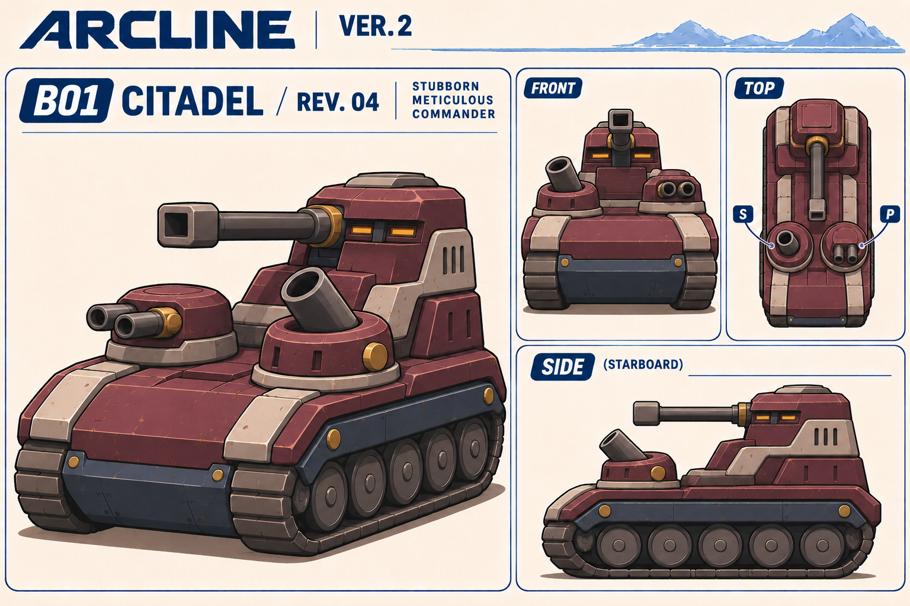

### B02 IRONROLL — 慎重に押し進む圧砕機

前面ドラムと後傾した胴体。顔の印象：ずれた小さな二窓と低いカウル。構成：三分割ドラム・後部二履帯・側面フライホイール。

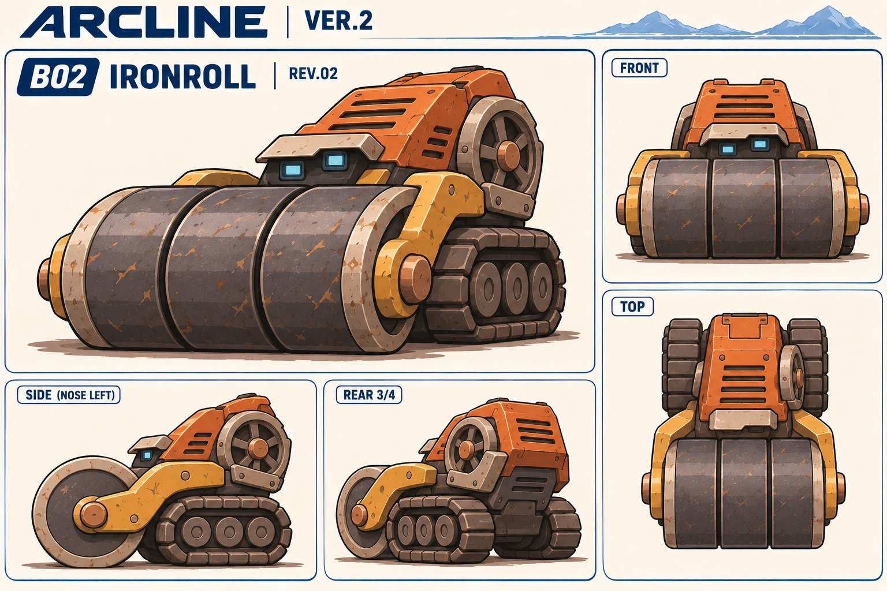

### B03 MANYSTRIDE — 用心深い鎧の守り手

長い三層の甲羅と低い姿勢。顔の印象：小さな観測鼻の二レンズと通気口。構成：六脚・三つずつの接続点・重なる装甲。

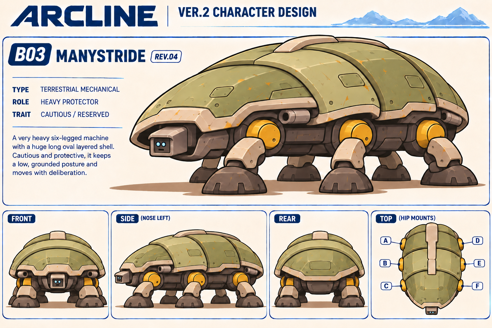

### B04 BREAKWATER — 誇り高い川船

大きな外輪と低い丸い船首。顔の印象：ブリッジの二窓と小さい通気口。構成：左右二外輪・高さの違う二煙突・前部一砲塔。

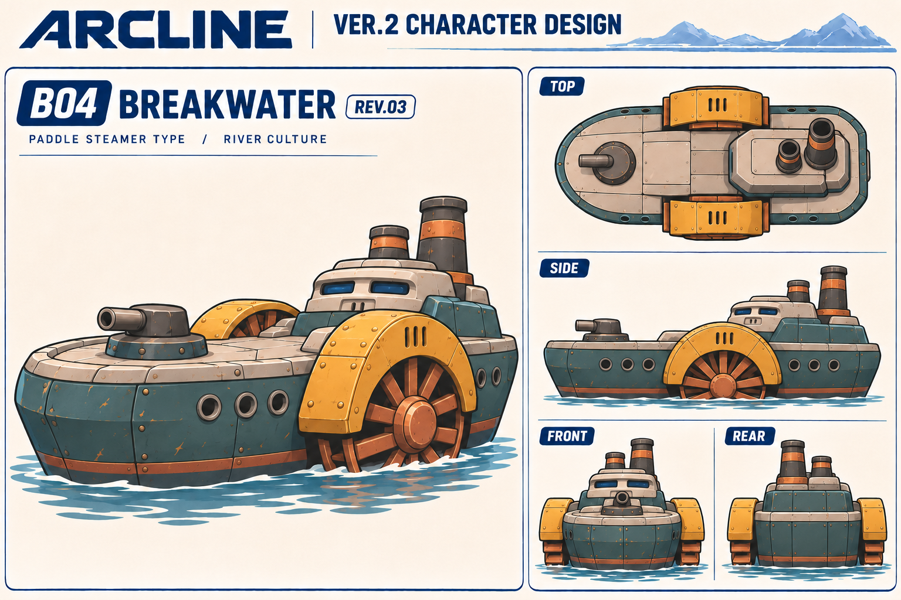

### B05 SALVO — 用心深い扇の番人

車体より大きい扇状の五本。顔の印象：ひさしの下の小さい二つの計器窓。構成：五つの筒・一つの支持梁・左右二履帯。

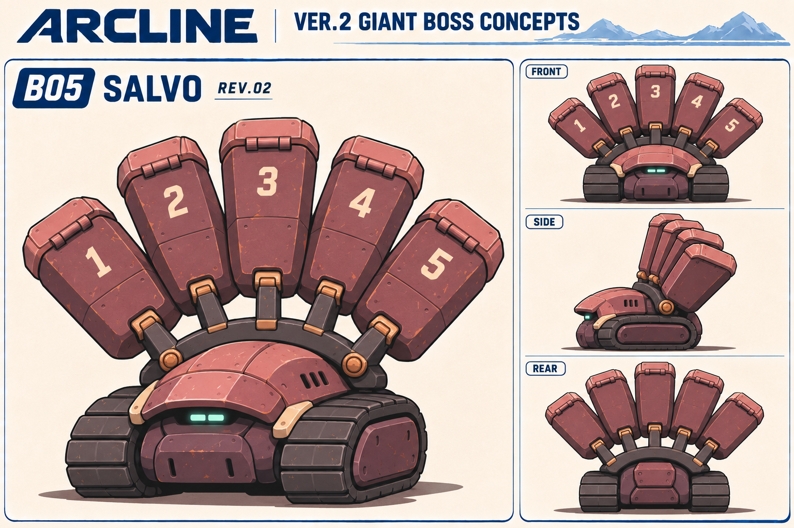

### B06 STAMPEDE — せっかちな重量級の走り屋

前重心の大きなカウルと低い後部。顔の印象：長い窓と小さな丸センサー、下の吸気口。構成：四軸八輪・後部二排気口。

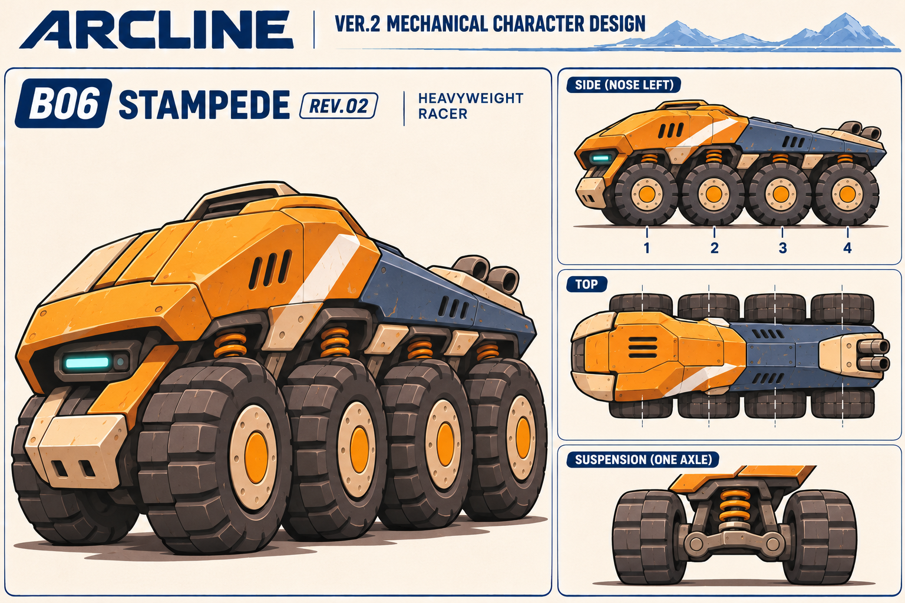

### B07 CROSSWIND — 余裕のある滑走者

上向きの舟首と大きな中央の空間。顔の印象：橋部の小さい二窓と短い通気口。構成：二舟体・二後部ファン・一つの接続橋。

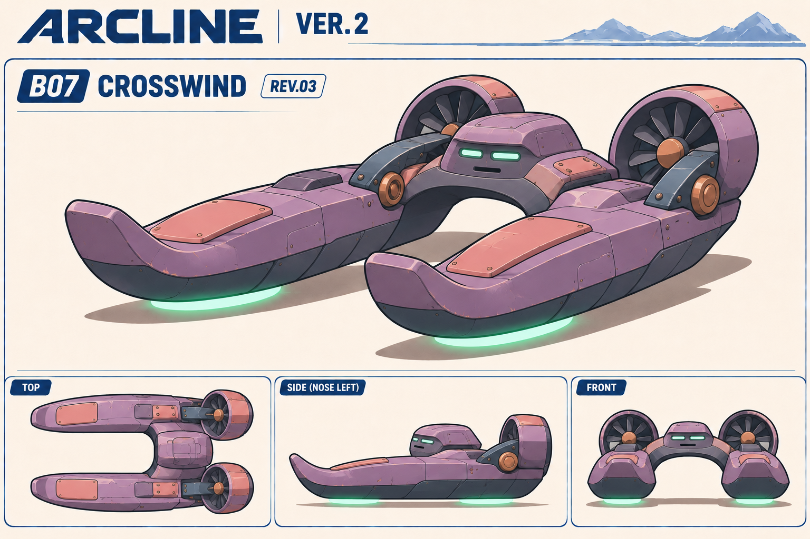

### B08 SKYFANG — 気取った高速機

短い機首と大きな丸い吸気部。顔の印象：斜めの計器窓と機首の吸気口。構成：固定主翼二枚・二エンジン・二尾翼・三支持脚。

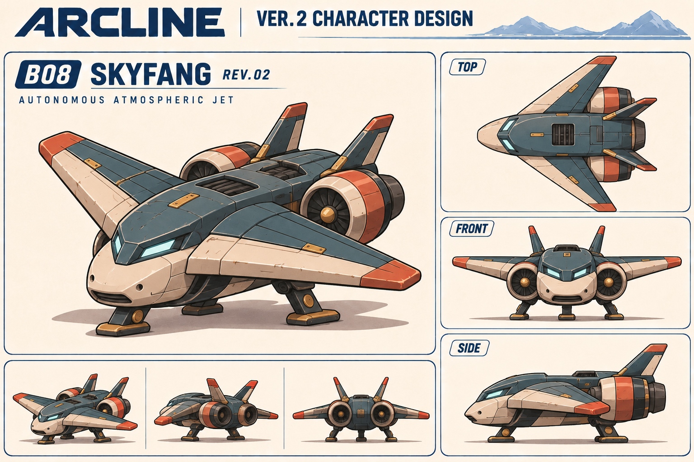

### B09 KESTREL — 静かな翼の監視者

丸い胴体と二段関節の機械翼。顔の印象：小さな観測レンズと鼻カバー、放熱スリット。構成：左右二翼・外翼板は片側四枚・二支持脚。

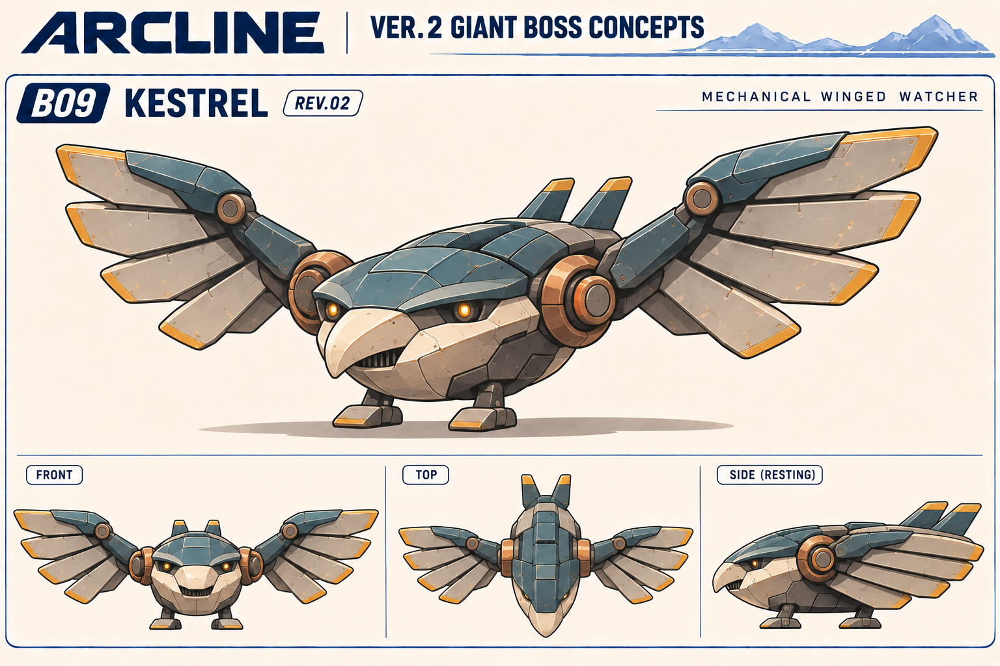

### B10 SHOALWALKER — のんびりした浅瀬の渡り手

ふくらんだ船体と後部観測塔。顔の印象：控えめな航海灯と船首の細い通気口。構成：四脚・四接続点・二推進器・甲板一砲塔。

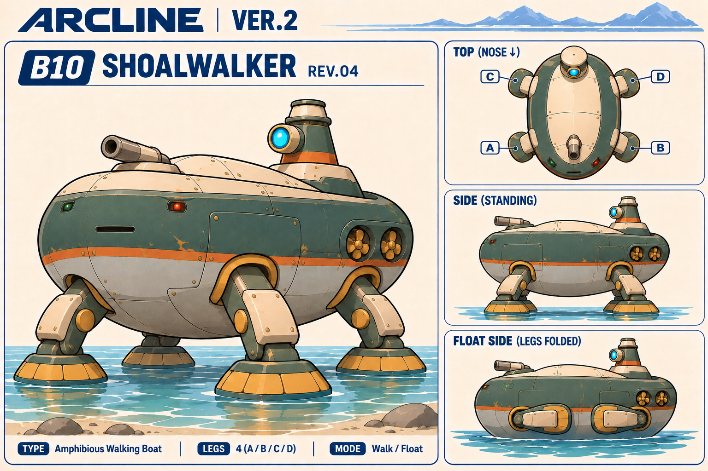

### B11 REVOLVER — 几帳面な切り替え屋

大きな四角い装置と小さい足回り。顔の印象：固定台座の小さい計器窓と放熱口。構成：四面A→B→C→D・一回転軸・左右二履帯。

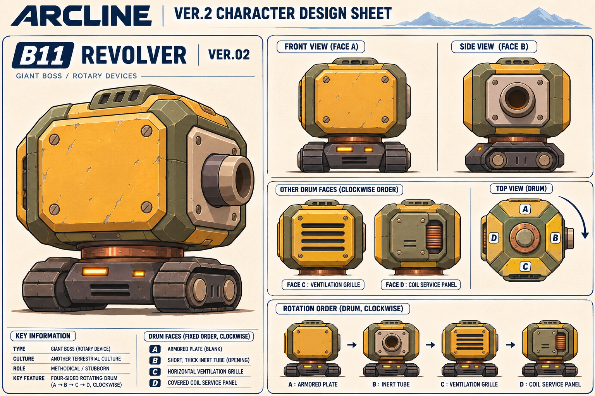

### B12 CONFLUENCE — 協調する三機

合体時に一枚の広いフロントを作る。顔の印象：左右機のセンサーと中央機のグリル。構成：三機・中央二履帯・左右機は各二輪。

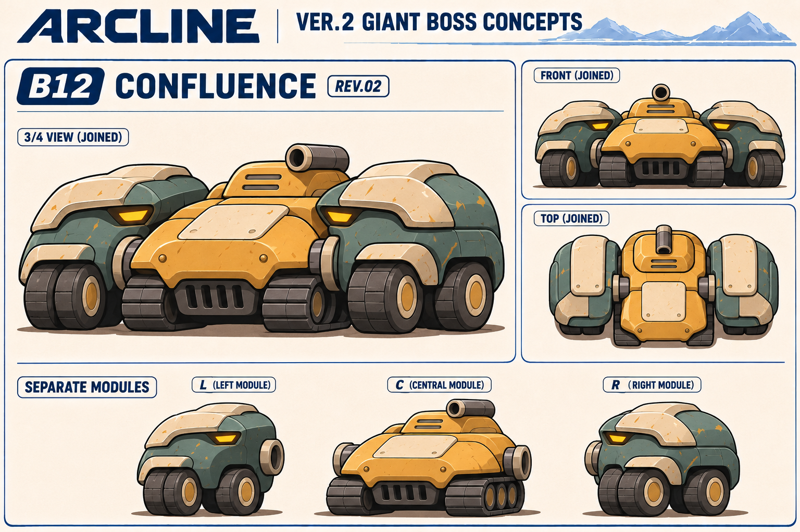

### B13 LONGCOIL — 長い体をまとめる調整役

高低のある節と連続した蛇腹の背骨。顔の印象：頭部の小さい二スリットと下の機器口。構成：五節・四接続・各節四短履帯。

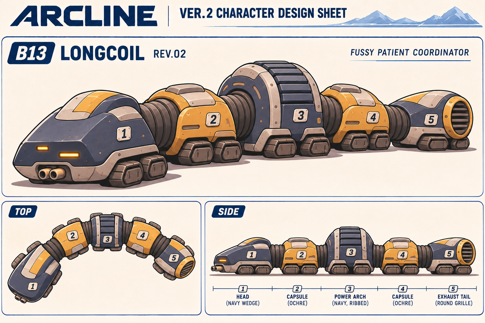

### B14 WAYFARER — おおらかな運び屋

広い翼とふくらんだ腹部。顔の印象：離れた小窓と小さい吸気口。構成：四エンジン・各三枚羽・三支持脚・腹部二枚扉。

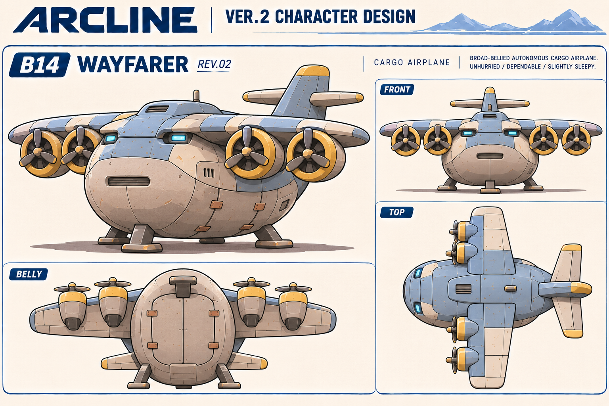

### B15 LODESTAR — 気難しい磁力の調律師

左右に高く立つ磁極と低い丸い台座。顔の印象：台座の小さい計器窓と放熱口。構成：二磁極・中央一コイル・四履帯。

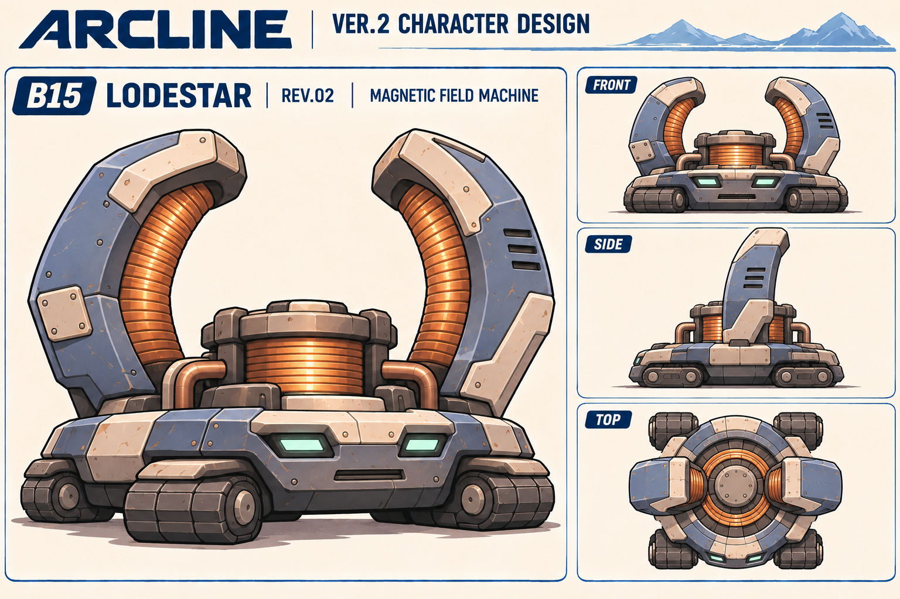

## 履歴の扱い

以前に保存した [B01 r02](B01_CITADEL_r02.png) は比較用に残します。現在の採用候補はr04です。38回のうち採用29枚を本セットへ収録し、不採用・中間案9枚のPNGは作業領域に保持、出典名・ハッシュ・理由を修正履歴へ記録しています。生成プロンプトは収録していません。
