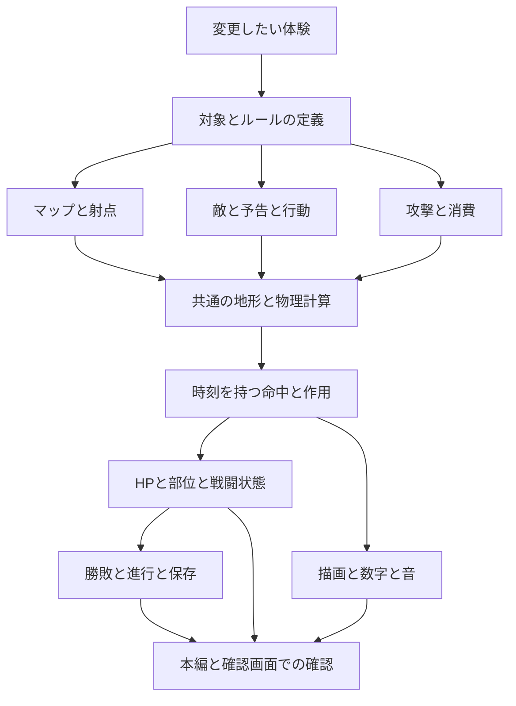

# ARCLINE 砲撃ゲーム開発ガイド

マップ、敵、攻撃、ダメージ、進行、操作、演出を、一つの対戦体験として設計・変更するための共通ガイド。**変更の目的から必要な参照先と確認範囲を開発側で引き受け、正本から本編・表示・確認画面まで整合させて完了する。** ユーザーにファイル間の関係や修正箇所の列挙を毎回求めない。

「どのファイルを直すか」より先に、「プレイヤーに何を判断してほしいか」「その変更で何が連動するか」を決める。データ・計算・表示に別々の正解を作らず、共通のルールを各画面・各実行経路で利用する。

## 参照基準と適用範囲

2026年11月9日 日本時間時点の基準は、[PR136](https://github.com/bittrove88/bittrove88.github.io/pull/136)がマージされたmain `1904d3e5032039eeae89b8c3f3f2604b67e94924`、ゲーム0.30.0。[PR135](https://github.com/bittrove88/bittrove88.github.io/pull/135)のメニュー統合0.30.1は、同時点では未マージの隣接変更として扱う。

対象は現在の1〜100面の砲撃ゲーム。Ver.2のキャラクター・ジョブ・ギミック企画は将来の候補であり、掲載済みであることを本編への採用と扱わない。この文書の追加で戦闘値や保存形式を変更しない。

最新のユーザー依頼と許可された範囲を優先する。実装事実は対象コミットのコードと生成元で、変更理由は該当PR・リリース記録で確認する。旧資料のHP・行動上限・「未マージ」表記を現行仕様へ戻す根拠にしない。現在値は正本で管理し、このガイドには設計判断と更新手順を残す。

## 1 砲撃ゲームで育てる判断

ARCLINEの中心は、地形を読み、射点と弾道を選び、準備に使う一手と反撃の危険を比較すること。狙いが当たった理由、外れた理由、次に変えられることが画面から理解できるようにする。

| 判断 | 設計で用意すること |
| --- | --- |
| どこから撃つか | 射線、砲口の高さ、頭上の空間、歩行・転移先、反撃を受ける場所 |
| どう通すか | 角度・出力、曲射、反射、破壊、場の作用の使い分け |
| いつ準備するか | 移動・機構操作に使う手数と、敵の予告・周期との関係 |
| 何を使うか | 通常弾、有限の武器・スキル、機体固有技の利点と消費 |
| 何を狙うか | 本体、部位、弱点、地形の開口、それぞれを狙う理由 |
| 失敗からどう戻すか | 別の射点、残り行動・HP・在庫、再挑戦時の復帰範囲 |

数値を増やす前に判断の違いを作る。HPだけを増やして同じ射撃を繰り返させる、狭い隙間だけを正解にする、説明のない消耗品を必須にする、といった難しさは見直す。

## 2 変更は体験と参照のつながりで扱う

次の図は変更を考える順序。実際のモジュールの読み込み順序は `game/runtime.json` で管理する。



マップ変更なら敵の射点・弾道・取得物まで、攻撃変更なら判定・上限・部位・消費・次手番までを見る。図の全項目を毎回修正・全件検査する必要はない。参照した結果として影響しない部分と、確認が必要な部分を分ける。

### 実装と表示の責任

| 責任 | 現行の主な担当 | 守る境界 |
| --- | --- | --- |
| 定義 | 設計JSON、攻撃カタログ、バランス設定 | 名前・値・IDの正本を明示する |
| 空間と弾道 | `geometry.js`、`physics.js` | 描画とは独立して接触・遮蔽・到達順を決める |
| 戦闘状態の適用 | `engine.js`、`final-team.js` | HP・部位・消費・交代を所定のタイミングで一度適用する |
| 敵の判断 | `enemy-actions.js`、`enemy-attacks.js`、`cpu-worker.js` | Workerの有無でルールを分けない |
| 表示と操作の接続 | `game.js`、`render.js`、`effects.js`、`ui/` | 確定した状態とイベントを使い、独自の戦闘結果を計算しない |
| 進行と永続化 | `campaign-run.js`、`inventory.js`、`save.js` | 戦闘内の一時状態と永続データを区別する |

`dist/`には生成物と手書き正本が混在する。ディレクトリ名だけで編集可否を決めない。`game/runtime.json` の `generated` に加え、`game/tools/generation.py` と各 `build_*` を確認する。`generated` に載らないデータ生成物もある。

## 3 分野別の編集元と反映先

パスは原則として `ARCLINE/` からの相対パス。複数の入力を合成する項目では、変更したい値の正本を選ぶ。

| 分野 | 編集する正本と処理 | 直接つながる主な範囲 |
| --- | --- | --- |
| 地形・出撃点・機構配置 | `design/expedition_013/stage_blueprints.json`、`game/dist/geometry.js` | `build_campaign.py` → `design/runtime_campaign_20x5.json` → `build_levels.py` → `game/dist/levels.js`、攻略資料・マップ総覧 |
| HP・部位HP・行動上限 | `design/combat_balance.json`、`game/tools/balance.py` | `build_campaign.py`・`build_encounters.py`、開始時の難易度適用、HUD・最終戦・攻略記録 |
| 敵の身体・弱点・部位・砲口 | `game/visual/encounters.json`、`game/tools/build_encounters.py` | `game/dist/encounters.js`、接触・描画・照準。ボスHPは共通バランス設定を優先 |
| 敵の歩行・転移・選択 | 手書き `game/dist/enemy-actions.js`、`engine.js` | 本編・Worker・非Worker経路、足場変更後の判断、次手番 |
| 敵の固有技・予告 | `design/attacks/definitions.json`、手書き `game/dist/enemy-attacks.js` | 予告位置・攻撃計画・物理・部位破壊後の行動・確認画面 |
| 自機性能・通常弾 | 手書き `game/dist/combat.js` | 機体選択、歩行・チャージ・通常弾、HP表示。必殺技は攻撃カタログも合成 |
| 武器・必殺技・攻撃説明 | `design/attacks/definitions.json`、手書き `game/dist/combat.js`・`weapons.js`・`physics.js` | `build_attacks.py` → `attack-catalog.js`、名前・実挙動・ダメージ・演出・図鑑 |
| スキル | 手書き `game/dist/skills.js`、`engine.js`、`game/ui/battle-catalog.js` | 効果の開始・失効・上書き、所持・消費・説明・共通アイコン |
| 取得物と章在庫 | `design/pickup_placements.json`、手書き `game/dist/inventory.js`・`campaign-run.js` | 取得時刻・一度だけの台帳・難易度別保存・再挑戦・一覧 |
| マップの美術 | `design/backgrounds/complete/`、`design/components/complete/`、`design/components/runtime-approval.json`、`game/ui/backgrounds.js`・`component-art.js` | 生成描画器、本編・マップ総覧・紹介デモ。衝突形状とは分離 |
| 攻撃演出・表示時計 | 手書き `game/dist/effects.js`・`attack-motion.js`・`render.js`・`game.js` | 弾の位置、命中数字、反応、音、停止・スロー、次の操作 |
| UI・入力・カメラ | `game/ui/`、`game/styles/`、手書き `game/dist/viewport.js`・`presentation.js`・`game.js` | 生成先、実タッチ・回転座標・フォーカス・一覧位置・ゲーム状態 |
| 仲間・物語 | `design/expedition_013/crew.json`、`design/narrative_0_13.json`、`game/tools/build_crew.py`・`build_story.py` | 解放・加入順・日英本文・既読・原画待機・章再生 |
| 最終戦 | `stage_blueprints.json` の `finalBattle`、`combat_balance.json`、手書き `game/dist/final-team.js`、`game/ui/final-team-ui.js` | 4戦場、固定順、担当量、交代、出撃時スナップショット |
| 保存・難易度・補充 | 手書き `game/dist/save.js`・`campaign-run.js`・`crew-usage.js`・`master-progress.js` | 旧セーブ、難易度切替、進行編集、在庫・補充の整合 |
| BGM・効果音・映像 | `design/ending_media.json`、`design/ending_roll.json`、`design/audio/sfx/runtime.json`、`game/ui/audio-manager.js`・`sfx-manager.js`・`ending-credits.js` | 本編とプレビューの共通時計、素材待機、消音・停止、音源の生成・配布 |
| 版数・依存・配布 | `game/runtime.json`、`game/tools/generation.py`、`build_runtime.py`、各生成・配布ツール | HTML・Worker・キャッシュ・単体HTML・ZIP。生成一覧だけで配布登録済みと判断しない |
| 紹介サイト | `site/site.js`・`experience.js`・`experience.css`、`index.html`、`site/gameplay-captures.json` | 現行ゲームの画像・説明・デモ・リンク・キャッシュ |

攻撃の全パラメータがJSONへ集約済みとは扱わない。カタログの上書き前後や手書きの分岐も読み、**実行時に有効な値**を確認する。新しいルールを足す際は、同じ値をさらに別の画面へ直書きする代わりに、所有する定義・共通関数から渡す。

## 4 マップとギミックを設計する

各面の体験を一文にする。「高い棚へ移ると反射板の裏を狙える」「壁の一片を壊すと低い射線が開く」のように、形状と選択の因果を示す。色や装置を替えるだけで同じ攻略を繰り返さない。

配置は見た目と実際の世界の両方で確認する。出撃後の安全配置、砲口の振り幅、頭上、反射の入口と出口、転移の実着地点、橋・破壊後の支持面を見る。歩行は1ターン左右累計140px、接地可能な上面は水平から70度以下という現行条件を使う。表示用のカメラ拡大で地形座標や判定を変えない。

主題の操作には選ぶ理由を持たせ、別解には射点・手数・反撃の受け方の違いを残す。機構を使わせるためだけに、広い曲射や転移の選択肢を一律に塞がない。有限の消耗品を使わなくても成立する基本経路を確認する。

| ギミックで決めること | 確認する関係 |
| --- | --- |
| 作用する対象 | 弾・機体・地形のどれに作用するか。未実装の昇降・連鎖崩落を仮定しない |
| 作用範囲と形 | 見える輪郭・ON/OFFと実際の接触範囲が一致するか |
| 切り替わる時刻 | ターン境界・周期・端子操作で、表示と物理が同じ状態になるか |
| 攻略への役割 | 射点、到達経路、準備、反撃の危険の何が変わるか |
| 状態変化の後 | 破壊・開閉・押し引き・転移の後も接地と次の行動が成立するか |

既存記号の意味も守る。Wは床の反射材、Cは弾の減速域。Tは磁場の極性切替であり、任意の扉を操作する端子ではない。雲は見える固定輪郭と判定を共有し、透明な隙間に当たり判定を置かない。

一面ずつ「制作 → 実描画 → 改善 → 再確認」を行い、前後の面、同テーマ、離れた区間の同機構と比較する。詳細は[マップデザイン方針](../../design/MAP_DESIGN_PRINCIPLES_001_100.md)。同資料の旧バランス値は現行設定で読み替える。

## 5 敵キャラクターと攻撃パターンを設計する

敵は外観・性能・行動を組み合わせ、プレイヤーに求める判断を定める。通常敵は射点や弾道の違い、中ボスは部位・固有モチーフ、大ボスは予告と対処、最終戦はこれまでの判断の総括を担う。強さを大きさや弾数だけで表さない。

敵ごとに、身体と弱点、砲口、移動できる足場、技の選択条件、予告の確定時刻、行動後の隙、部位破壊後の変化を定義する。原画の見える部位と判定の位置・向き・斜面回転を揃える。演出だけで「砲が壊れた」と見せ、攻撃条件が変わらない状態を作らない。

予告はプレイヤーが対処できる情報にする。現行の固有技は予告で位置を固定し、発射直前の自機位置や照準へ追従させない。行動選択、移動・転移の消費、再使用待ち、射撃を同じ手番として整理する。

通常敵の戦略的歩行・転移は `enemy-actions.js` の共通判断を使う。地形変更後には足場・候補位置・遮蔽を再評価する。Workerへ送った後に状態が変わった場合は古い計画を採用せず、非Worker経路も同じルールを利用する。関数、DOM、描画時計を送信データへ混ぜない。

確認は「敵の一発が出る」までで終えず、予告 → 自機の対処 → 敵の行動 → 次の自機操作までつなぐ。AIを調整した際は固定シード等で再現条件を残し、自動攻略の成功を人間の初見の楽しさや勝率と置き換えない。

## 6 攻撃とダメージを一つの仕様にする

各技は[グラフィックとモーションのガイド](ARCLINE_GRAPHICS_MOTION_GUIDE.md)に従い、弾道・着弾・敵効果・時間・終了を個別に設計する。加えて、威力の予算と適用先を明確にする。

| 項目 | 必ず決める内容 |
| --- | --- |
| 発射 | 弾数、角度、出力、初速、遅延、分裂・収束の条件 |
| 接触と範囲 | 点・爆風・円周・波の区別、遮蔽、反射、貫通、地形破壊 |
| 威力 | 1発・1段・技全体のどの値か、通常・弱点・大ボスの上限 |
| 部位 | 本体との優先関係、破壊後の後続弾、残り威力の扱い |
| 追加作用 | 押す・引く・回復する対象と量、作用時刻、地形との関係 |
| 消費 | 1回の使用で消費する行動・武器・必殺技・スキルの回数 |
| 終了 | 全段の適用、余韻、敵手番への移行、次の入力再開 |

### 計算と適用と表示をつなぐ

現行では `physics.js` が時刻付きの `damage`・`part-damage` 等を作り、`engine.js` の `applyEvents` が到達済みのイベントを適用する。`render.js` の累積数字も到達済みのダメージから表示する。新しい攻撃も、この関係を保つ。

1. 実際の地形・機体・部位に対して接触と作用順を計算する。
2. 技全体の上限、対象の残HP、部位へ使った威力を踏まえて有効ダメージを確定する。
3. 命中時刻にHP・部位・強制変位を適用し、同じ出来事を数字・反応・音へ渡す。
4. 終端処理や再描画で再適用せず、消費と手番を一回だけ確定する。

現行の換算は内部1単位＝表示20ポイント。HP・技威力を扱う場所では内部値か表示値かを明記し、換算は `ArcCombat.pointsPerUnit`・`points` を使う。画面ごとの独自倍率や早い丸めで結果を変えない。

たとえばヒバリの通常対象への上限35は、中心11と光輪12×2の合計。部位を破壊した光輪は、その部位の残HPだけを消費し、残った威力を先へ運ぶ。同じ12を部位と本体へ重複計上しない。前進した円周が届いていない敵や、通過済みの内側へ後から入った敵を命中扱いにしない。この例の値は他の技へ一般化しない。

回復は説明上の予定ダメージではなく、実際に与えた量と回復上限へ従う。複数段でも武器・必殺技の消費を弾数分に増やさない。フレームレート、シーク、停止・再開、最終適用で合計量が変わらないことを、変更に関係する経路で確かめる。

### 演出と時間

静止・スロー・加速は読ませたい瞬間だけに用いる。等速と自然な連射間隔も完成形として選ぶ。表示時計を使う場合は、弾道・命中・数字・音・強制移動が同じ進行を参照し、Workerへ渡す射撃計画から時計の関数を分離する。

通常速度で「狙う → 発射 → 命中 → 反撃 → 次の操作」を見る。外れ・遮蔽・反射・低い残HPでも意味が伝わるか確認する。装飾の粒子へ説明のないダメージを持たせず、光や残像が敵・足場・予告を隠す場合は量と時間を減らす。

## 7 HPと難易度と行動上限を調整する

HP、攻撃力、照準誤差、行動上限、地形、在庫は別の調整軸として扱う。どの判断を変えたいのかを明記し、マップの不備を敵HPやAIの変更で埋めない。

現行0.30.0は `design/combat_balance.json` がHP・部位HP・上限の正本。通常4面の設定は5面ごとのテーマ単位で共有し、中ボス・大ボスは個別設定を使う。NormalとHardはHP・行動上限が共通。Easyの敵HPは基準の75％を四捨五入し、上限80とする。照準誤差と射線表示の難易度差も維持される。「難易度差は狙いだけ」という旧説明を再利用しない。

難易度適用は開始時の戦闘状態で行い、元のレベル配列を変更しない。再開始・再挑戦・ボス段階移行でHP倍率を二度適用しない。部位HPと本体HP、HUD、説明、Workerへ渡す状態が同じ有効設定を使うことを確認する。

調整時は、変更対象の代表面で、撃破に必要な命中、準備の手数、反撃を受ける回数、残HPと行動の余裕を記録する。`HP ÷ 一発の威力` は見積もりに使えるが、遮蔽・外れ・部位・移動・消耗品を含む攻略の証拠にはならない。

新しいHP・上限・物理・AIで、過去の操作列が現在も勝てるとは扱わない。古い証拠は当時のコミット・条件の履歴として保持し、必要な代表ケースを現行エンジンで更新する。

## 8 取得物と進行と再挑戦を設計する

武器・スキルには、拾う価値、取得へ向かう危険、今使うか残すかの選択を持たせる。取得物は地形内へ埋めず、実際の射撃・移動・出現ターンで届く位置へ置く。地形を変えた場合は座標だけでなく到達経路も見直す。

取得IDは一度だけの台帳と結び付く。名称の変更や並べ替えでIDを作り直さず、再読み込み・面の再選択・難易度切替で重複取得や消失が起きないようにする。章在庫、戦闘中の残数、保存されたチェックポイントの関係を保つ。

| 状況 | 保持と復帰の基準 |
| --- | --- |
| 通常の画面閲覧 | 所持・進行・選択機体を勝手に変更しない |
| 1〜99面の再挑戦 | 消費後の在庫と取得台帳を保持する現行ルールに従う |
| 難易度切替 | 攻略・保有・章在庫・補充・物語を難易度別に復帰する |
| 仲間の変更 | HP割合、必殺技残数、解放・補充状態等の現行条件を引き継ぐ |
| 100面の再挑戦 | 対象機体の出撃時スナップショットへ戦闘内で戻す |
| マスター設定 | 進行・在庫・チェックポイントの整合を保って保存する |

永続保存に失敗したら、ライブ状態だけを先へ進めない。保存schema・キー・resetVersionを機能追加の都合だけで上げず、旧セーブの不足フィールドへ互換の初期値を用意する。復帰条件を変える場合は、その変更を独立した仕様として扱う。

### 最終100面

最終戦は固定10機・4戦場の専用フロー。0.30.0では自機HP100、担当150ポイント、各20行動、必殺3。Easyは担当80ポイント。担当量と総HPを混同せず、交代時に当該機体のHP・行動数を切り替える。上限ちょうどで担当達成した場合の交代・勝利を、行動超過の敗北より優先する。

通常面の変更を理由に、固定順、担当量、戦場切替、敗北機からの再挑戦を変えない。最終戦の変更では、担当達成・部位・交代・段階移行・再挑戦を一続きで考える。

## 9 UIと物語と音をプレイへつなぐ

画面はプレイヤーが今判断する情報を優先する。照準中は角度・出力・射線・残数・行動可能状態、着弾時は実際の命中と残HP、次手番では敵の予告と操作の再開が読めるようにする。内部の検証用情報を通常のプレイ画面へ持ち込まない。

所持品・図鑑・確認用の技紹介は、戦闘と同じID・名前・説明・アイコンを参照する。閲覧、選択、確定、消費を区別する。PR135の統合方針ではカテゴリと保有範囲の切替、選択とスクロールの維持、明示的な仲間確定を扱う。未マージのため、現行mainの画面と区別して接続する。

タッチ、マウス、キーボードは同じ操作へつなぐ。常時横向きの回転、左右のセーフエリア、二指ズーム、見渡しと照準、スクロール後の誤タップを、共通の座標変換・入力制御で扱う。カメラ移動やリサイズ通知でHP・弾道・行動数を変えない。小画面と英語の長い説明でも、対象・状態・戻り先が分かることを確かめる。

物語やチュートリアルは、実装された変化を、プレイヤーが必要とするタイミングで伝える。敵の学習・歩行・転移の説明を変えても、既読を初期化したり、新しい通知や実演を自動追加したりしない。機体加入は原画の読込・decode完了と演出開始を揃える。

BGM・効果音はゲーム状態と実際の作用に合わせる。読み込み待ち、失敗、停止・復帰、二重再生、同じ命中音の再発火を考える。音声のデコード・再生を変更する場合はAAC対応ブラウザ等の検証条件も計画する。視覚だけを変更した作業へ音声一式の検査を慣例で追加しない。

## 10 変更をまとめて完了する手順

実作業の開始時は [AGENTS](../../AGENTS.md) 冒頭の手順から本章を読み、第3章の対象分野と第11章の検証へ進む。PRには [ARCLINE用テンプレート](../../../.github/PULL_REQUEST_TEMPLATE/arcline.md)の項目を使う。記録は既存の作業記録からPR本文へ引き継ぎ、検証計画・証拠はリンクする。

1. **目的を一文にする。** 誰のどの操作・判断を改善するか、現在の症状と期待する結果を書く。
2. **基準を固定する。** 最新mainと未マージPRを確認し、作業基準のコミット、競合しうる変更、保護範囲を決める。マージの許可範囲と条件を記録し、今回の作業に有効な許可は引き継ぐ。
3. **正本と利用先を洗い出す。** このガイドの表から所有する定義・処理を選び、本編・Worker・UI・確認画面・保存への直接影響を追う。参照調査は開発側で行う。
4. **変更と確認の単位を決める。** 目的に必要な依存先を一つの変更として含め、必要な検査、対象外と理由、完了条件を記録する。
5. **正本から実装する。** 生成物だけの上書き、表示だけの帳尻合わせ、画面ごとの値の複製を避ける。一面・一技ごとに実際に描画し、体験を改善する。
6. **必要な派生物を同期する。** 生成一覧、読み込み順、Workerのimport、総覧・単体HTML、説明・日英、キャッシュ・配布を変更内容に合わせて揃える。
7. **選んだ条件で確認する。** 修正前の再現と修正後の同操作、直接影響する隣接動作を確かめる。成功後に無関係な全件検査を足さない。
8. **結果を状態ごとに伝える。** 変更・理由・確認結果・未確認条件を記録し、ローカル、コミット、PR、CI、マージ、配信、公開URL、物理端末を区別する。

ユーザーへ返すのは、実現した挙動と判断が必要な選択肢。通常の参照先確認や生成物の追従を、追加依頼としてユーザーへ差し戻さない。依頼の範囲を超えるゲームルール変更が必要な場合は、その具体的な変更と影響を示す。

### 変更とPRの単位

**1PRは、一つの目的を実現し、独立して動作・検証・復旧できる単位にする。** ファイル数、分野名、面数だけでは区切らない。「ヒバリの見える光輪と命中を一致させる」なら、物理・ダメージ・表示・確認画面・必要な生成物を同じPRへ含める。判定だけ、数字だけ、説明だけを別々にマージして不整合を残さない。

| 単位 | 区切り方 |
| --- | --- |
| 制作・内部確認 | 一面・一技・一つの導線を作って確認し、改善する |
| コミット | 意図を説明できる整合した変更。正本と必要な生成物を同じコミットに含める |
| PR・マージ | 一つの目的と完了条件を持ち、単独で成立し、問題時に影響を絞って戻せる |
| 公開 | 実際の配信方式に従う。このリポジトリではmainへのマージがPages配信につながるため、配信可能な状態でマージする |

マップは一面ずつ制作し、同じ改善目的と検証範囲を持つ完成分をPRへまとめてよい。「必ず一面一PR」「100面すべてを完成してから一PR」のどちらも固定ルールにしない。

別PRへ分けるのは、目的・採否・検証・復旧のいずれかを独立して判断できる場合。メニュー整理と攻撃力調整、大規模な構造移行と新技追加、無関係な既存不具合の修正は原則として分ける。今回の実現に必要な小さな共通化は同じPRへ含め、必要性と既存挙動への影響を説明する。

複数の変更が一緒でなければ成立しない場合は一つのPRへまとめるか、先に既存挙動を保つ共通基盤を独立してマージし、その上に機能を追加する。未完成機能を含む中間状態をmainへ置く前提で分割しない。

### マージの順序と条件

依存がある変更は「共通基盤 → それを利用する機能 → 独立した調整」の順に進める。依存のないPRはそれぞれの完了条件でマージできる。同じファイルを触るという理由だけで一つへまとめず、未マージPRをすべて取り込むことも既定にしない。

たとえばHP設定の集約とメニュー変更は別PRとして成立する。HP設定が先にmainへ入ったら、メニュー側で新しいHP・難易度説明を保持して統合する。メニューを完成させるためにHP変更を巻き戻したり、説明へ旧値を再入力したりしない。

マージ前には次を満たす。

1. 目的・対象・対象外・完了条件が明確で、必要な実装・表示・説明・生成物が揃っている。
2. 影響範囲に合った検証が成功し、今回の変更による不具合や、完了条件に関わる指摘が解消している。
3. 最新mainの先行変更を保持している。基準更新や競合解消で変わった箇所と、その直接の影響先を再確認している。
4. 保存互換性、公開入口、版数・キャッシュ・配布が、今回必要な範囲で整合している。
5. マージに有効なユーザー指示と、その条件を満たしている。ユーザーが「確認後にマージ」と指示済みなら、条件を満たした時点で進め、同じ許可を再確認しない。

マージの許可が必要な場合も、実装・検証・PRの内容を先に具体化し、ユーザーが判断できる最終段階で求める。許可を待つことを理由に、その前にできる準備を残さない。

検証済みの状態と最終マージ対象の差分を確認する。同じ内容・条件で成功済みの無関係な検査は再利用し、先行マージで影響が変わった検査を選んでやり直す。ブランチが最新になっただけで全件を再実行することも、競合を解消しただけで確認済みとすることもしない。

マージ後は対象コミットのCI・Pages配信を確認し、必要な公開URL確認を行う。公開後に重大な不具合が出たら、影響する変更単位で修正または復旧する。後続PRの依存と保存互換性を調べ、mainの履歴全体を無条件に巻き戻さない。

### 作業中に見つけた別の変更

発見した内容を、今回の目的との因果関係で判断する。ファイルが近いことや、同時に直すと便利なことだけで作業を増やさない。

| 発見 | 扱い | 例 |
| --- | --- | --- |
| 今回の変更で生じた不具合・更新漏れ | 同じ変更で直し、必要な検証まで完了する | 技の威力を変えた結果、数字や図鑑が旧値のままになった |
| 目的を成立させるために必要な隣接修正 | 許可された目的の範囲で含め、理由と影響を記録する | 光輪の命中修正に、部位破壊後の残り威力の計上が必要になった |
| 独立した既存不具合 | 原因と影響を調べ、独立して直せるなら別変更にする。未依頼の修正を今回へ混ぜない | 持ち物画面の整理中に、別の画面のスクロール不良を発見した |
| 新しいゲームルール・体験の追加 | 根拠と選択肢を示して別提案にし、採用前に実装しない | HP増加に合わせて、武器威力や取得量も増やしたくなった |
| 将来の保守性・見た目の改善 | 具体的な重複・不整合・プレイ上の問題がある場合に、効果と工数を比較して提案する | 新技の登録が複数の一覧へ重複し、登録漏れが再発している |

別件でも、セーブ消失や進行不能などが今回のリリース判断を妨げる場合は、根拠・影響する条件・対処案を先に伝える。別PRへ移しただけで解決済みと扱わず、公開前に必要な対処か、独立して後回しにできるものかを明示する。

### 次の提案を出す基準

変更のたびに別の改善案を必ず出す運用にはしない。現在の変更が完了し、具体的な問題や次の価値が見つからなければ、その時点で完了とする。追加提案がある場合も、今回の完了報告と分け、未採用案を実施済みのように扱わない。

提案には「観察した事実」「今回の変更との関係」「プレイヤーまたは開発への影響」「推奨する変更範囲と概算の大きさ」「優先度と後回しにした場合」「完了条件」を添える。仮説は仮説と分かるようにし、数合わせの候補や無関係な一括改修を並べない。

優先するのは、公開を妨げる不具合、繰り返し体験を損なう問題、参照の重複によって再発する修正漏れ、効果を説明できる新しい体験の順。ただし優先度は実際の影響とユーザーの目的で調整する。

たとえば「HP変更後に同じ攻撃の繰り返しが長くなった」というプレイ上の根拠があれば、次の提案として行動上限・敵の対処・弱点の使い方を比較する。HPを変えたという事実だけで、攻撃力強化まで自動で追加しない。

採用済みで今回の範囲に含まれる作業は、そのまま進める。独立した新提案は現在の作業の完了条件へ後付けせず、ユーザーが採用した段階で別の変更単位として扱う。

### よくある変更で一緒に扱う範囲

| 依頼 | 変更・確認のまとまり |
| --- | --- |
| 敵HPを変える | 共通バランス設定 → 難易度・部位倍率 → 開始・再開始 → HP表示 → 必要な代表対戦。攻撃力は依頼なしに変えない |
| 新しい敵を追加する | ID・外観と身体の対応 → 配置 → 予告・行動条件 → 攻撃・部位破壊 → Worker → 説明・表示 → 次の自機手番 |
| 新しい攻撃を追加する | 定義と実挙動 → 威力予算・上限 → 遮蔽・部位 → 消費・手番 → 演出・音・説明 → 本編と確認画面 |
| ダメージ表示のずれを直す | 同じ発射条件で再現 → 命中イベント・適用済み量・残HPを照合 → 原因の層を修正 → 数字とHPと次手番の一致 |
| マップを変える | 地形正本 → 足場・砲口・射線 → 敵の反撃 → 取得物の到達性 → 実描画・総覧 → 必要な攻略証拠 |
| メニューを整理する | 入り口と戻り先 → 選択・一覧位置 → 入力・フォーカス → 閲覧時の保存不変 → 確定時だけの状態変更 |
| 新しいギミックを作る | 対象・範囲・時刻 → 共通物理と状態 → 敵の判断 → 見える形と操作 → 導入面 → 確認画面・生成・配布 |

### 変更の記録ひな形

```text
目的と期待する体験:
基準コミットと隣接PR:
PRにまとめる目的と分割する別件:
先行変更への依存とマージの順序:
対象と正本:
連動して更新する処理と表示:
保存と既存仕様への影響:
生成物と参照先の反映:
実施する確認と理由:
対象外と理由:
完了条件:
マージの許可範囲と条件:
結果と未確認事項:
別提案と優先度 任意:
```

記録は既存のPR・作業記録・検証計画へまとめる。同じ内容の台帳を新しく何重にも作らない。

## 11 検証と生成の選び方

[修正単位の検証計画](../VERIFICATION.md)と[更新ルール](../UPDATE_RULES.md)に従う。コード・設定変更は `verification-plan.json` に対象ファイル・検査名・理由・対象外・完了条件を反映する。文書だけの変更はリンク・記述・差分を確認し、ゲームの再生成や動作検査を自動追加しない。

| 変更の性質 | 選ぶ確認の例 |
| --- | --- |
| ダメージ・部位・到達時刻 | 有効量と上限、低残HP、遮蔽、後続弾、イベントの二重適用、数字とHP、必要なフレーム条件 |
| AI・Workerとの受け渡し | 共通条件での判断一致、送信可能なデータ、古い計画の破棄、発射後から次の操作 |
| 地形・配置 | 安全配置後の状態、支持と射線、取得、敵反撃、必要な変更面の現行操作列 |
| HP・行動上限 | 影響する設定の初期化、難易度・部位倍率、上限境界、代表対戦と再挑戦 |
| UI・入力 | 小画面・回転・日英、実入力、フォーカス、戻り先、閲覧時の保存不変 |
| 保存・在庫 | 旧データ、再読込、重複防止、保存失敗、難易度切替、対象の再挑戦 |
| 生成元・共有モジュール | 正式生成、必要な生成物一致、本編・埋め込みHTML・Workerの参照一致 |
| 配布・音声・キャッシュ | 変更した配布経路・素材・版数、必要な実デコードや更新後の読込 |

既存スイートは `game/tests/suites.json` で選ぶ。旧バランスを固定した検査もあるため、名前だけで現行変更に適合すると判断しない。期待値を更新する場合も、変わるべき契約と保持する契約を説明し、失敗を消すだけの変更にしない。

ARCLINEディレクトリからの実行例。必要な検査を選び、まず一覧だけを確認できる。

```sh
node game/tools/test.cjs browser battle-turn-continuity-browser --list
node game/tools/test.cjs browser battle-turn-continuity-browser --skip-aac-probe --fail-fast
npm test -- damage-sync hibari-ring
```

生成元や埋め込み対象を変えた作業では、計画に応じて正式生成と一致確認を行う。

```sh
npm run build
npm run check:generated
```

`npm run build` は生成物を書き換える。`check:generated` は隔離した再生成との比較を行う。単体HTMLやマップ総覧が同じ実装を含むことと、実際の敵反撃込みで勝てることは別の確認である。

静的な図、契約検査、実弾道、実入力対戦、人間のプレイ、物理端末の表示を区別する。ゲームの楽しさは、自動テストに加えて通常速度での操作と読みやすさを評価して判断する。

## 12 今後の共通化とガイドの保守

現行にはJSONからの生成、手書き定義、個別ビルダーのモジュール一覧が併存する。以下は、関連する開発で順に進める構造改善の候補。今回の文書追加で実装済みにはならない。

| 優先 | 改善候補 | 反復修正を減らす効果と完了条件 |
| --- | --- | --- |
| 1 | 残る攻撃の重複値と説明の所有先を整理 | 有効値と既定値を区別し、機構以外の同じ調整値を複数ファイルへ書かずに済む。本編・図鑑・確認画面で同じ定義を参照 |
| 2 | 命中イベントの共通契約を明文化 | ID・対象・時刻・有効量・部位・一度だけの適用を明確にし、HP・数字・音が別々の計算を持たない。既存の特殊経路との差を検証 |
| 3 | 本編・Worker・総覧・攻撃確認の依存登録を集約 | 必要な機能のまとまりから各一覧を生成し、新モジュールの登録漏れを検出。確認画面の保存非接続も維持 |
| 4 | 攻略証拠と実行時条件の対応を強化 | 地形だけでなく、バランス・攻撃・AIの変更も追跡し、古い操作列を現行合格として表示しない |

共通化は重複するルールと参照登録を減らすために行う。全ての技を同じ挙動にする、全マップを一つの形にする、巨大な共通ファイルへ統合することを目標にしない。機能変更と大規模な構造移行は、影響を評価できる単位へ分ける。

新しい知見は該当節へ統合する。AGENTSやREADMEには恒久ガイドへの入口を置き、数値・指示の全文・過去の公開状態を何度も複製しない。個別値は正本、採否の理由と結果はPR・リリース、再利用する判断はこのガイドへ残す。

## 参照したPRと関連ガイド

| PR | ガイドへ反映した判断 |
| --- | --- |
| [PR136 HPと行動上限](https://github.com/bittrove88/bittrove88.github.io/pull/136) | 共通バランス設定、難易度・部位の一度だけの倍率適用、現行証拠と旧証拠の分離 |
| [PR135 メニューと持ち物の統合](https://github.com/bittrove88/bittrove88.github.io/pull/135) | 閲覧と確定の分離、同じ対象と位置の維持。参照時点では未マージ |
| [PR134 ダメージ表示とヒバリ光輪](https://github.com/bittrove88/bittrove88.github.io/pull/134) | 円周と判定の一致、部位破壊後の残り威力、単一の累積数字 |
| [PR133 攻撃とダメージの同期](https://github.com/bittrove88/bittrove88.github.io/pull/133) | 命中時のHP・数字・部位・音の同期、上限と残HP、先行変更の保持 |
| [PR132 マスター在庫設定](https://github.com/bittrove88/bittrove88.github.io/pull/132) | 現行カタログの参照、進行・在庫・チェックポイントの整合 |
| [PR131 修正単位の検証](https://github.com/bittrove88/bittrove88.github.io/pull/131) | 影響に応じた検査選択、成功済みの無関係な全件・重複検査の回避 |
| [PR130 敵の変化と物語](https://github.com/bittrove88/bittrove88.github.io/pull/130) | 実装された行動変化を必要な物語だけで伝え、既読と進行を保持 |
| [PR129 仲間原画と敵AI](https://github.com/bittrove88/bittrove88.github.io/pull/129) | 原画待機、戦略的歩行・転移、Worker共通化、確認画面への依存登録 |
| [PR127 攻撃と個別モーション](https://github.com/bittrove88/bittrove88.github.io/pull/127) | 技ごとの設計、通常速度での改善、本編と確認画面の共通実装 |
| [PR126 UIと雲とマップ](https://github.com/bittrove88/bittrove88.github.io/pull/126) | 表示と物理での輪郭共有、回転・安全領域、変更面と保護範囲の区別 |

- [グラフィックとモーションのデザインガイド](ARCLINE_GRAPHICS_MOTION_GUIDE.md)
- [1〜100面のマップデザイン方針](../../design/MAP_DESIGN_PRINCIPLES_001_100.md)
- [ゲームの編集元と生成物](../../game/README.md)
- [検証運用](../VERIFICATION.md)と[更新ルール](../UPDATE_RULES.md)
- [全技の確認画面](../../game/attack-review/index.html)と[全100面のマップ総覧](../../design/expedition_013/arcline_100_maps_atlas.html)
