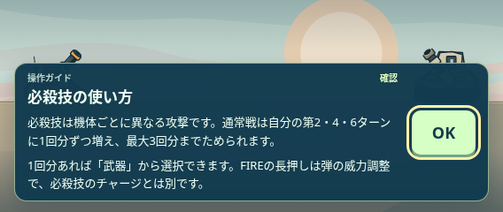
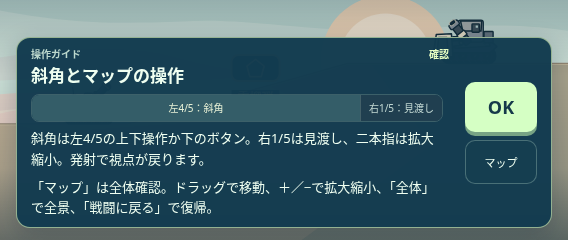

# 0.32.0 — 序盤のチュートリアル整理

## 合意した範囲

全体反映方針に対するユーザーの「OK」を受領。1〜20面の導入順、開始前のホーム画面追加、ガン紹介、難易度選択を保持する。1面の発射と必殺技、2面の斜角とマップ操作は同じ案内枠にまとめる。マップ・全ギミック・10面の装甲とコアは必須のまま。武器個別の実演任意化は今回に含めない。

開始時の所持品・取得後のスキル実演を外し、道具の実演は実際の選択時に限定する。応急処理は既存の回復量・1行動消費の確認にまとめる。5面は既存の巻上げドラム説明を保持し、失敗する大ボス用コア実演の呼び出しを削除する。ドラムの破壊後に攻撃ダメージが半減する既存処理は変えない。

未使用の slope / height / pickup / boss-swap / ceiling-lift / gate-choices / touch-controls-v2 / wall-fall / choices / W01 専用説明と専用分岐を削除する。通常弾そのもの、旧道具の使用互換性、旧既読キーの読込は保持する。手動再生で使う W は反射床へ正規化する。

途中再開で基本操作が優先されても、その面の未読ギミックを落とさない。実演生成に失敗した必須説明は短文へ切り替える。既読・進行・在庫・難易度・物理・HP・攻撃・装甲回数・残像演出は保護する。

## 基準と状態

- 基準 main: 3854535（0.31.5）。PR151〜153の装甲と残像変更を取り込み、残像識別・着地後の間・画角を保持。
- Draft PR154提示後、ユーザーの「検証しマージ」を受領。実装内容の最終合意・本検証・マージ指示として引き継ぐ。
- 選択した単体・ブラウザ2スイートと生成物一致を本検証する。成功後に先行mainを保持してマージし、mainのCI・Pages配信・公開版を確認する。
- 実行結果とマージ・配信の最新状態は [PR154](https://github.com/bittrove88/bittrove88.github.io/pull/154) を参照。

## 完了条件

1. 1面の発射と必殺技、2面の斜角とマップ操作が同じ案内枠で順に表示される。
2. 開始時・取得後に道具実演で割り込まない。選択時の武器実演と、回復確認は維持する。
3. 1〜20面の主題・9面のキャラ変更・10面の装甲を保持し、必須ギミックの表示漏れをなくす。
4. 未使用定義と専用分岐を削除し、通常弾・手動再確認・旧道具・セーブ互換性を保持する。
5. 小画面・日英・操作再開と、必要な生成物の同期を確認する。

## 制作中の事前確認

- 単体の限定確認336項目：全100面の導入順、初登場16説明の実弾道、プレビューによる状態非変更、未使用定義の削除、旧既読・在庫・進行、反射の手動再確認。
- Chromium174項目：844×390日本語、568×240日英、1280×800英語。1・2面の同じ案内枠、実マップ操作からの復帰、回復確認、実際のカプセル取得と敵反撃後、5/9/10面、実保存・再読込後の未完了マップ復帰、ホスト一時停止、基本操作→雲、全ギミック導入、生成失敗の短文代替、初回導線。
- 小画面のスクロール領域と固定の確認・マップボタンを実描画で調整。画像と記録は [事前確認](../../evidence/tutorial-flow-0320/PRECHECK.json) に保存。
- 上記はDraft提示時の事前確認。現在は「検証しマージ」の最終合意を受領済み。本検証の結果はPR154へ記録し、物理端末確認とは区別する。

## 変更の正本と同期

- 導線: game/dist/game.js。案内内容: game/ui/special-ui.js。9面のキャラ変更: game/ui/battle-ui.js。
- 定義: design/preview_curriculum.json と game/src/lessons-runtime.js。実演の手書き実装: game/dist/preview.js。
- 5面の既存短文: design/narrative_0_13.json と game/visual/encounters.json。破壊時の半減処理は未変更。
- game/runtime.json を0.32.0へ更新し、正式ビルドで本編・単体確認・総覧・キャッシュ参照を同期。旧 save schema8/reset2 と既読IDを保持する。
- PR153を統合後、戦闘エンジン・物理・装甲設定・残像描画・画角の正本が main と一致することを確認する。

### 変更後の小画面

