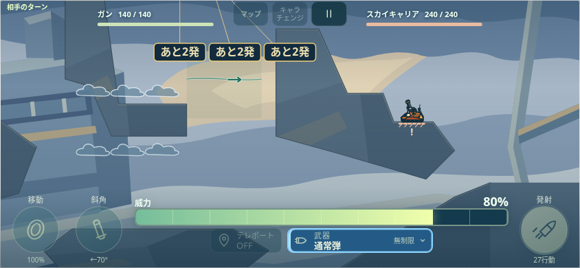
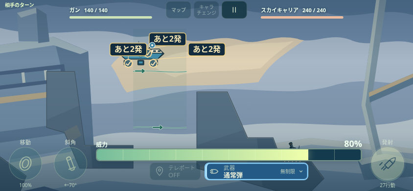
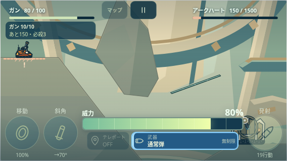
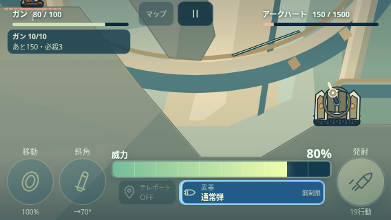

# 0.33.1 — 敵共通の発射前カメラ

## 目的と合意範囲

90面のボスが上端の外から、100面第4戦場の敵が操作パネルの裏から発射する報告を修正する。通常敵・中ボス・大ボス・最終戦の共通処理へ適用し、面番号による特例にしない。

基準main `467e13662f0c568eab18103f962b828322be70c7`（0.32.0、PR154）。関連する未マージPR150はマーケティング文書であり今回へ取り込まない。0.31.4の装甲、0.31.5の残像、0.32.0のチュートリアルを保持する。

ユーザーは共通修正方針へ `ok` と回答し、実装・比較画像の提示後、2026-11-10（日本時間）に `マージ` と指示。最終合意と、本検証・CI・PR作成・マージ・配信確認の許可として進める。

本検証前に最新main `83b576c`（0.33.0、PR155）を統合。位置選び・間隔・歩行・転移の先行変更を保持し、版数を0.33.1とする。以下の事前確認は0.32.0基準で制作した履歴として残し、本検証の条件と区別する。

## 実装

- 正本は `game/ui/enemy-camera.js`、手書き `game/dist/game.js`・`render.js`。`runtime.json` に生成・依存・読み込み順を登録する。
- 発射済みの弾道を変えず、確定済み計画の発射姿勢・砲口・実際の射出点だけで表示範囲を決める。全軌道や着弾先を画角へ押し込めない。落下弾の出現位置を砲口と混同せず、終極砲はレーザーの実発射位置と0.5秒のためを使う。
- HUD・最終戦の編成表示・操作パネルを避けた表示領域へ、必要な最小限の移動と縮小で攻撃元を収める。必要時のみ0.24秒の準備を行い、実際の表示が収まってから `E.launch` へ進む。既に収まっている場合は待機なし。
- 連射の最後の射出から0.14秒まで攻撃元を維持し、0.24秒で現在の弾追従カメラへ戻す。分裂後の子弾を発射元や連射の最後と誤認しない。
- 通常のカメラは別に保持し、表示変換だけを重ねる。自機操作時のチャージ縮小と見渡しへ倍率・位置を蓄積しない。次の操作までに通常表示へ戻す。
- 準備状態・計画参照は表示側だけに保持し、Workerへ送る戦闘状態や保存へ関数・カメラ情報を追加しない。ポーズで表示時計を止め、画面寸法変更時は新しい有効領域で再計算する。
- 通常の残像は既存の専用カメラを維持。モーション軽減時は共通処理で残像の射点も即時に表示し、準備の待機・移動アニメーションは加えない。

`game/runtime.json` を0.33.1へ更新し、正式生成コマンドで本編・Workerのキャッシュ参照・紹介サイト・単体攻撃確認・総覧を同期する。

## 保護範囲と完了条件

物理・技の威力・射出間隔・地形・機体移動・AI・予告・HP・行動数・保存schema8/reset2は変更しない。変更するのは表示画角と、必要時の発射開始までの準備だけ。全100面攻略、音声全件、物理端末は今回の検査へ自動追加しない。

完了条件は、敵本体・砲口・実際の射出点が発射時と連射中にHUD・操作パネルの外へ収まり、歩行・転移・残像からの連続攻撃後も次の自機操作へ戻ること。既に見える場合の待機なし、ポーズ・寸法変更・軽減表示、物理計画の保持も確認する。

## 制作中の事前確認

修正前の調査は後半8面・3画面サイズの36条件。90面の通常・固有技は844×390と568×320で上端外、100面第4戦場の三連射は568×320で操作パネルへ重なる。公開版の描画コードと基準mainの `render.js` のSHA-256一致を確認した。

今回の限定確認は `enemy-camera.test.cjs`、`enemy-camera-browser.test.cjs` と `enemy-camera-flow-browser.test.cjs`。数学的な画角だけでなく、本編の実 `launch/update/draw`、通常敵92面・中ボス85面・90面・100面、通常敵41面の歩行、85/99面の転移、50面の残像と本体の連続攻撃、ポーズと軽減表示を対象とする。操作前の計画と、表示後の弾道・イベント・威力・物理時刻を照合する。

結果と見本は [事前確認記録](../../evidence/enemy-camera-0321/PRECHECK.json) に保存する。本検証計画は [verification-plan.json](../../verification-plan.json)。本検証・CI・実機・マージ・公開の成功として扱わない。

### 同じ操作による修正前後

シード42、射角70度・威力80の自機射撃から、実際の敵計画・歩行・発射までを繰り返した。通常敵・中ボスの事前確認とは別に、元の報告と同じ操作で比較している。

| 条件 | 修正前の砲口Y | 修正後の砲口Y |
| --- | ---: | ---: |
| 90面・844×390・通常攻撃 | −53.03px（上端外） | 92.33px（表示内） |
| 100面第4戦場・568×320・三連射 | 239.38px（操作部214pxより下） | 135.20px（表示内） |

| 90面・修正前 | 90面・修正後 |
| --- | --- |
|  |  |

| 100面・修正前 | 100面・修正後 |
| --- | --- |
|  |  |

制作中の単体確認113項目が成功。限定ブラウザ確認では、通常表示・軽減表示、通常敵／中ボス／大ボス／最終戦、実AIの歩行・転移・残像→本体、ポーズ、画面寸法変更、通常操作への復帰、チャージの90％縮小とキャンセル後の復帰を確認した。途中で発見した軽減表示の小数時刻境界を修正し、該当条件から再確認した。成功済みの条件を無関係に全件繰り返していない。

正式生成コマンドを実行し、変更後の描画コード・新モジュールを単体確認・総覧へ再同期した。物理・エンジン・AI・ボス行動・保存・最終戦・バランス・地形の正本9ファイルが基準mainと同一であることを照合した。検証計画の差分網羅・検査名は形式確認済み。本検証・CI・実機・マージ・公開は未実施。

## 最終合意後の本検証（0.33.1）

ユーザーの「マージ」を受け、先行PR155を保持したmain `83b576c` 上で本検証した。元の0.32.0基準の事前確認とは別の記録として [本検証結果](../../evidence/enemy-camera-0331/VALIDATION.json) を保存する。

- 単体3スイート：enemy-camera、charge-camera、echo-presentation が成功。
- ブラウザ4スイート：enemy-camera-browser（32条件）、enemy-camera-flow-browser（8条件）、charge-camera-browser（234項目）、boss-motion-browser が成功。
- 生成156ファイルが隔離した2回の再生成と一致し、元ツリーは未変更。
- 最新mainの位置選びを含むAI・物理・保存・最終戦・バランス・地形の正本10ファイルが、mainと完全一致。

マージ指示は受領済み。対象PRのCI成功後にマージし、対象mainコミットのCI・Pages配信と公開0.33.1の参照を確認する。実機と全100面攻略は今回の成功に含めない。
