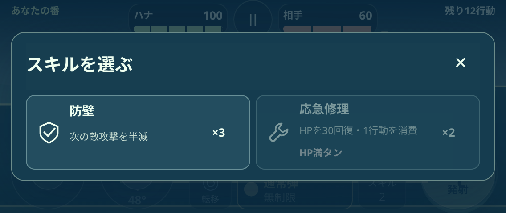
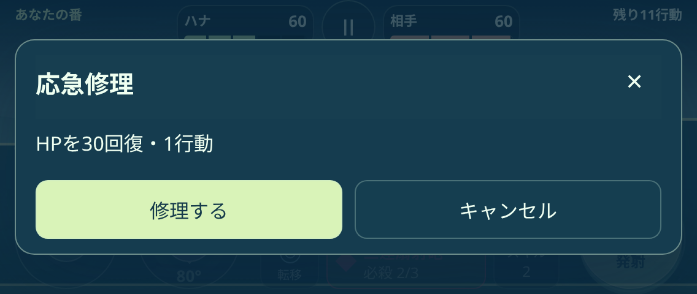
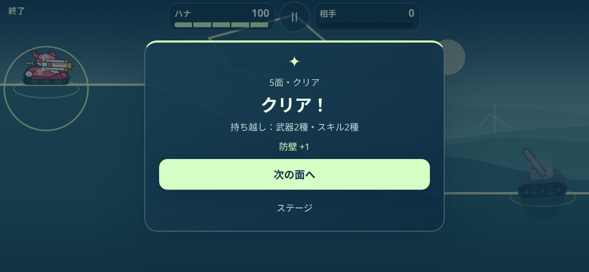

# ARCLINE 0.9.0 検証記録

今回の範囲は序盤1〜20面です。防壁・砕路・応急修理、武器箱11個・スキル箱5個、5/15面のクリア報酬を組み込みました。基準は公開版0.8.0（`41830b77947a025d9ae79b00557624cd6be597cf`）。地形・敵・機体性能・描画の定義は保持しています。5/15面は通常の戦闘のままで、報酬だけを追加しています。

| 証跡 | 結果 | 確認範囲 |
|---|---:|---|
| [EARLY_SKILLS.json](EARLY_SKILLS.json) |1,556項目|全10機の3スキル、次の敵攻撃一式の半減・期限・自爆との区別、追加破壊1片・48の境界・固定壁保護、修理の回復量・1行動・最終行動、旧保存の移行・旧版書き戻し防止|
| [EARLY_SKILLS_BROWSER.json](EARLY_SKILLS_BROWSER.json) |379項目|6画面の日英UI、実タッチ／マウスの予約・取消・発射、実Workerの反撃、修理確認と再挑戦・中断復元、実弾の拾得と入替、報酬保存失敗・再試行・重複防止、16箱の全体表示|
| [EARLY_MATCHES.json](EARLY_MATCHES.json) |200戦攻略|全10機×1〜20面。実HPと実乱数の敵応答、通常／必殺／歩行／開削／転移。補助弾・スキルなしでも攻略できる経路|
| [MACHINE_COMBAT.json](MACHINE_COMBAT.json) |4,152項目|機体性能、100面の開始位置、弾道と必殺合算上限、遮蔽、章在庫、旧敵AI100比較|
| [MACHINE_PREVIEWS.json](MACHINE_PREVIEWS.json) |1,340項目|67案内×10機の効果成立と本番状態の非変更。新スキル30例も含む|
| 既存UI・保存・操作・紹介サイト |各JSON参照|100面×8画面、84pxの主要操作、点線3モード、取消・一時停止、回転・ズーム復帰・全画面、機体選択、サイトの日英・リンク・ダウンロード|

16箱すべてに、全10機の通常弾が開始位置から到達する160経路を実弾で確認しました。小さい横画面でも箱全体がHUD・操作部に隠れない座標にしています。砕路の初登場17面では、通常移動だけで追加破壊を使える位置も各機で確認しました。箱の取得は攻略の必須条件ではありません。

防壁は通常・必殺・補助弾・転移と併用できます。砕路は通常・補助弾のみで、非対応の選択へ変えると無消費で予約解除します。修理は最大30回復し、1行動を使って相手の番へ移ります。取消では消費しません。スキルの表示は名前・残数・効果1行とし、初案内は実際の作用を自動ループで示します。

保存はスキーマ4へ移行し、原本を端末内へ退避します。実際の0.8.0保存モジュールが新スキーマを拒否し、書き戻さないことも検証しました。旧武器20種・外観37種・旧スキル在庫は保持し、旧スキルの効果を読み替えていません。報酬の枠選択は勝利保存前に解決します。保存失敗時は次面へ進めず、再試行で報酬が増えないことを実ブラウザーでも確認しました。

[SUMMARY.json](SUMMARY.json) に今回実行した検証を、[PRESERVED_DEFINITIONS.json](PRESERVED_DEFINITIONS.json) に同一のまま保持した8モジュールを、[BUNDLE_CHECK.json](BUNDLE_CHECK.json) に配布25ファイルのSHA-256を記録しています。ZIP・キャッシュ・非公開の変更計画はGitへ追加していません。21〜100面の既存13箱・旧支給は保持し、今回の新しい配置は20面で区切っています。ドリル弾のみ、薄い破壊材を通過し、固定岩盤・反射材・装置は通らないように調整しました。旧PHASE在庫の効果は保持しています。

ブラウザー検証はローカルの実Chromiumとタッチ入力のエミュレーションです。修理・報酬のUIテストでは負傷／敵HPを制御し、上記200戦では実HPを使用しています。実機iPhone／Android、ホーム画面インストール、人による操作感・難易度、全10機×全100面の攻略は未確認です。旧床専用描画テストの既知の失敗は[基準版の記録](../difficulty/HISTORICAL_RENDER_CHECK.json)にあり、今回の合格数へ含めていません。過去版の証跡も今回の合格数へ加えていません。

