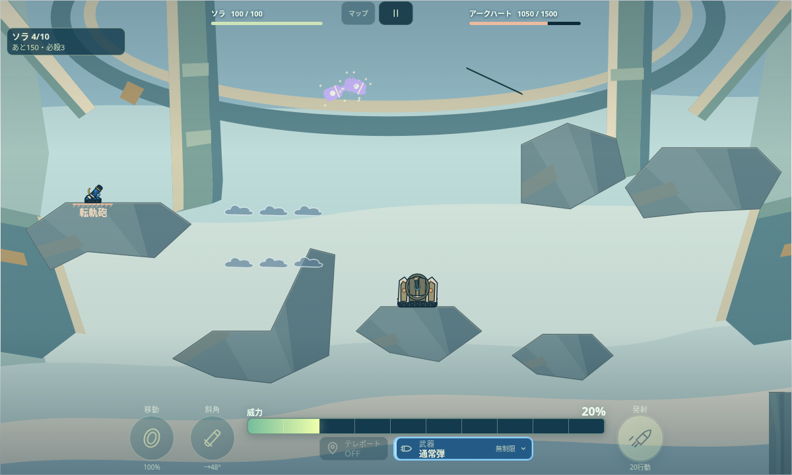
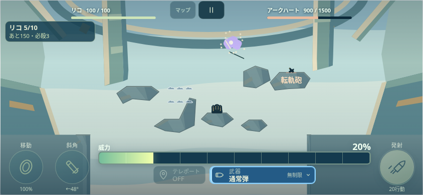

# 0.30.1 ラスボス攻撃の検証

PR136を含むmain1904d3eを基準にしたローカル実装。自機HP100・担当150（Easy80）・各20行動を保持する。マージ・公開・物理端末確認は未実施。

[計画](PLAN.md)／[総合結果](VERIFY.json)／[リリース説明](../../docs/releases/0.30.1.md)。全12選択スイートが成功。成功した検査はコードが変わらない限り再実行せず、失敗した対象だけ修正して再確認した。

- [新しい単体検査](FINAL_ATTACKS.json)：874項目。通常25と固有32/34/36/38、防御・無敵・残りHP、30/120fps、6手の順番、同一戦場の交代・新戦場・再挑戦を検査。
- [転軌砲の変更前](TRANSFER_BEFORE.json)：ソラ・リコ・ヒバリの実配置で全件0。修正後は全件34、固定予告後の移動で0、固定天井で0。前の機体の担当を埋めて配置した検査用状態であり、10機通しの勝利記録ではない。
- [実Controllerの検査](FINAL_ATTACKS_BROWSER.json)：PC1200×720/30fps・スマホ844×390/120fps、3機の待機と合法な140px歩行、Workerなしのリコも含む14条件。命中時HP100→66・累積34・次の操作まで確認。ブラウザ例外なし。
- [HPと上限の画面](HP_ACTION_BROWSER.json)：日英・3難易度、93項目。300件の実初期化と2662項目のHP・地形・保存保護も成功。
- [攻撃総覧](ATTACK_REVIEW_BROWSER.json)：149項目。[紹介サイト](SERVICE_SITE.json)：622項目。現在の画像4枚と物理の指紋を同期。
- 既存の自機ダメージ同期372、ヒバリ光輪74、攻撃時間3093、SFX整合性16973項目、紹介の単体135項目と他の敵攻撃の回帰検査が成功。音声デコードは対象外。
- [正式生成](GENERATED_CHECK.json)：154ファイルを隔離環境で2回生成し差分なし。配布ZIPは214項目・87ランタイム、アーカイブ検査成功。ZIP自体はリポジトリに追加しない。

| PCでの高い転向点 | スマホ相当での高い転向点 |
|---|---|
|  |  |

全100面の再攻略、音源・原画の再検証、人の勝率、本番URLは対象外。保存・機体攻撃・他の敵と先行HP設定の保護は、限定差分の逆適用と既存検査で確認した。ユーザー提供動画や原本フレームは追加していない。
