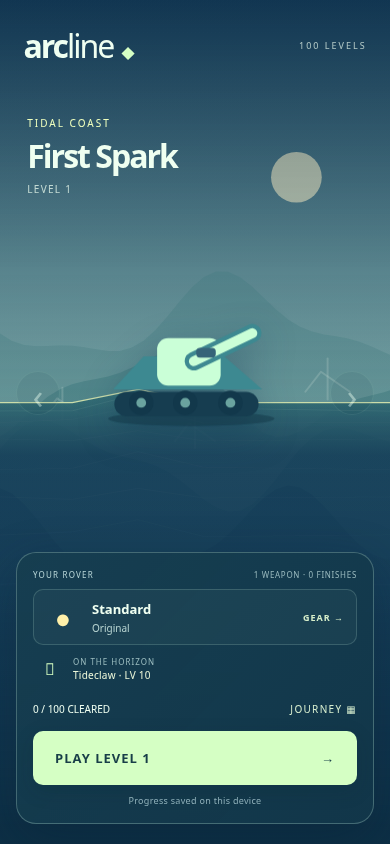
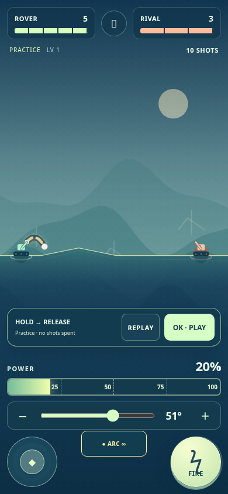
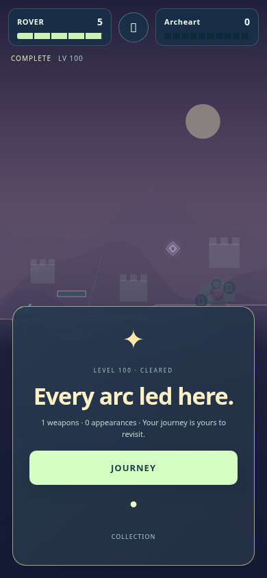

# 没入感の改善 — 0.5.0

2026年10月27日。操作への反応、工夫と結果のつながり、次の場所・収集への期待という3つの観点で共通のゲーム体験を改善。100面の地形・物理・耐久・ダメージ・武器性能・進行保存の規則は維持した。

## 実装

- **照準と射撃**：チャージ開始時のカメラ位置・倍率を固定。待機とチャージ開始のパワーを20%にそろえ、参考65%の線への切替を廃止。太い射線、現在入力の実弾道、着弾範囲を維持。高い弧に合わせて機体が極端に縮む表示も抑える。
- **テンポと手応え**：着弾後の残像0.8秒＋消去0.6秒は維持し、その間に敵の計算を進める。静止敵の0.6秒の移動待ちを撤去。移動時は距離に応じた走行時間にし、敵弾の残像消去と次の環境の遷移を重ねる。反動、被弾、装甲破片、コア露出、機能停止を描き分ける。照準吸着や敵命中の裏調整は追加しない。
- **見てから試す**：初出プレビューはOKまで繰り返す。TRYで実際の角度・移動・チャージ操作を試せる独立した練習状態へ入り、REPLAYで見本へ戻る。元の戦闘・手数・弾薬・拾得・セーブには影響しない。OKで戦闘へ戻る。
- **獲得と装備**：取得した武器の本名と印を表示。取得時に自動装備せず、操作可能な自分のターンにTRY 1で明示的に切替。装備画面は20武器・37外観の名前付きカードへ変更。旗・軌跡・砲口・装飾を描き分ける。敗北しても取得物を保持し、性能の恒久加算はしない。
- **旅路と入口**：ロビーは自機とPLAYを中心にし、1項目しかない選択フォームを撤去。100面を10地域にまとめ、各地域のボス・進捗・未回収物を表示。既クリア面への再訪を残す。地域ごとの背景の目印を追加。
- **遭遇と結末**：ボスは短い登場演出を経て開始。部位の形、残り耐久、破壊跡、広がったコアを可視化。停止・勝利・敗北を別の表示にし、手数切れと耐久切れを分ける。戦場をぼかさず残し、Lv100は専用の祝福と収集表示、JOURNEY／COLLECTIONを用意。

## 検証の扱い

同梱JSONは0.5.0で実行した結果。実ブラウザーはヘッドレスChromiumとタッチエミュレーションを使用。新しい画面・練習・試用の検査に加え、従来の保存／SDK停止再開／2本指入力／ズーム回帰検査を実施。勝敗・報酬の一部の表示検査は状態を設定しており、人が100面をクリアした記録ではない。

| 検査 | 結果 |
|---|---|
| エンジンの不変条件 | 51項目PASS |
| 既存Chromiumランタイム | 147フローPASS、100面初期化・描画 |
| 実タッチイベントの回帰 | 193項目PASS、8画面サイズ |
| 新しい体験の回帰 | 430項目PASS、8画面サイズ |
| 構文・配布 | 全JS構文PASS、12ファイルのZIPとSHA-256照合PASS |

8画面サイズは320×568、360×640、390×844、568×320、640×360、844×390、768×1024、1024×768。横画面の勝敗シートは約114〜116pxに収め、戦場を表示する。高角度で画面外へ続く予測線は上端の矢印で示す。初期化・描画の100面確認と人による100面プレイは区別する。

物理の自動検査は、100面の固定シード対戦100件、合法状態のサンプル1017件、武器と支給スキル5500組を確認。100面の初期状態で13整数パワー以上の有効帯、カプセル60個の回収経路、ボス192状態の経路検査もPASS。連続な全状態の証明や初見の人間の成功率を意味しない。

実物のiPhone/Safari・Android、実ユーザーによる楽しさ・難しさの評価、実際のYouTube SDKホスト上の認証は未確認。

