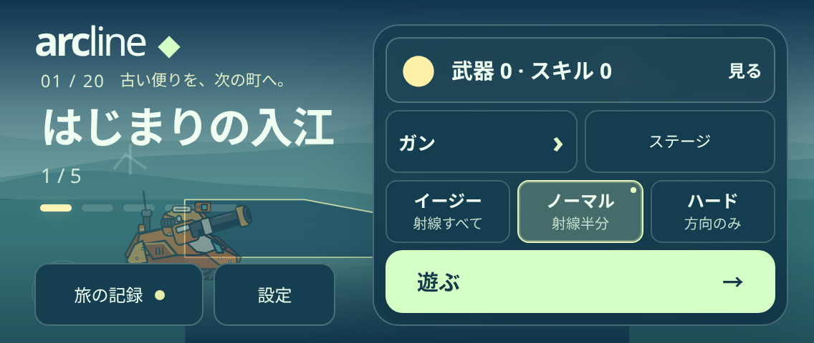
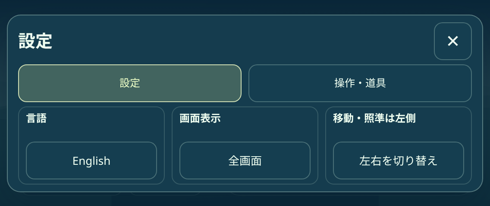
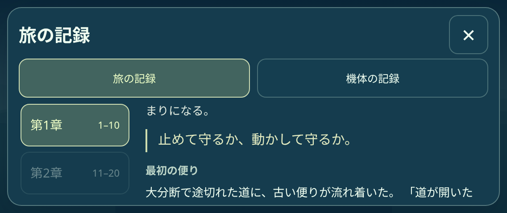
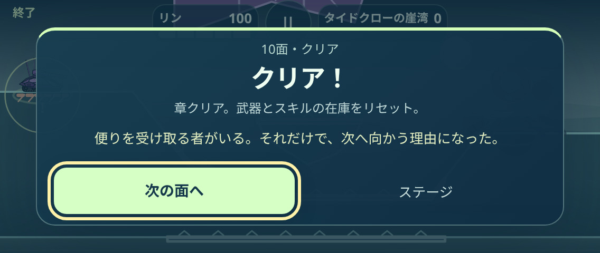

# ARCLINE 0.10.0 検証記録

開始画面の設定と、任意で読む「旅の記録」を実装した範囲の記録です。基準は0.9.0（`3c49ef94b77f245a02de534d4371b7a62556273b`）。通常弾・必殺・敵・ボス・全100面・29箱・ギミック・美術・エフェクトの内容は保持しています。

物語は全体の導入、5幕・10章、10機それぞれの背景・弱さ・選んだ行動・後日談で構成します。新しい敵・ボスの設定や台詞、景観の開通演出は含みません。初回ロビーの一行と章クリアの短文以外は任意閲覧です。機体の成長は担当章のクリア後、後日談は100面後に開きます。機体を選び直しても旅の記録を失いません。

| 証跡 | 結果 | 確認範囲 |
|---|---:|---|
| [JOURNAL.json](JOURNAL.json) |5,384項目|57記録のID、日英の全10機、クリア数0〜100の開示、未解放項目の保護、既読の冪等性、実際の0.9.0保存からの移行と旧版書き戻し防止、保存失敗・復元、戦闘16モジュールの同一性|
| [JOURNAL_BROWSER.json](JOURNAL_BROWSER.json) |431項目|6画面の実タッチ／マウス、スクロール直後のタップとドラッグの区別、2指での誤操作防止、日英、左右保存、全10機の本文と開示、プロフィールからの導線、章クリア・最終クリア、保存失敗からの再試行、SDK模擬3ケース|
| [MACHINE_COMBAT_BROWSER.json](MACHINE_COMBAT_BROWSER.json) |1,744項目|6画面×10機の通常／必殺選択、実入力の取消・発射、敵応答、日英、残数、やり直し・中断復元|
| [EARLY_SKILLS.json](EARLY_SKILLS.json)・[EARLY_SKILLS_BROWSER.json](EARLY_SKILLS_BROWSER.json) |1,556・379項目|3スキル、160回収経路、選択・修理・入替、クリア報酬と保存失敗・重複防止の維持|
| 既存機能の回帰 |各JSON参照|機体戦闘4,152、案内1,340、統合598、点線1,001、章在庫129、取消・一時停止245、難易度154、100面×8画面3,267、機体描画3,338、回転57、表示179、全画面13、Worker46、サイト229|

全検証の一覧と合計は[SUMMARY.json](SUMMARY.json)。一時停止と戦闘操作の位置は維持し、ロビーの言語・全画面・操作左右を「設定」へまとめました。説明は任意の「操作・道具」タブに置いています。小さい568×240でも主要な設定・閉じる・結果のボタンは画面内にあり、本文と記録一覧は別々にスクロールできます。

保存スキーマ5は言語・左右・既読を進行と同じアダプターへ保存します。旧プロフィールに設定がなければ端末の既存設定を引き継ぎ、保存済みの設定があれば優先します。移行前の原本・章在庫・20武器と37外観の所有履歴は保持します。読み込み完了前の操作・書き込み、読み込み失敗時の初期値書き戻しを防ぐことも確認しました。章クリア文の既読と次面入口は一緒に保存され、保存失敗後の再試行でも重複しません。

[PRESERVED_CONTENT.json](PRESERVED_CONTENT.json) は戦闘16モジュールと100面の元JSONが0.9.0と同一である記録です。[BUNDLE_CHECK.json](BUNDLE_CHECK.json) は配布27ファイルのSHA-256。ZIP、キャッシュ、非公開の設計書・作業計画はGitへ追加していません。

ブラウザーは実際のChromiumとタッチ入力のエミュレーションを使用。章・最終クリアの画面テストでは敵HPを制御しています。これを実HPでの全100面攻略と扱っていません。SDKの設定・保存確認は模擬アダプターです。実機iPhone／Android、ホーム画面へのインストール、人による操作感・難易度、YouTube認定は未確認です。0.9.0の200戦など過去の結果を今回の実行数に加えていません。旧床専用描画テストの既知の失敗は[基準版の記録](../difficulty/HISTORICAL_RENDER_CHECK.json)にあり、今回の合格数から除外しています。

