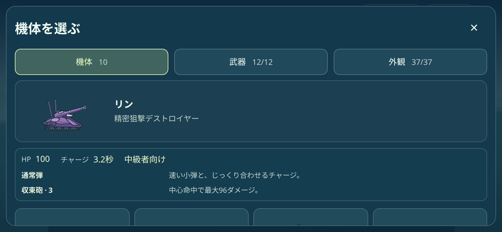
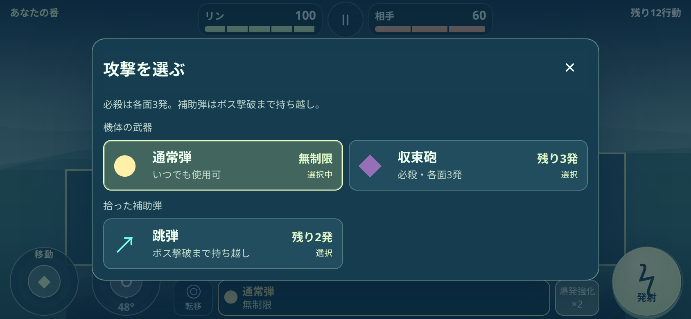
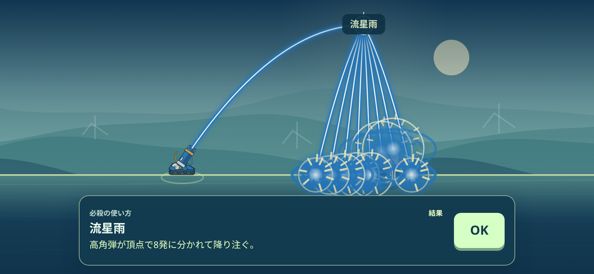

# ARCLINE 0.8.0 検証記録

10機体の通常弾・必殺弾・耐久・チャージ・移動を実装した範囲の記録です。基準コミットは `1068e90bf9ba20fee2734fb6c89d5da1e6575f5b`。機体の描画、100面の定義、章在庫の定義は保持しています。

通常弾は全機体で基本20ダメージ、中心直撃30、ボス弱点40。必殺は各面3回で、連射・子弾・連続爆破も1行動・1回分として消費します。必殺と章の補助弾・スキルは独立した残数です。機体別の数値と効果は [ARCLINE README](../../README.md) に掲載しています。

| 検証 | 結果 | 範囲 |
|---|---:|---|
| `MACHINE_COMBAT.json` |4,152項目|10機×100面の安全な開始位置、560弾道、中心・弱点・必殺合算の上限、チャージと移動、残数、地形・遮蔽、保存、旧敵AI100比較|
| `MACHINE_PREVIEWS.json` |1,280項目|64案内×10機の効果成立と本番状態の非変更|
| `MACHINE_COMBAT_BROWSER.json` |1,744項目|6画面×10機。実タッチ／マウスの取消と発射、敵応答、日英、残数、やり直し、中断復元。844×390では全必殺の結果画面に自機・敵・効果が収まることも確認|
| `MACHINE_WORKER.json` |46項目|全10機で実Web Workerの敵応答、意図的にWorkerを使わない1件、スキル併用不可の説明|
| `REPRESENTATIVE_MATCHES.json` |120戦攻略|10機×1・7・13・23・33・53・62・75・80・90・95・100面。実HP、実敵応答、通常／必殺／歩行／地形破壊／転移。補助弾・スキルなし|
| `CHARACTERS.json` |3,338項目|6画面の機体選択・保存、300描画姿勢、1,000機体別状態の地形・敵・開始位置・乱数の保持|
| 既存機能の回帰確認 |6,019項目|現行統合、章在庫、点線と難易度、取消・一時停止、100面×8画面、回転・言語・ズーム復帰・全画面、紹介サイト|

合計16,579項目と代表120戦が合格。詳細は [SUMMARY.json](SUMMARY.json)、配布24ファイルの照合は [BUNDLE_CHECK.json](BUNDLE_CHECK.json)、保持した定義のSHA-256は [PRESERVED_DEFINITIONS.json](PRESERVED_DEFINITIONS.json) を参照してください。ZIPはリポジトリへ追加していません。

代表戦では、13面の崖上へ転移し、屋根が壊れた後に安全に着地して攻撃する経路も確認しました。探索側は足場が壊れても落下できる地点を選びます。地形や敵のHPを緩和した結果ではありません。これとは別に、敵が下方にいると正常な上段足場を横距離だけで排除していた位置補正を修正し、上下距離も含めて検証しています。

ブラウザー検証はローカルで実際のChromiumを動かした結果です。実機のiPhone／Android、ホーム画面インストール、人による操作感・難易度、全10機×全100面の攻略経路は未確認です。通常弾・必殺の数値、命中しやすさのタイプ分類も、人によるプレイ調整の余地があります。

旧床専用描画テストの既知の失敗は [基準版の記録](../difficulty/HISTORICAL_RENDER_CHECK.json) にあります。この旧テストや過去版の合格数を、今回の合格数へ加えていません。

