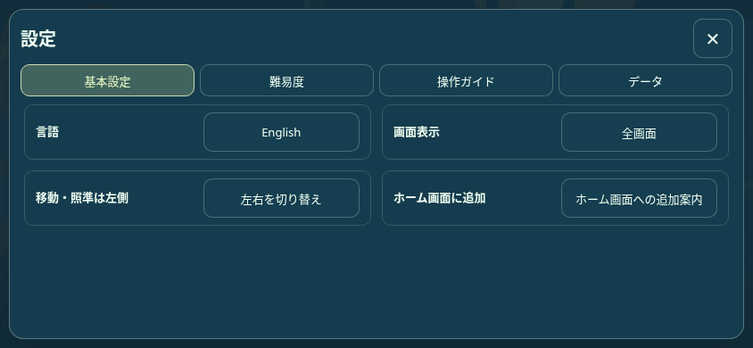
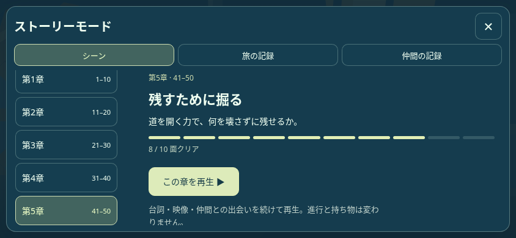
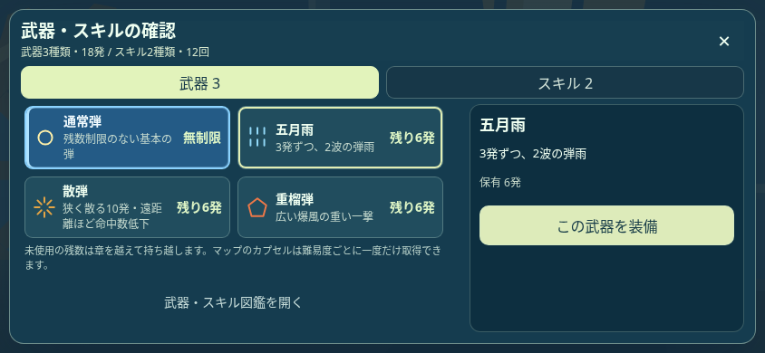

# 0.29.7 メニューの修正

844×390・日本語のローカルChromium見本。テスト用の進行48面・在庫を使用し、ユーザーの保存には接続していない。

| 設定 | ストーリー |
| --- | --- |
|  |  |
| 武器確認 | 武器・スキル図鑑 |
|  |  |

[メニュー検証](MENU_INVENTORY_BROWSER.json)は4画面サイズ×2言語・259項目。[設定削除](SETTINGS_DELETE_BROWSER.json)は35項目。[保存単体](START_LANDSCAPE_UNIT.json)は削除処理の旧データ保護・直列保存を確認。実タッチはChromium CDP入力であり、物理端末での動作確認とは区別する。
