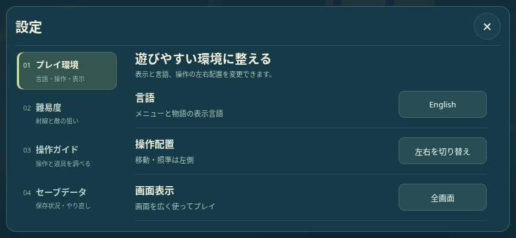
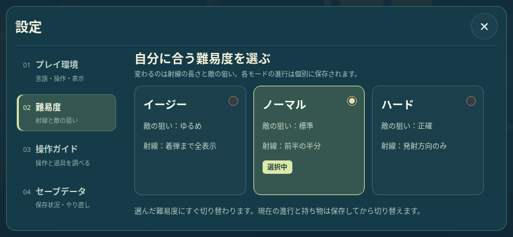
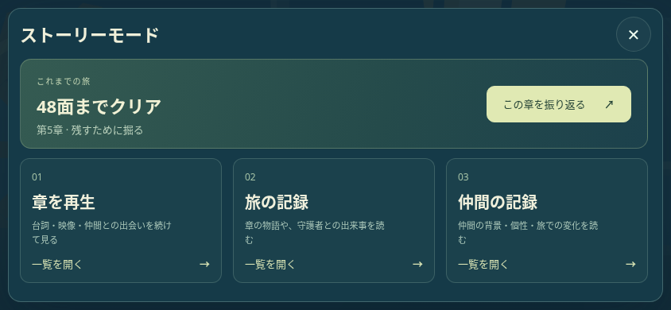
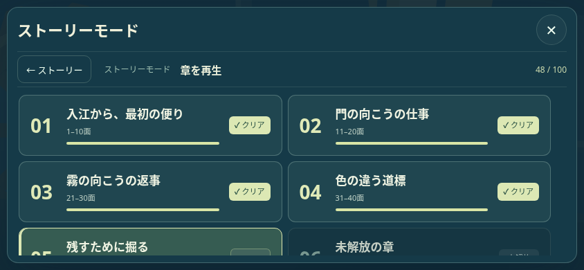
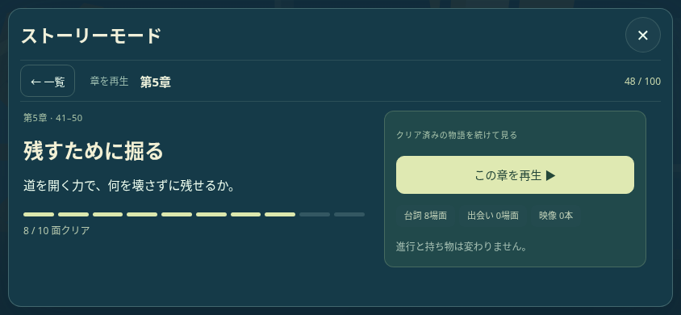
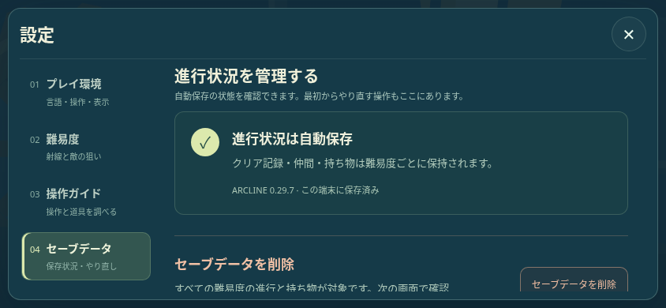
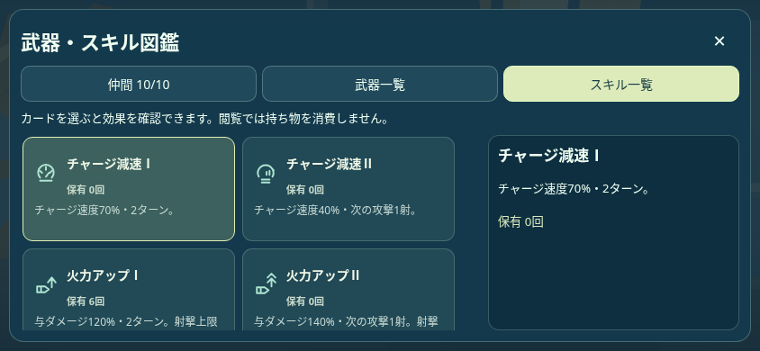

# 0.29.7 メニュー・一覧の修正と再設計

最終UIは、設定を「カテゴリナビ＋内容ペイン」、ストーリーを「入口→一覧→詳細」として構成する。844×390・日本語のローカルChromium見本。テスト用の進行48面・在庫を使い、ユーザーの保存には接続していない。

| 設定のプレイ環境 | 難易度 |
| --- | --- |
|  |  |
| ストーリーの入口 | 章の一覧 |
|  |  |
| 章の概要・再生 | セーブデータ |
|  |  |

| 武器確認 | 武器・スキル図鑑 |
| --- | --- |
|  |  |

[再設計の計画](redesign/PLAN.txt)／[ローカルの再開後8条件](redesign/MENU_STRUCTURE_BROWSER_LOCAL.json)／[先行4条件の記録](redesign/EARLIER_CASES.txt)。全12条件は最終PRのCIで通して実行する。既存の[持ち物メニュー検査](MENU_INVENTORY_BROWSER.json)は閲覧専用・図鑑直行へ更新して306項目成功、[削除保護](SETTINGS_DELETE_BROWSER.json)35項目成功。[保存単体](START_LANDSCAPE_UNIT.json)と戦闘UIは前回の成功結果を再利用し、PR全体のCI計画では引き続き検証する。実タッチはChromium CDP入力であり、物理端末での動作確認とは区別する。

最新追加: [章一覧・図鑑入口の計画](discovery/PLAN.txt)。武器確認の装備ボタンは削除し、武器・スキルそれぞれの図鑑入口を保有タブの横へ固定した。章一覧は番号・章名・面範囲と状態を分けたコンパクトな2列表示。上の見本も更新済み。

最新追加: [武器確認・スキル確認・各図鑑の統一デザイン](equipment-design/README.md)。共通カードと詳細、青枠と「✓確認中」、同じ保有数バッジ、読みやすい効果説明に統一。348項目の実画面検査が成功。

最新追加: [コンパクトな装備カードと情報整理](compact-equipment/README.md)。高さ64px、PC3列・通常横向き2列。一覧は識別と保有数、詳細は効果と種類へ分ける。428項目と戦闘UI15シナリオ、155生成物が成功。

最新追加: [仲間・持ち物・図鑑の導線を統合](collection-flow/README.md)。カテゴリと保有/図鑑を同じ画面で切り替え、選択と位置を保持。導線354項目・装備428項目・戦闘UI15シナリオが成功。

最新追加: [TOPからの遷移と仲間画面](companion-profile/README.md)。一覧に必殺技名、右ペイン40％、内容幅のボタンと状態表示、10機の紹介文。導線・仲間422項目、装備428項目、155生成物が成功。
