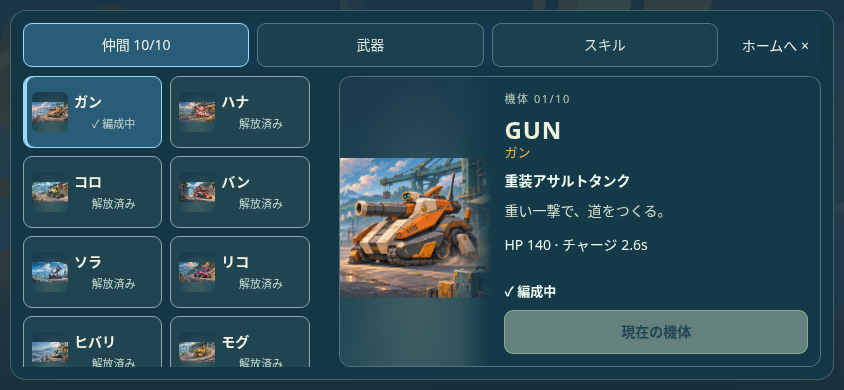
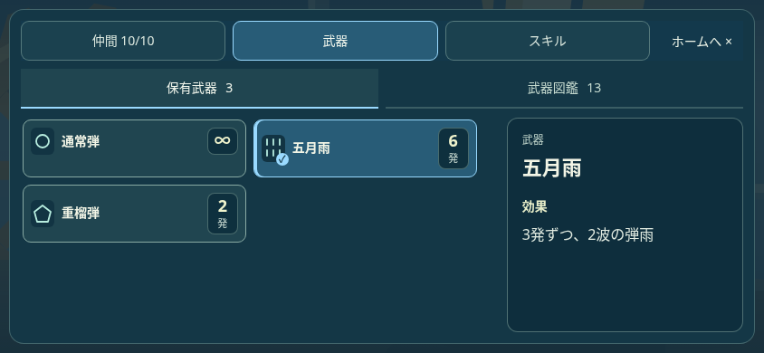
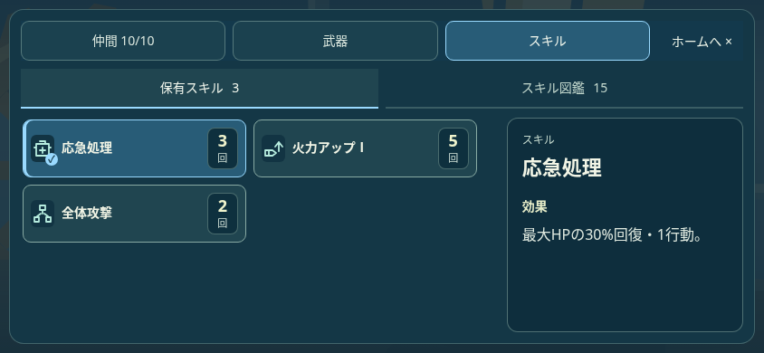
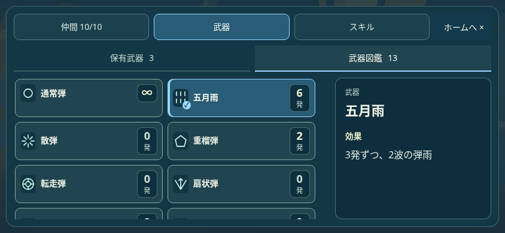
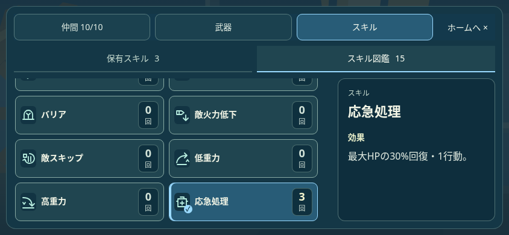

# 仲間・持ち物・図鑑の導線を整理

最新のTOP遷移と、必殺技名・細い右ペイン・紹介文を整理した[仲間画面](../companion-profile/README.md)を参照。以下は導線統合時の記録。

仲間・保有武器・保有スキル・武器図鑑・スキル図鑑を1つの画面へ統合。ヘッダーの「仲間／武器／スキル」で対象を選び、武器とスキルは「保有分／図鑑」で範囲を切り替える。図鑑へ移るために持ち物を閉じたり、ホームへ戻ったりする必要がない。

| 目的 | ホームからの入口と操作 |
| --- | --- |
| 仲間を確認・変更 | 仲間 → カードで詳細確認 → 「この仲間を選ぶ」で変更してホームへ |
| 武器を確認 | 持ち物・図鑑 → 保有武器を直接表示 |
| スキルを確認 | 持ち物・図鑑 → スキル |
| 武器図鑑を見る | 持ち物・図鑑 → 武器図鑑 |
| スキル図鑑を見る | 持ち物・図鑑 → スキル → スキル図鑑 |

同じ項目が次の範囲にもあれば、保有分と図鑑で選択を継続する。カテゴリごと・範囲ごとの一覧位置、仲間の説明位置と能力欄の開閉を保持。範囲は武器／スキル間で継続し、何を見ているかを選択表示で示す。「ホームへ」とEscapeは最初のホーム入口へフォーカスを戻す。再度ホームから開く際は、入口に対応するカテゴリと保有分から開始する。

64pxの装備カードと一覧／詳細の情報分担を維持。仲間カードは名称と状態、詳細は原画・役割・能力・加入条件と変更操作。カードを触れただけでは仲間を変えず、未解放と補充待ちは確認できても選択できない。空のスキル一覧からも全図鑑へ直行できる。Tabは選択中のタブだけを通り、矢印・Home・Endで切り替える。

## 実画面

Chromium、844×390、日本語、テスト用進行・在庫。ユーザーのセーブは使っていない。

| 保有武器 | 保有スキル |
| --- | --- |
|  |  |
| 武器図鑑 | スキル図鑑 |
|  |  |

[計画](PLAN.txt)／[導線354項目](COLLECTION_FLOW_BROWSER.json)／[装備の視認性428項目](EQUIPMENT_DESIGN_BROWSER.json)／[155生成物](GENERATED.json)。各4サイズ×日英、5表示間の遷移、独立した一覧と説明の位置、能力欄、選択継続、44pxのナビ・確定、実タッチ、キーボード、原画、未解放／補充待ち、空・旧・未保有、閲覧時の完全な保存不変と確定時の仲間だけの変更が成功。隣接する戦闘UI15シナリオも成功。物理端末・本番反映は未実施。
