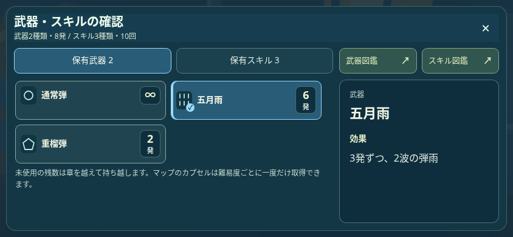
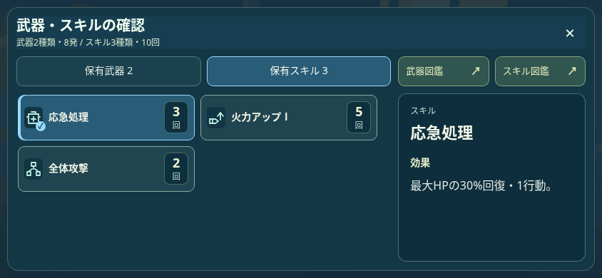
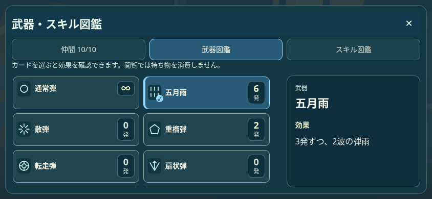
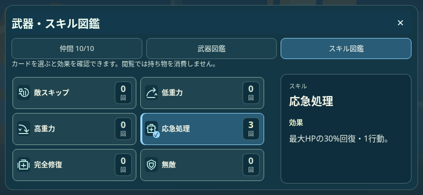

# コンパクトな武器・スキル一覧

武器確認・スキル確認・武器図鑑・スキル図鑑を同じ64pxカードへ縮小。一覧はアイコン・名称・保有数と選択チェック、詳細は種類・名称・効果・未所持時の入手案内を表示する。効果は一覧から、保有数とアイコンは詳細から削除し、重複を整理した。詳細の名称は選択中の対象を示す見出しとして残す。

PCは3列、通常の横向き・縦端末の回転表示は2列。全保有のテストでは1280×720で12枚、844×390と393×852で6枚、568×240で2枚のカード全体が同時に見える。カードの文字14px・保有数18px、詳細14〜16px、コントラスト4.5:1以上を維持する。英語の効果が名称だけになる取り込みも修正した。

以下はローカルChromium、844×390、日本語、テスト用在庫の画面。ユーザーのセーブは使用していない。

| 武器確認 | スキル確認 |
| --- | --- |
|  |  |
| 武器図鑑 | スキル図鑑 |
|  |  |

[計画](PLAN.txt)／[428項目のブラウザ検査](EQUIPMENT_DESIGN_BROWSER.json)／[155生成物の整合](GENERATED.json)。4サイズ×日英、一覧密度、文字の見切れ、同一部品、選択と効果の対応、レア・旧・未所持・空在庫、必要時の実タッチスクロール、言語切替、全セーブ不変を確認。関連する戦闘UI15シナリオも成功。本番公開・物理端末は未確認。
