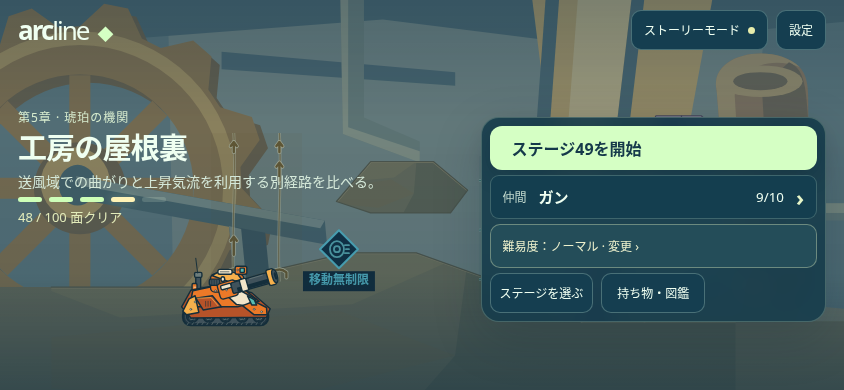
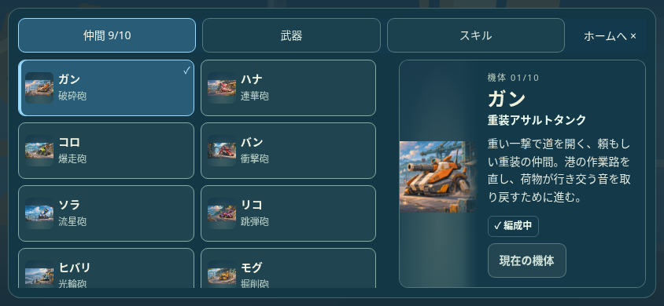
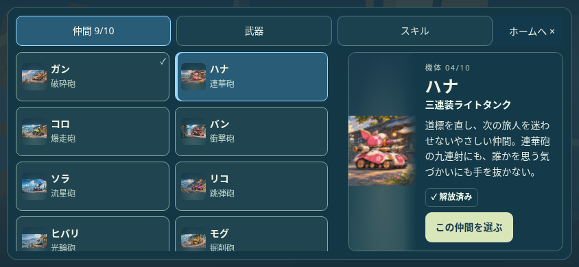
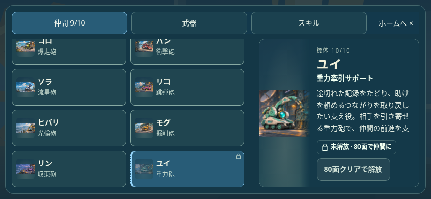
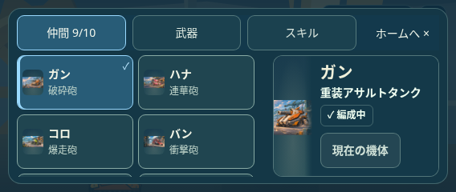
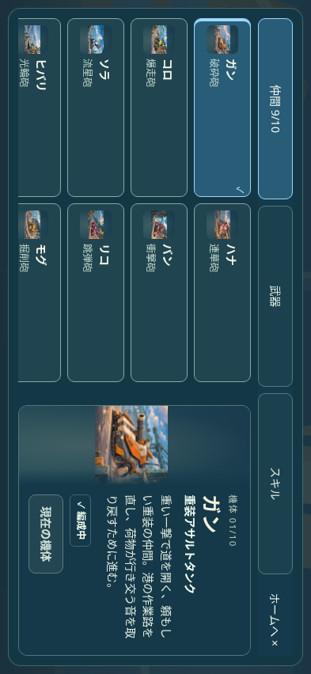

# TOPからの遷移と仲間画面

## TOPと各入口

進行48面・日本語・844×390のテスト用セーブ。TOPの構成と入口は維持する。以下は実装ブランチでの挙動で、本番反映は未実施。

| TOPの操作 | 遷移先・戻り方 |
| --- | --- |
| ステージ49を開始 | 選択中のステージの本編を開始。表示番号は選択中の面に合わせる |
| 仲間（現在の名前と人数） | 現在選択中の仲間の詳細を直接表示。カードは閲覧、確定で仲間を変更してTOPへ |
| 持ち物・図鑑 | 保有武器を直接表示。上部で仲間／武器／スキル、保有分／図鑑を切り替え |
| ステージを選ぶ | ステージ一覧。選択するとTOPへ戻り、開始ボタンがその面に変わる |
| 難易度 | 設定の難易度を直接表示 |
| ストーリーモード | ストーリーの入口。章・仲間・映像の一覧から詳細へ |
| 設定 | 設定カテゴリ。セーブ削除はデータの中 |

仲間・持ち物・図鑑ではホームを挟まず相互に切り替えられる。「ホームへ」・EscapeはTOPの元の入口へフォーカスを戻す。TOPから開き直すと入口に対応するカテゴリと保有分から開始する。

## 仲間の情報整理

左の一覧は原画・名前・必殺技名。「解放済み」を外し、現在の仲間にはチェック、未解放には鍵を残す。必殺技名は実際の戦闘データから日英で取得する。右は約40％へ縮小し、「編成中」の表示と選択ボタンを内容に沿った幅へ変更。日本語の「現在の機体」は100px、タッチ高さは44pxを維持する。

紹介文は10機の役割・現在の必殺技・既存の願いを照合して書き直し、特徴と冒険する理由を短い一段落へ整理。重複する標語と日英二重の名前を外し、能力の正確な効果は既存の能力欄に分ける。紹介文は機械性能やシナリオ設定の変更ではない。未解放・補充待ちの制限、原画と保存は維持する。

| 現在の仲間 | 変更できる仲間 |
| --- | --- |
|  |  |
| 未解放の仲間 | 小さい横向き画面 |
|  |  |

[計画](PLAN.txt)／[422項目](COLLECTION_FLOW_BROWSER.json)／[装備画面428項目](EQUIPMENT_DESIGN_BROWSER.json)／[155生成物の整合](GENERATED.json)。日英・4サイズ、10機の必殺技名と説明、見切れ・ペインとボタンの幅、原画、TOPからの直接入口と戻り先、キーボード・実タッチ、位置保持、未解放／補充待ち、閲覧時保存不変と確定時に仲間だけが変わることを確認。物理端末と本番反映は未確認。
