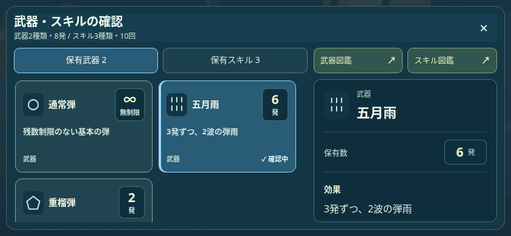
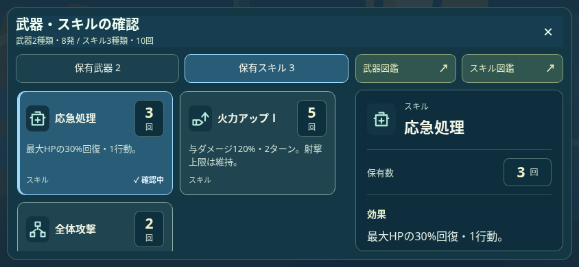
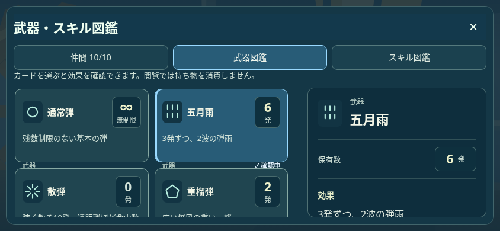
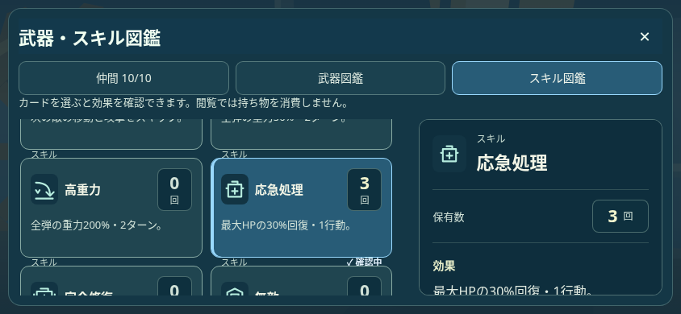

# 武器・スキルの確認と図鑑を統一

制作時の記録。最新依頼でカードを縮小し、一覧と詳細の情報を整理した。[最終のコンパクト表示](../compact-equipment/README.md)を参照。

ローカルChromium、844×390、日本語、テスト用の進行・在庫。ユーザーのセーブには接続していない。名称・アイコン・保有数・効果・種類・選択状態と右の詳細を共通化する。閲覧専用と図鑑への常設入口を保持する。

| 武器確認 | スキル確認 |
| --- | --- |
|  |  |
| 武器図鑑 | スキル図鑑 |
|  |  |

[計画](PLAN.txt)／[348項目のブラウザ検査](EQUIPMENT_DESIGN_BROWSER.json)／[154生成物](GENERATED.json)。4画面サイズ×日英。実算出色のコントラスト4.5:1以上、同じ項目の文字・効果・保有数・配色・余白の一致、選択のチェック表示、レア・旧・未所持・空在庫、実タッチ、言語再描画、保存不変を確認。戦闘UIの15シナリオも別途成功。

未保有の項目も説明を薄くせず、保有数0を明示する。戦闘のネイティブ武器カード用CSSがロビー確認に適用されないよう範囲を分け、既存の使用操作は保持する。物理端末・本番公開は別工程。

## 本番0.30.0との統合

作業中に本番へ入ったHP/行動数の変更を維持して0.30.1へ統合。[mainとの12ファイル一致](MAIN_PRESERVATION.json)、[統合後の348項目](INTEGRATED_EQUIPMENT_DESIGN_BROWSER.json)、[155生成物の一致](INTEGRATED_GENERATED.json)を確認し、戦闘UI15シナリオも再成功。物理・HP・行動数・マップ・在庫保存はUI統合で変更しない。
