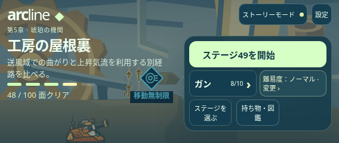
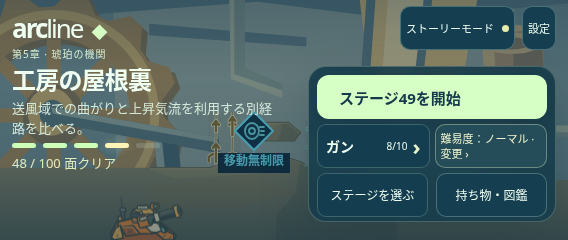
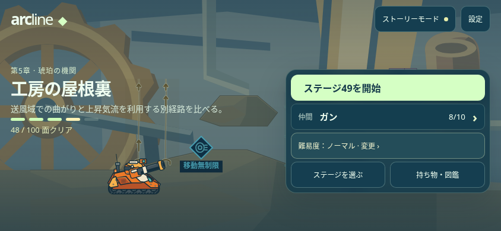
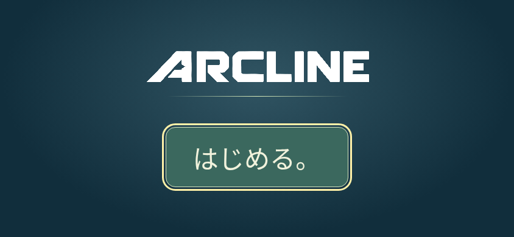
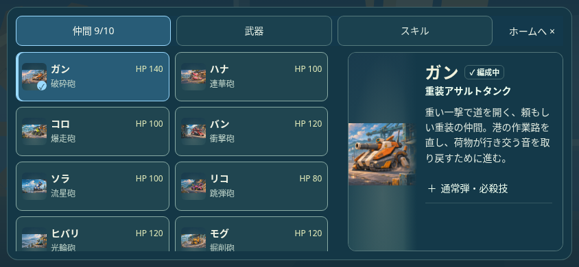
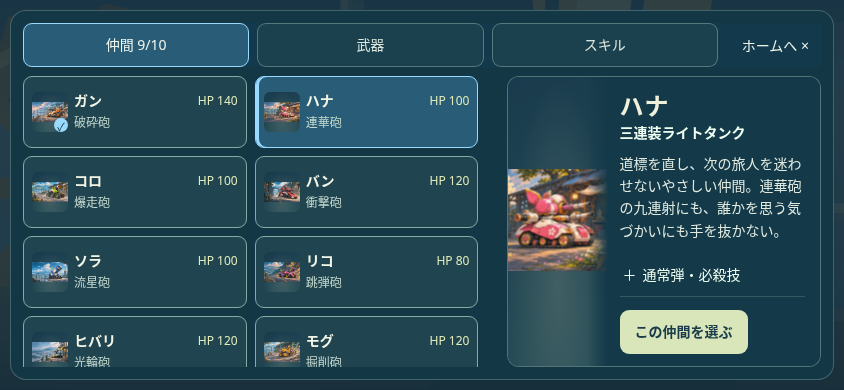
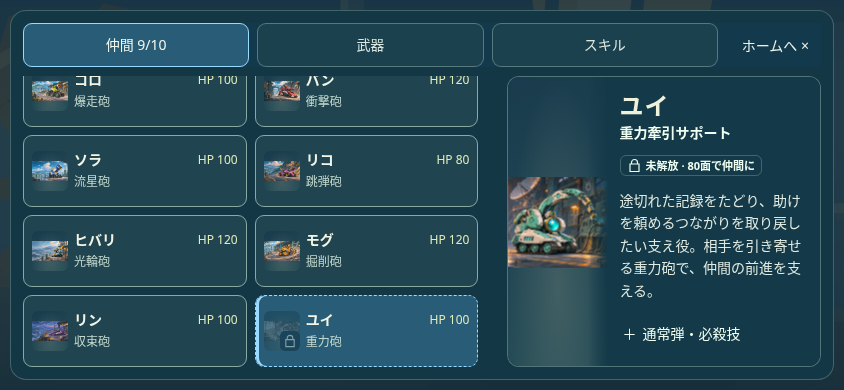
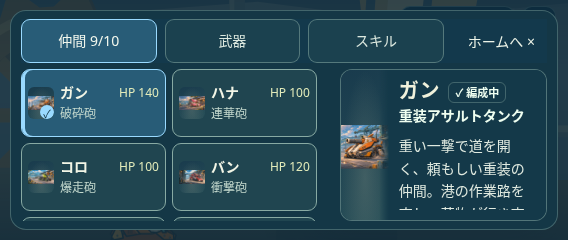
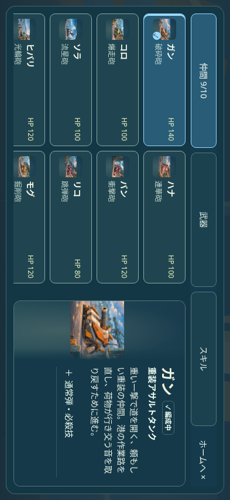

# TOPの空き列と仲間の状態表示を修正

## TOP：削除ボタン用の空き列を解消

セーブ削除を設定へ移した後も `styles/chapter-flow.css` に3列指定が残り、2つのボタンが行の3分の2に押し込まれていた。この不要指定を削除し、既存の2列へ戻した。「ステージを選ぶ」と「持ち物・図鑑」が同じ幅で行を埋める。小さい画面の上部・下部のメニュー操作も44px以上を確保する。

| 修正前：右の空きと狭いボタン | 修正後：2列で横幅を使用 |
| --- | --- |
|  |  |

初回のロゴと「はじめる」画面も4サイズ×日英で確認。削除の入口は設定のデータだけに維持し、タイトルやTOPへ戻さない。開始操作・セーブ形式・進行は変更しない。

## 仲間：一覧で比較し、詳細は紹介を中心にする

一覧は原画・名前・HP・必殺技名。HPと必殺技名は実際の戦闘データから表示し、性能を変更しない。仲間になっている機体の原画はカラー、未解放はグレーと鍵で区別。現在の仲間は原画のチェックで示す。「解放済み」を繰り返さない。

詳細は名前・役割・紹介文を先に表示。「機体 x/10」と一覧にあるHPの重複を削除し、能力の詳しい説明は折りたたみ欄に維持。選択中の仲間は名前横の小さな「編成中」だけに統合し、「現在の機体」の無効ボタンや下部の状態欄を削除した。未解放・補充待ちも条件を説明の中で一度だけ表示する。変更できる仲間には明示的な選択ボタンを残す。

| 選択中：下部の操作欄なし | 変更できる仲間：選択操作あり |
| --- | --- |
|  |  |
| 未解放：鍵とグレーの原画 | 568×240：説明の高さを確保 |
|  |  |

ローカルChromiumとテスト用セーブ。ユーザーのセーブは使っていない。[計画](PLAN.txt)／[TOP 291項目](TOP_LAYOUT_BROWSER.json)／[仲間・導線446項目](COLLECTION_FLOW_BROWSER.json)／[155生成物](GENERATED.json)。TOPは初回／進行ありの16ケース、仲間は8ケース（4サイズ×日英）。TOPの空きなし・44px・文字の見切れ・入口／戻り先・設定だけの削除とキャンセル、10機のHP／必殺技名／解放の見分け、説明領域、選択中と補充待ちの表示、未解放・原画・キーボード・タッチ・位置保持、閲覧時の全セーブ不変と確定時の仲間だけの変更を確認。ネイティブ映像・音声、物理端末、本番配信は今回の確認に含めない。

## 並行した開発ガイド更新との統合

main7095659（PR137）は文書のみ。開発手順と今回のUI記録を両方保持して競合を解消した。[照合結果](MAIN_INTEGRATION.json)のとおり、成功済みcb23db2のゲーム実装・スタイル・生成物・データ・素材と同一で、最新mainの12保護ファイルとも一致する。文書リンクと差分を確認し、機能のローカル再検査は増やさない。最終コミットのCI状態はPR本文へ記録する。
