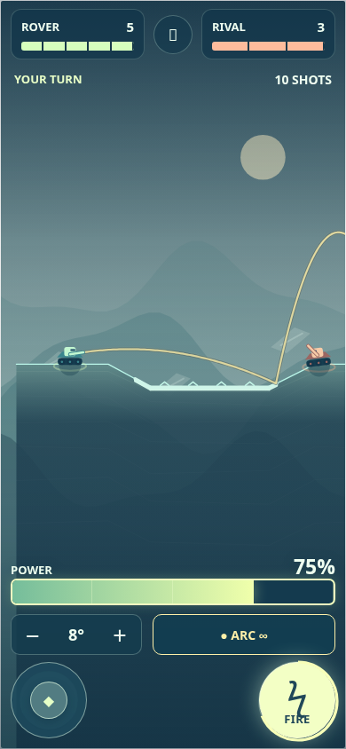
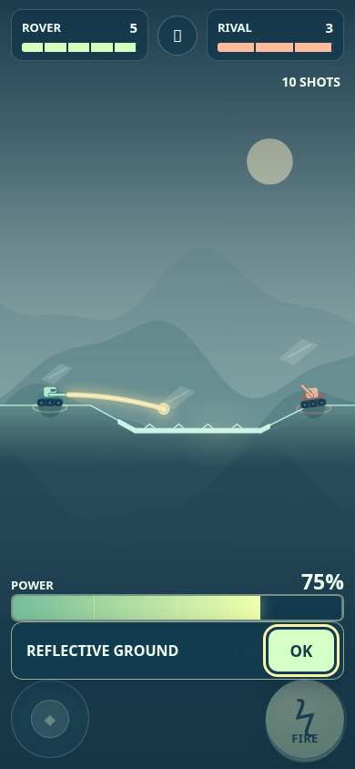
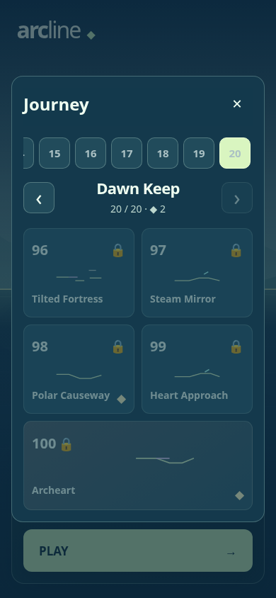

# 反射地面と20テーマ×5面 — 0.6.0

2026年10月28日。プレイヤーからの「水ではなく反射する地面」「設計をアプリへ反映」の指示に合わせ、0.5.0からゲームの動作・教材・100面・UIを変更した。元の設計書は履歴資料として保持し、新しい実行用設計を `design/runtime_campaign_20x5.json` に分けた。

## 実装済み

- **反射する地面**：旧水域を、実際の床に沿う固体の反射材へ置き換えた。上から・斜めから・浅い角度でも接触面で反射する。22度の条件、入水、減速、水中表現は廃止。反射回数は共通上限3回。描画と衝突の面を一致させ、歩行もできる。
- **操作と表示**：チャージを片道0.95秒から1.6秒、往復3.2秒へ緩和。広いゲージと固定カメラを維持し、照準線を約2px、下線を4pxへ細くした。チャージ中の終点丸・着弾円・十字は表示しない。重要な数値・操作を残し、重複した%や小文字、角度スライダー、装飾文を削減。壁は面・陰影・模様、雲と気流は形・流線で区別する。
- **武器選択**：Gearで選んだ武器を開幕から使用。基本砲・装備武器・試用武器を同じ選択画面から選べる。新武器の取得だけでは自動装備しない。取得物と装備は敗北後も保存する。
- **20武器の作用**：Heavyの大きな爆風、Needleの速度、Mortarの高い弧、Drillの壁厚を消費する貫通、Railの低い直射、Archerの実際の急降下、跳弾・転がり・低い連続反射、散開・分裂・時間差二連射、地面波、押引・高い足場への持ち上げを実動作で分けた。総威力の分配、部位の重複加算防止、敵一行動の最大被害1を維持する。
- **正しい実演**：プレビューは自動ループ＋OKだけ。TRY／REPLAYの操作は廃止。実際に回収・反射・貫通・起爆・位置変化を起こす見本を用意し、武器・砲身・角度・ゲージも一致させる。目的の作用を示せない汎用弾へのフォールバックはしない。実演用の独立状態を使い、元の戦闘・支給・手数・保存を進めない。
- **100面の再設計**：20テーマ×5面、各テーマを導入・反復・武器の見せ場・経路選択・締めの戦闘へ構成。地形・距離・開始位置も変更し、単に一覧を5面ずつに分けていない。新武器を拾う19面にはスキルボタンを併設せず、最後の武器はLv84へ前倒しした。10体のボスは10／20／…／100面、間のテーマ末は通常のライバル戦にした。
- **実際に異なるボス攻撃**：LOW／ARC／REFLECT／FAN／CURVE、上空からのDROP、複数列のMARK、予備動作を伴うPREPAREなどを共有物理へ統合。部位破壊による攻撃減少と露出を維持。端子の切替予約が次の境界で実際に反映されない問題も修正した。
- **保存互換**：同じ保存キーと収集IDを維持。クリア数、取得武器・外観、装備を保持し、contentRevisionを2.0.0へ更新。新版の実演確認は機能別のv2 IDで記録し、既存の取得物を取り上げない。SDKロード失敗時の上書き防止も維持する。

## 検証の範囲

同梱JSONは実際の検査記録。物理・武器・実演の因果関係をNodeで検査し、ブラウザーはヘッドレスChromiumと実タッチイベントで確認した。プレビューや結果画面の一部は状態を設定して検査しており、人が全100面を攻略した記録ではない。

| 検査 | 最終版での結果 |
|---|---|
| エンジン・保存 | 57＋159項目PASS |
| 接触と20武器の作用 | 112項目PASS |
| 目的の現象を起こす実演 | 73実演・1011項目PASS |
| キャンペーン | 100対戦・934状態・3560武器／スキル組PASS |
| 成功幅と取得 | 100面で13整数パワー以上、回収経路60件PASS |
| ボス経路 | 192状態・20攻略例PASS |
| 押引・持ち上げ・交換後の経路 | 405ケースPASS |
| Chromiumランタイム | 147フローPASS |
| 実タッチ入力 | 222項目・8画面サイズPASS |
| 旅路・装備・見本・勝敗 | 625項目・8画面サイズPASS |
| 表示 | 1128項目、各8画面サイズで全100面の機体と砲口が画面内 |
| 固定カメラ中の移動 | 小さい縦横画面×100面で左右移動PASS |
| 配布 | 13ファイル・82,562バイトのZIP、構文・決定的な面データ生成・SHA-256照合PASS |

画面サイズは320×568、360×640、390×844、568×320、640×360、844×390、768×1024、1024×768。検証前後の配布13ファイルのSHA-256は一致し、パッケージとも照合済み。ZIP本体はリポジトリへ追加していない。

公開時のGit通信に追加の実行権限を要求する操作は、この環境の承認設定で拒否された。そのため接続済みGitHubの機能から、検証済みファイルと同じGitオブジェクトを保存し、通常の作業ブランチ・PRで反映する。強制更新は使用しない。

Lv81ではLifterが敵を実際に100px高い屋根へ移し、地形を再構築してもその位置を維持することを確認。初期・移動後・持ち上げ後の両陣営の基本砲経路も確認した。プレビューでは端子の次境界での磁場反転、ボスSWAPのコア回転もCanvas描画に反映されることを確認している。

100面の検査では、自然な初期位置に加え、移動端、押引後、交換後、ボス段階・環境状態などの有限サンプルを調べる。自動対戦の結果を初見プレイヤーの成功率や面白さとはみなさない。有効パワー幅は、到達可能な位置・角度を探索した結果であり、初見で発見できることの保証ではない。

実物のiPhone／Safari・Androidでの操作感、1.4／1.6／1.8秒の人による比較、初見の理解・楽しさ、実際のYouTubeホスト上の審査・認証は未確認。

