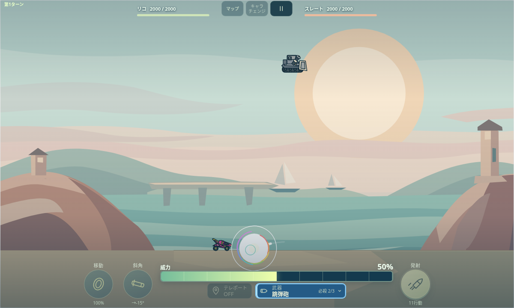
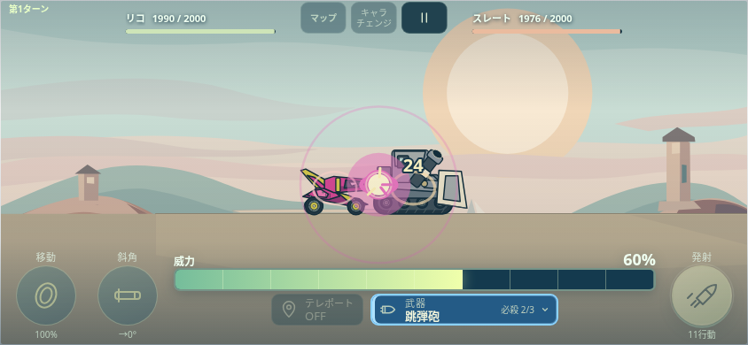

# 0.30.2 リコの4段階と必殺技の自傷軽減

未マージの0.30.1（4c419ec）へ追加したローカル実装。マージ・公開・物理端末は未実施。

[修正前の計画](PLAN.md)／[総合結果](VERIFY.json)／[リリース説明](../../docs/releases/0.30.2.md)。今回のコードで9選択スイートが成功。既に成功した他の6スイートは前版の結果として保持し、0.30.2での再実行とは区別する。累積PRのCI計画は15スイートを指定する。

- [リコの方向](RICO_DIRECTION.json)：593項目。発射＋3反射の4段階、左右・機体の向き・射角・斜面、敵を追い越した後の戻り、天井、固定壁での停止、砲口と実弾、40/45の威力上限、30/120fps。[同じ弾道の変更前後](RICO_BEFORE_AFTER.json)。
- [全10必殺技の自傷](SPECIAL_SELF_DAMAGE.json)：866項目。軽減前後を前版と比較し、自傷だけ50％、従来20の上限は10、残りHP4/10/15の致死境界、接触時刻・数値・HP、通常弾・全補助武器・敵の攻撃を確認。元から自傷しない技は0のまま。
- [実Controller](RICO_DIRECTION_BROWSER.json)：PC1200×720/30fpsとスマホ844×390/120fps、実4面と4段階の往復用配置・自傷用配置の6件。砲口・プレビュー・実弾一致、全反射の方向、HPの減少、自傷10、使用弾数、敵のWorker反撃から次入力まで成功。
- [攻撃確認ページ](ATTACK_REVIEW_BROWSER.json)：149項目。既存自機のダメージ同期372、ヒバリ光輪74、最終戦874、先行HPと上限2662（300初期化）、紹介画像135項目の検査も今回のコードで成功。旧リコ個別スイートもリコだけ選んで成功。
- [正式生成](GENERATED_CHECK.json)：154ファイルを隔離環境で二度生成して差分なし。87ランタイム・214項目の配布ZIPは内容とアーカイブ検査成功。ZIP自体はリポジトリへ追加しない。

| 4段階の確認用配置 | 自傷10を確認する配置 |
|---|---|
|  |  |

上記の浮遊標的とHP2000は、全反射の方向や自傷の実行を見やすくする検査用配置。実4面での確認と分けて記録し、ネイティブ勝利の証拠とは扱わない。自傷の画面は自機HP2000→1990、敵は2000→1976。

先行のラスボス通常25・固有32/34/36/38、HP100・担当150（Easy80）・20行動を保持。全マップ再攻略、音声デコード、原画、実機、本番URLと人の勝率は対象外。
